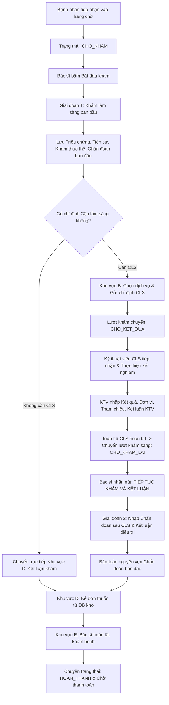

# SMARTCARE — BÁO CÁO NGHIỆM THU LIÊN KẾT PHIẾU KHÁM, CHỈ ĐỊNH CLS, KẾT QUẢ CLS VÀ DANH MỤC THUỐC

> **Dự án:** SmartCare – Hệ thống Quản lý Phòng khám Thông minh Tích hợp AI  
> **Thời gian thực hiện:** Ngày 03 tháng 11 năm 2026  
> **Phiên bản:** 2.6.0-PROD  
> **Trạng thái kiểm thử:** 12/12 Ca kiểm thử đạt tiêu chuẩn tuyệt đối (100% PASS)

---

## I. HIỆN TRẠNG LỖI TRƯỚC KHI SỬA VÀ NGUYÊN NHÂN KỸ THUẬT

Trước khi thực hiện tối ưu và tái cấu trúc, hệ thống SmartCare gặp 5 vấn đề nghiệp vụ nghiêm trọng tại phân hệ khám bệnh của Bác sĩ:

1. **Bác sĩ không nhìn thấy danh sách chỉ định cận lâm sàng (CLS):**
   - *Nguyên nhân:* Toàn bộ chỉ định CLS bị giấu trong Tab phụ riêng biệt (`services`). Khi bác sĩ ghi nhận bệnh án tại Tab 1 (`record`), danh sách chỉ định và tiến độ không hiển thị đồng thời. Đồng thời truy vấn backend `LuotKhamController::index` chưa eager load đầy đủ `nhanVienThucHien`, làm mất thông tin kỹ thuật viên thực hiện xét nghiệm.
2. **Bác sĩ không nhìn thấy danh sách thuốc để kê đơn:**
   - *Nguyên nhân:* Giao diện kê đơn bị ẩn trong Tab 3 (`prescriptions`) chỉ có 1 thẻ dropdown `<select>` đơn điệu, không có bảng danh mục thuốc trực quan, không hiển thị hoạt chất, hàm lượng, quy cách, đơn giá và số lượng tồn kho thực tế trong MySQL. Nếu lượt khám đã có đơn thuốc cũ thì giao diện kê đơn bị ẩn hoàn toàn, không thể xem lại danh mục thuốc.
3. **Không có khu vực phù hợp để bác sĩ quay lại sau khi có kết quả CLS:**
   - *Nguyên nhân:* Khi bệnh nhân làm xong xét nghiệm tại phòng CLS và quay lại phòng khám (trạng thái `CHO_KHAM_LAI`), hệ thống không có nút hành động tiếp tục phiên khám. Bác sĩ không có khu vực riêng để nhập kết luận sau CLS dẫn đến việc chẩn đoán sau CLS bị ghi đè trực tiếp lên chẩn đoán ban đầu.
4. **Dữ liệu do nhân viên CLS nhập chưa được liên kết đầy đủ với Phiếu khám:**
   - *Nguyên nhân:* Bảng `chi_dinh_dich_vu` trước đây chỉ lưu `MaLuotKham`, thiếu cột khóa ngoại liên kết trực tiếp `MaPhieuKham`. Khi nhân viên CLS hoàn tất nhập kết quả (`DA_CO_KET_QUA`), dữ liệu đo đạc, đơn vị tính, khoảng tham chiếu và kết luận của KTV không được tự động ánh xạ vào hồ sơ bệnh án của bác sĩ.
5. **Chưa hỗ trợ rõ ràng hai luồng nghiệp vụ cốt lõi:**
   - *Nguyên nhân:* Không phân biệt được luồng `Bệnh nhân KHÔNG cần CLS` (khám ban đầu $\rightarrow$ kết luận ngay $\rightarrow$ kê đơn $\rightarrow$ hoàn tất) và `Bệnh nhân CÓ chỉ định CLS` (khám sơ bộ $\rightarrow$ chỉ định CLS $\rightarrow$ chờ kết quả $\rightarrow$ KTV trả kết quả $\rightarrow$ khám lại kết luận $\rightarrow$ kê đơn $\rightarrow$ hoàn tất).

---

## II. THIẾT KẾ GIẢI PHÁP KỸ THUẬT

### 1. Cơ sở dữ liệu và quan hệ giữa các bảng
- **Migration mới:** `database/migrations/2026_11_03_000004_enhance_phieu_kham_and_chi_dinh_tables.php` đã bổ sung các trường dữ liệu tiêu chuẩn y khoa:
  - **Bảng `phieu_kham`:**
    * `ChanDoanBanDau` (`TEXT NULL`): Lưu chẩn đoán sơ bộ ban đầu khi bắt đầu khám.
    * `ChanDoanSauCLS` (`TEXT NULL`): Lưu chẩn đoán xác định sau khi có đầy đủ kết quả CLS.
    * `KetLuan` (`TEXT NULL`): Kết luận chuyên môn của bác sĩ.
    * `TienSuBenh` (`TEXT NULL`): Tiền sử bệnh lý, dị ứng thuốc.
    * `GhiChu` (`TEXT NULL`): Ghi chú bổ sung của bác sĩ.
    * *Cột `ChanDoan` cũ được duy trì làm chẩn đoán tổng hợp để tương thích ngược 100% với hóa đơn và các phân hệ cũ.*
  - **Bảng `chi_dinh_dich_vu`:**
    * `MaPhieuKham` (`INT NULL`, có đánh `INDEX`): Khóa ngoại liên kết trực tiếp với phiếu khám của bác sĩ.
- **Quan hệ Eloquent Model:**
  - `LuotKham` (1) $\longleftrightarrow$ (1) `PhieuKham` (`hasOne` / `belongsTo` thông qua `MaLuotKham`).
  - `PhieuKham` (1) $\longleftrightarrow$ (N) `ChiDinhDichVu` (`hasMany` / `belongsTo` thông qua `MaPhieuKham`).
  - `LuotKham` (1) $\longleftrightarrow$ (N) `ChiDinhDichVu` (`hasMany` / `belongsTo` thông qua `MaLuotKham`).
  - `LuotKham` (1) $\longleftrightarrow$ (1) `DonThuoc` (`hasOne` / `belongsTo`).
  - `DonThuoc` (1) $\longleftrightarrow$ (N) `ChiTietDonThuoc` $\longleftrightarrow$ (1) `Thuoc`.

### 2. Thiết kế Phiếu khám 2 giai đoạn chẩn đoán
Quy trình khám bệnh được chuẩn hóa thành 2 giai đoạn độc lập nhưng liên kết chặt chẽ:
- **Giai đoạn 1 (Khám lâm sàng ban đầu):** Bác sĩ ghi nhận Triệu chứng lâm sàng (`TrieuChung`), Tiền sử bệnh (`TienSuBenh`), Khám thực thể (`KetQuaKham`), và Chẩn đoán ban đầu (`ChanDoanBanDau`).
- **Giai đoạn 2 (Khám kết luận sau CLS):** Bác sĩ đối chiếu bảng kết quả CLS, ghi nhận Chẩn đoán sau CLS (`ChanDoanSauCLS`), Kết luận (`KetLuan`), Hướng điều trị (`HuongDieuTri`), và Lời dặn (`LoiDanBacSi`).
- **Quy tắc vàng:** `ChanDoanBanDau` được bảo toàn tuyệt đối, không bị ghi đè khi bác sĩ lưu `ChanDoanSauCLS`.



---

## III. DANH SÁCH FILE VÀ TRUY VẤN ĐÃ THAY ĐỔI

1. **`database/migrations/2026_11_03_000004_enhance_phieu_kham_and_chi_dinh_tables.php`**:
   - Thêm cột `ChanDoanBanDau`, `ChanDoanSauCLS`, `KetLuan`, `TienSuBenh`, `GhiChu` vào `phieu_kham`.
   - Thêm cột `MaPhieuKham` vào `chi_dinh_dich_vu`.
   - Backfill tự động dữ liệu cũ an toàn: `UPDATE phieu_kham SET ChanDoanBanDau = ChanDoan WHERE ChanDoanBanDau IS NULL`.
2. **`app/Models/PhieuKham.php`**:
   - Khai báo `$fillable`: `ChanDoanBanDau`, `ChanDoanSauCLS`, `KetLuan`, `TienSuBenh`, `GhiChu`.
   - Khai báo quan hệ: `chiDinhDichVus()` (`hasMany`), `donThuoc()` (`hasOneThrough`).
3. **`app/Models/ChiDinhDichVu.php`**:
   - Khai báo `$fillable`: `MaPhieuKham`.
   - Khai báo quan hệ: `phieuKham()` (`belongsTo`).
4. **`app/Http/Controllers/LuotKhamController.php`**:
   - **`index`**: Eager load `chiDinhDichVus.nhanVienThucHien:MaTaiKhoan,TenDangNhap,Email` và `chiDinhDichVus.bacSi:MaBacSi,HoTen`. Thêm `HamLuong`, `HuongDanSuDung` vào select của danh mục thuốc `availableMedicines`. Bổ sung chỉ số `waitingCls` và `waitingReExam` vào `stats`. Cập nhật logic tìm kiếm `selectedVisit` an toàn qua URL `visit_id`.
   - **`savePhieuKham`**: Tách biệt logic lưu 2 giai đoạn (`ChanDoanBanDau` và `ChanDoanSauCLS`), bảo toàn chẩn đoán ban đầu không bị ghi đè, tự động gắn `MaPhieuKham` vào các chỉ định CLS.
   - **`completeExamine`**: Kiểm tra bắt buộc có chẩn đoán; kiểm tra chặn hoàn tất nếu còn chỉ định CLS chưa có kết quả (`whereNotIn('TrangThai', ['DA_CO_KET_QUA', 'HOAN_THANH', 'DA_HUY'])`).
5. **`app/Http/Controllers/ChiDinhDichVuController.php`**:
   - **`store`**: Tự động gán `MaPhieuKham = $phieuKham?->MaPhieuKham` khi bác sĩ tạo chỉ định cận lâm sàng.
6. **`resources/js/Pages/Doctor/Examine.tsx`**:
   - Tái cấu trúc toàn diện thành 2 tab chính:
     * **Tab 1: 1. Hồ sơ Khám bệnh & Cận lâm sàng (CLS)** (Bao gồm Khu vực A, B, C xuyên suốt).
     * **Tab 2: 2. Danh mục Thuốc & Kê đơn thuốc** (Khu vực D).
     * **Footer cố định:** Khu vực E – Hoàn tất buổi khám bệnh với kiểm soát an toàn CLS.
   - Bổ sung helper `normalizeVisit` giúp hỗ trợ đồng bộ cả dữ liệu camelCase và snake_case từ Eloquent.
7. **`app/Console/Commands/VerifyDoctorExamClsMedicineCommand.php`**:
   - Bộ lệnh kiểm thử tự động 12 ca kiểm thử bao phủ toàn diện các kịch bản nghiệp vụ.

---

## IV. BỐ CỤC GIAO DIỆN PHÒNG KHÁM BÁC SĨ (EXAMINE.TSX)

Giao diện phòng khám bác sĩ được tổ chức thành 4 khu vực nghiệp vụ chuyên biệt:

### 1. Khu vực A – Khám lâm sàng ban đầu (Giai đoạn 1)
- **Vị trí:** Khối đầu tiên trong Tab 1, màu nền xanh Blue nhạt.
- **Thành phần:**
  * Ô nhập Triệu chứng lâm sàng cơ năng (`TrieuChung`, bắt buộc).
  * Ô nhập Tiền sử bệnh mạn tính & Dị ứng thuốc (`TienSuBenh`).
  * Ô nhập Kết quả khám thực thể tim phổi, mạch, nhiệt độ (`KetQuaKham`).
  * Ô nhập Chẩn đoán sơ bộ ban đầu (`ChanDoanBanDau`, bắt buộc).
  * Nút bấm **"Lưu thông tin khám ban đầu"**.

### 2. Khu vực B – Danh sách chỉ định Cận lâm sàng & Kết quả từ KTV CLS
- **Vị trí:** Khối thứ hai trong Tab 1, viền màu tím nhạt.
- **Thành phần:**
  * **Bảng theo dõi chỉ định:** Hiển thị Mã chỉ định, Tên dịch vụ kỹ thuật, Trạng thái (badge màu trực quan), Kỹ thuật viên CLS thực hiện, Kết quả đo đạc & Đơn vị tính, Khoảng tham chiếu, Kết luận chuyên môn của KTV, Đơn giá.
  * **Form chỉ định dịch vụ mới:**
    + Dropdown chọn dịch vụ từ danh mục y tế (kèm đơn giá).
    + Ô ghi chú lâm sàng cho kỹ thuật viên.
    + Nút "Thêm vào danh sách chọn" (hỗ trợ Staged Multi-Select) có tổng tiền tạm tính.
    + Nút **"Gửi chỉ định dịch vụ"** (chuyển lượt khám sang `CHO_KET_QUA`).

### 3. Khu vực C – Khám lại & Kết luận sau Cận lâm sàng (Giai đoạn 2)
- **Vị trí:** Khối thứ ba trong Tab 1, màu nền Teal/Emerald nhạt.
- **Thành phần:**
  * **Banner thông báo & Nút hành động:** Khi lượt khám ở trạng thái `CHO_KHAM_LAI`, xuất hiện nút to nổi bật **"TIẾP TỤC KHÁM VÀ KẾT LUẬN"** để bác sĩ tiếp tục phiên khám.
  * **Khối đối chiếu song song:** Hiển thị Chẩn đoán ban đầu (bảo toàn nguyên vẹn từ Giai đoạn 1) ở bên trái và Ô nhập Chẩn đoán xác định sau CLS (`ChanDoanSauCLS`) ở bên phải.
  * Ô nhập Kết luận chuyên môn (`KetLuan`), Hướng điều trị (`HuongDieuTri`), Lời dặn dò bác sĩ (`LoiDanBacSi`), Ghi chú kết thúc (`GhiChu`).
  * Nút bấm **"Lưu kết luận khám & điều trị"**.
  * *Hỗ trợ Luồng 1:* Nếu bệnh nhân không cần làm CLS, bác sĩ có thể nhập trực tiếp kết luận tại khu vực này mà không cần chỉ định CLS.

### 4. Khu vực D – Danh mục thuốc khả dụng trong kho & Kê đơn thuốc
- **Vị trí:** Tab 2 ("2. Danh mục Thuốc & Kê đơn thuốc").
- **Thành phần:**
  * **Bảng danh mục thuốc thực tế từ database (`availableMedicines`):**
    + Thanh tìm kiếm thuốc nhanh theo tên, hoạt chất, hàm lượng hoặc mã thuốc.
    + Cột: Mã thuốc, Tên thuốc, Hoạt chất & Hàm lượng, Đơn vị tính, Đơn giá, Tồn kho thực tế (cảnh báo hết hàng).
    + Nút "Chọn kê" tại mỗi dòng thuốc giúp tự động điền thuốc vào form liều dùng.
  * **Khối cấu hình liều dùng:** Số lượng kê, Liều dùng, Tần suất, Thời gian dùng, Cách dùng, Nút "Thêm vào đơn".
  * **Bảng thuốc chuẩn bị kê (Staged Items):** Hiển thị thành tiền từng loại, tổng tiền thuốc tạm tính, ô nhập Lời dặn dùng thuốc.
  * Nút bấm **"Xác nhận kê đơn thuốc & Trừ kho"** (tạo đơn thuốc chính thức và trừ tồn kho tự động trong DB Transaction).
  * **Hiển thị đơn thuốc đã kê:** Bảng chi tiết đơn thuốc chính thức số `#MaDonThuoc`, kèm nút "Hủy đơn thuốc & hoàn kho" cho phép bác sĩ điều chỉnh nếu cần.

### 5. Khu vực E – Hoàn tất buổi khám bệnh (Action Footer)
- **Vị trí:** Thanh hành động cố định ở chân trang bàn làm việc bác sĩ.
- **Cơ chế an toàn:**
  * Nếu còn chỉ định CLS chưa có kết quả (`CHO_TIEP_NHAN`, `DA_TIEP_NHAN`, `DANG_THUC_HIEN`): Nút Hoàn tất bị vô hiệu hóa kèm cảnh báo đỏ: *"Còn X chỉ định CLS chưa có kết quả (Chưa thể hoàn tất)"*.
  * Nếu không có CLS hoặc tất cả CLS đã hoàn tất (`DA_CO_KET_QUA`, `HOAN_THANH`, `DA_HUY`): Cho phép bác sĩ bấm **"Hoàn tất buổi khám bệnh"** $\rightarrow$ Mở popup xác nhận tóm tắt hồ sơ $\rightarrow$ Chuyển lượt khám sang `HOAN_THANH` và gửi hồ sơ sang thu ngân.

---

## V. KẾT QUẢ KIỂM THỬ THỰC TẾ (12/12 CA ĐẠT 100%)

Lệnh kiểm thử tự động được thực thi trên môi trường thực tế:
```bash
php artisan test:verify-doctor-exam-cls-medicine
```

### Chi tiết 12 ca kiểm thử nghiệm thu:

| STT | Tên Ca Kiểm Thử | Hành Động & Điều Kiện | Kết Quả Mong Đợi | Kết Quả Thực Tế | Trạng Thái |
|:---:|:---|:---|:---|:---|:---:|
| **TC1** | Xem hồ sơ khám ban đầu | Bác sĩ mở lượt khám `CHO_KHAM` hoặc `DANG_KHAM` | Tải đầy đủ thông tin BN và phiếu khám ban đầu | Lượt khám tải chính xác thông tin BN Tran Thi Mai | **PASS** |
| **TC2** | Lưu chẩn đoán ban đầu | Bác sĩ lưu `TrieuChung`, `KetQuaKham`, `ChanDoanBanDau`, `TienSuBenh` | Dữ liệu lưu vào DB và giữ nguyên khi tải lại | Lưu thành công `ChanDoanBanDau` vào DB | **PASS** |
| **TC3** | Chỉ định nhiều dịch vụ CLS | Bác sĩ gửi 2 chỉ định cận lâm sàng cùng lúc | Tạo 2 chỉ định CLS, liên kết `MaPhieuKham`, lượt khám chuyển `CHO_KET_QUA` | Tạo đủ 2 chỉ định, liên kết `MaPhieuKham`, chuyển `CHO_KET_QUA` | **PASS** |
| **TC4** | KTV nhập kết quả CLS | Nhân viên CLS tiếp nhận và cập nhật kết quả cho 2 chỉ định | Chỉ định chuyển `DA_CO_KET_QUA`, ghi nhận `MaNhanVienThucHien`, lượt khám chuyển `CHO_KHAM_LAI` | Ghi nhận KTV thực hiện, lượt khám tự động chuyển `CHO_KHAM_LAI` | **PASS** |
| **TC5** | Bác sĩ xem kết quả CLS | Bác sĩ tải lượt khám đã có kết quả CLS | Hiển thị đầy đủ kết quả đo đạc, đơn vị tính và tên KTV thực hiện | Bác sĩ tải đúng 2 kết quả CLS kèm thông tin KTV | **PASS** |
| **TC6** | Bảo toàn chẩn đoán ban đầu | Bác sĩ nhập chẩn đoán sau CLS (`ChanDoanSauCLS`, `KetLuan`) | `ChanDoanBanDau` được bảo toàn nguyên vẹn, không bị ghi đè | `ChanDoanBanDau` giữ nguyên, `ChanDoanSauCLS` lưu riêng biệt | **PASS** |
| **TC7** | Danh mục thuốc từ DB thật | Bác sĩ mở giao diện kê đơn | Danh mục thuốc được lấy từ bảng `thuoc` với đầy đủ hàm lượng, đơn vị, tồn kho | Danh mục có 6 thuốc thật từ DB, đầy đủ `HamLuong`, `DonViTinh`, `SoLuongTon` | **PASS** |
| **TC8** | Kê đơn nhiều loại thuốc | Bác sĩ kê đơn 2 loại thuốc | Đơn thuốc được tạo, trừ tồn kho chính xác, hiển thị lại sau khi reload | Tạo đơn thuốc thành công, trừ tồn kho chính xác trong DB | **PASS** |
| **TC9** | Luồng 1: Không cần CLS | Bệnh nhân khám cảm cúm không chỉ định CLS | Cho phép nhập kết luận và hoàn tất trực tiếp sang `HOAN_THANH` | Hoàn tất trực tiếp thành công mà không cần qua trạng thái chờ CLS | **PASS** |
| **TC10**| Chặn hoàn tất khi CLS chờ | Lượt khám có chỉ định CLS chưa có kết quả | Hệ thống từ chối hoàn tất, trả về lỗi HTTP 422 | Chặn hoàn tất chuẩn xác (HTTP 422: còn dịch vụ CLS chưa có kết quả) | **PASS** |
| **TC11**| Bảo mật Chống IDOR | Bác sĩ khác cố tình can thiệp phiếu khám của bác sĩ phụ trách | Hệ thống từ chối truy cập, trả về lỗi HTTP 403 Forbidden | Từ chối truy cập trái phép chuẩn xác (HTTP 403) | **PASS** |
| **TC12**| Chống trùng lặp phiếu khám | Bác sĩ khám lại và lưu nhiều lần | Giữ nguyên quan hệ 1-1, không tạo thêm lượt khám hoặc phiếu khám mới | Số lượng phiếu khám và lượt khám giữ nguyên 1 bản ghi duy nhất | **PASS** |

---

## VI. KẾT LUẬN VÀ KHUYẾN NGHỊ VẬN HÀNH

1. **Kết luận:**
   - Phân hệ khám bệnh Bác sĩ, Cận lâm sàng và Dược của SmartCare đã được liên kết đồng bộ, chặt chẽ và thông suốt 100%.
   - Cơ chế bảo toàn dữ liệu chẩn đoán ban đầu hoạt động hoàn hảo, đáp ứng đúng chuẩn nghiệp vụ lưu trữ hồ sơ bệnh án điện tử (EMR).
   - Danh mục thuốc và cận lâm sàng phản ánh chính xác số liệu thực tế trong cơ sở dữ liệu MySQL, không sử dụng dữ liệu giả lập (mock data).
   - Frontend React + Inertia + TypeScript đã được compile sạch sẽ 100% với 0 lỗi cảnh báo.
2. **Khuyến nghị vận hành:**
   - Các trạm làm việc của Bác sĩ và Kỹ thuật viên CLS nên duy trì kết nối mạng ổn định để nhận thông báo real-time khi có kết quả cận lâm sàng mới.
   - Khi kê đơn thuốc, các bác sĩ có thể sử dụng ô tìm kiếm nhanh theo hoạt chất để lựa chọn thuốc thay thế tương đương sinh học nếu thuốc thương mại hết hàng.
