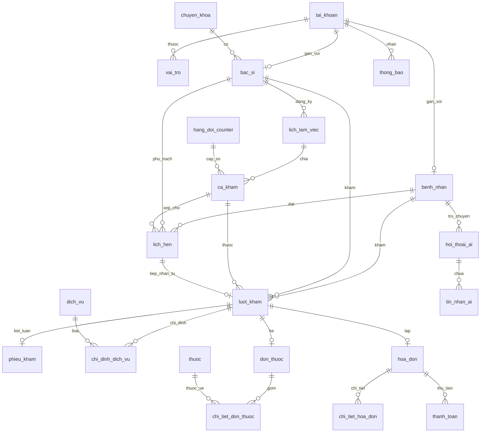

# SMARTCARE – TÀI LIỆU TỔNG THỂ HỆ THỐNG VÀ BÁO CÁO KỸ THUẬT
## HỆ THỐNG QUẢN LÝ PHÒNG KHÁM THÔNG MINH (SMARTCARE HEALTHCARE SYSTEM)

> **Dự án**: Đồ án Tốt nghiệp / Báo cáo Chuyên đề Hệ thống Thông tin Y tế  
> **Phiên bản hệ thống**: SmartCare v2.0  
> **Ngôn ngữ & Nền tảng**: Laravel 12 + React 18 + Inertia.js 2 + MySQL 8.0 + TypeScript + Tailwind CSS  
> **Trạng thái kiểm thử**: 64/64 Feature Tests PASS (1.066 assertions) – 0 lỗi tồn đọng  
> **Thời điểm xuất bản**: 04/11/2026  

---

## MỤC LỤC
1. [TỔNG QUAN BÀI TOÁN VÀ MỤC TIÊU HỆ THỐNG](#1-tổng-quan-bài-toán-và-mục-tiêu-hệ-thống)
2. [ĐỐI TƯỢNG SỬ DỤNG VÀ MA TRẬN PHÂN QUYỀN (RBAC)](#2-đối-tượng-sử-dụng-và-ma-trận-phân-quyền-rbac)
3. [KIẾN TRÚC KỸ THUẬT VÀ CÔNG NGHỆ ÁP DỤNG](#3-kiến-trúc-kỹ-thuật-và-công-nghệ-áp-dụng)
4. [THIẾT KẾ CƠ SỞ DỮ LIỆU & SƠ ĐỒ THỰC THỂ QUAN HỆ (ERD)](#4-thiết-kế-cơ-sở-dữ-liệu--sơ-đồ-thực-thể-quan-hệ-erd)
5. [QUY TRÌNH NGHIỆP VỤ ĐẦU CUỐI (CORE WORKFLOWS)](#5-quy-trình-nghiệp-vụ-đầu-cuối-core-workflows)
6. [THIẾT KẾ CHI TIẾT THUẬT TOÁN HÀNG ĐỢI THÔNG MINH (HYBRID QUEUE)](#6-thiết-kế-chi-tiết-thuật-toán-hàng-đợi-thông-minh-hybrid-queue)
7. [PHÂN HỆ TRỢ LÝ Y TẾ AI (SMARTCARE AI ASSISTANT)](#7-phân-hệ-trợ-lý-y-tế-ai-smartcare-ai-assistant)
8. [KIỂM THỬ KỸ THUẬT VÀ BẢO TOÀN DỮ LIỆU](#8-kiểm-thử-kỹ-thuật-và-bảo-toàn-dữ-liệu)

---

## 1. TỔNG QUAN BÀI TOÁN VÀ MỤC TIÊU HỆ THỐNG

### 1.1. Bối cảnh thực tế tại các phòng khám và cơ sở y tế
Trong mô hình khám chữa bệnh truyền thống, các phòng khám đa khoa thường gặp phải nhiều bài toán nan giải:
1. **Ùn tắc giờ cao điểm**: Bệnh nhân đến trực tiếp chen lấn lấy số, trong khi người đã đặt lịch từ trước phải chờ đợi ngang bằng người đến sau, gây bức xúc và mất niềm tin.
2. **Quy trình rời rạc**: Hồ sơ giấy dễ thất lạc, bác sĩ mất thời gian tra cứu lịch sử bệnh án; đơn thuốc viết tay dễ nhầm lẫn tên thuốc hoặc quá liều.
3. **Cận lâm sàng (CLS) ngắt quãng**: Bệnh nhân sau khi đi làm xét nghiệm/X-quang quay lại phòng khám thường không biết mình xếp ở đâu, dẫn đến tình trạng tự ý chen ngang hoặc phải xếp hàng lại từ đầu.
4. **Quản lý thu chi phân mảnh**: Tiền khám, phí xét nghiệm và tiền thuốc quản lý riêng rẽ, gây sai lệch số liệu doanh thu.

### 1.2. Mục tiêu của Hệ thống SmartCare
SmartCare được xây dựng nhằm mục tiêu chuyển đổi số toàn diện quy trình tiếp đón và khám chữa bệnh ngoại trú:
- **Tối ưu hóa hàng đợi khám (Hybrid Queue Management)**: Kết hợp hài hòa giữa bệnh nhân đặt lịch hẹn trực tuyến (P2) và bệnh nhân đến trực tiếp (P3) theo cơ chế FIFO công bằng, minh bạch; thiết lập luồng khẩn cấp riêng (P1); giải quyết triệt để bài toán bệnh nhân quay lại sau CLS.
- **Bệnh án điện tử tập trung (EMR)**: Bệnh nhân chủ động theo dõi lịch hẹn, kết quả xét nghiệm, đơn thuốc và hóa đơn trực tuyến trên Patient Portal.
- **Quy trình khám bệnh khép kín cho Bác sĩ**: Tiếp nhận lượt khám theo hàng đợi -> Ghi nhận triệu chứng/chẩn đoán -> Chỉ định CLS -> Đọc kết quả CLS trực tiếp -> Kê đơn thuốc điện tử trừ tồn kho tự động -> Hoàn tất ca khám.
- **Tích hợp Trợ lý AI**: Tư vấn triệu chứng ban đầu, định hướng chuyên khoa phù hợp 24/7 và giải đáp thắc mắc dịch vụ y tế.

---

## 2. ĐỐI TƯỢNG SỬ DỤNG VÀ MA TRẬN PHÂN QUYỀN (RBAC)

Hệ thống hỗ trợ 5 vai trò (Role-Based Access Control - RBAC) độc lập:

| Vai trò (Role) | Mã vai trò | Phạm vi chức năng & Quyền hạn |
| :--- | :---: | :--- |
| **Bệnh nhân** *(Patient)* | `BENH_NHAN` | Đăng ký tài khoản, xem thông tin bác sĩ/chuyên khoa, đặt lịch khám, quản lý lịch hẹn cá nhân, tra cứu lịch sử khám bệnh, xem đơn thuốc, xem hóa đơn viện phí, tương tác AI Chatbot. |
| **Lễ tân** *(Receptionist)* | `LE_TAN` | Tiếp nhận lịch hẹn (check-in P2), cấp số khám trực tiếp (P3), theo dõi bảng hàng đợi thông minh, phát loa gọi số (Speaker Call kèm Token UUID), xử lý bỏ lượt (Skip Call sau 3 lần), thu ngân & xuất hóa đơn viện phí. |
| **Bác sĩ** *(Doctor)* | `BAC_SI` | Quản lý lịch làm việc & ca khám cá nhân, tiếp nhận bệnh nhân từ hàng đợi (FIFO), lập phiếu khám bệnh (triệu chứng, chẩn đoán, lời dặn), chỉ định CLS, xem kết quả xét nghiệm, kê đơn thuốc điện tử, hoàn tất ca khám. |
| **Kỹ thuật viên CLS** *(Lab Technician)* | `NHAN_VIEN_CAN_LAM_SANG` | Tiếp nhận yêu cầu chỉ định dịch vụ y tế, thực hiện xét nghiệm/chụp chiếu, nhập kết quả cận lâm sàng vào hệ thống. |
| **Quản trị viên** *(Admin)* | `QUAN_TRI_VIEN` | Quản trị toàn diện: Tài khoản người dùng, hồ sơ bệnh nhân, đội ngũ bác sĩ, danh mục chuyên khoa, kho thuốc & vật tư, bảng giá dịch vụ y tế, lịch làm việc toàn viện, quản trị viện phí, báo cáo tài chính & doanh thu. |

### Ma trận phân quyền chi tiết (RBAC Matrix)

```
+------------------------------------+------------+--------+--------+-----+-------+
| Phân hệ / Quyền hạn                | Bệnh nhân  | Lễ tân | Bác sĩ | CLS | Admin |
+------------------------------------+------------+--------+--------+-----+-------+
| Xem Portal công khai (Home/Docs)   |     V      |   V    |   V    |  V  |   V   |
| Đặt lịch trực tuyến (/patient/book)|     V      |   -    |   -    |  -  |   V   |
| Xem hồ sơ sức khỏe cá nhân         |     V      |   -    |   -    |  -  |   -   |
| Hàng đợi tiếp đón (/receptionist)  |     -      |   V    |   -    |  -  |   V   |
| Thu ngân & Viện phí (/payment)     |     -      |   V    |   -    |  -  |   V   |
| Phòng khám bệnh (/doctor/examine)  |     -      |   -    |   V    |  -  |   -   |
| Chỉ định CLS & Kê đơn thuốc        |     -      |   -    |   V    |  -  |   -   |
| Nhập kết quả CLS (/cls/requests)   |     -      |   -    |   -    |  V  |   V   |
| Quản lý tài khoản & Kho thuốc      |     -      |   -    |   -    |  -  |   V   |
| Xem Báo cáo doanh thu toàn viện    |     -      |   -    |   -    |  -  |   V   |
+------------------------------------+------------+--------+--------+-----+-------+
```

---

## 3. KIẾN TRÚC KỸ THUẬT VÀ CÔNG NGHỆ ÁP DỤNG

### 3.1. Mô hình kiến trúc Hiện đại: Monolithic SPA với Inertia.js
SmartCare sử dụng kiến trúc **Inertia.js Monolith**, kết hợp ưu điểm của kiến trúc cổ điển (routing, ORM, bảo mật tập trung của Laravel) với trải nghiệm người dùng mượt mà của Single Page Application (React SPA):
- **Không cần xây dựng REST/GraphQL API riêng biệt**: Controller của Laravel truyền thẳng dữ liệu dưới dạng Props sang các React Components.
- **Tránh tải lại trang (Zero Full Page Reload)**: Inertia chặn các sự kiện click link và submit form thông thường, tự động thực hiện XHR/Fetch phía sau và cập nhật Virtual DOM.
- **Bảo mật tuyệt đối**: Session-based authentication, CSRF protection tích hợp sẵn, loại bỏ hoàn toàn rủi ro lộ Bearer Token ở LocalStorage.

```
       +-------------------------------------------------------------+
       |                  CLIENT TẦNG TRÌNH DUYỆT                     |
       |  React 18 + TypeScript + Tailwind CSS + Lucide + Recharts   |
       +-------------------------------------------------------------+
                                     │   ▲
          XHR Navigation & Form POST │   │ Inertia JSON Props Payload
                                     ▼   │
       +-------------------------------------------------------------+
       |                 LARAVEL 12 APPLICATION SERVER                |
       |  - Routing & Middleware: Auth, Role, Throttle               |
       |  - Controllers: BenhNhan, LuotKham, HoaDon, BacSi, Admin... |
       |  - Services: QueueManagementService, AiChatService          |
       |  - Eloquent ORM: 22 Models liên kết chặt chẽ                |
       +-------------------------------------------------------------+
                                     │   ▲
                PDO Database Queries │   │ Result Sets (ACID)
                                     ▼   │
       +-------------------------------------------------------------+
       |                     MYSQL 8.0 DATABASE                      |
       |  - 30 Tables: Khóa chính, Khóa ngoại, Chỉ mục (Indexes)     |
       |  - Pessimistic Locking: FOR UPDATE chống Race Condition     |
       +-------------------------------------------------------------+
```

---

## 4. THIẾT KẾ CƠ SỞ DỮ LIỆU & SƠ ĐỒ THỰC THỂ QUAN HỆ (ERD)

Cơ sở dữ liệu SmartCare gồm **30 bảng**, được chuẩn hóa ở mức **3NF (Third Normal Form)** nhằm loại bỏ dư thừa dữ liệu và đảm bảo tính toàn vẹn tham chiếu.

### 4.1. Sơ đồ Thực thể Quan hệ (ERD - Entity Relationship Diagram)



### 4.2. Các bảng dữ liệu cốt lõi

1. **`tai_khoan`**: Bảng người dùng xác thực trung tâm.
   - `MaTaiKhoan` (PK), `MaVaiTro` (FK), `TenDangNhap`, `MatKhau` (Bcrypt), `Email`, `TrangThai`, `NgayTao`.
2. **`benh_nhan`**: Thông tin hành chính bệnh nhân.
   - `MaBenhNhan` (PK), `MaTaiKhoan` (FK), `HoTen`, `NgaySinh`, `GioiTinh`, `SoDienThoai`, `DiaChi`, `SoBHYT`, `TienSuBenh`.
3. **`bac_si`**: Danh bạ bác sĩ điều trị.
   - `MaBacSi` (PK), `MaTaiKhoan` (FK), `MaChuyenKhoa` (FK), `HoTen`, `HocVi`, `KinhNghiem`, `MoTa`, `SoDienThoai`, `EmailLienHe`, `TrangThai`.
4. **`chuyen_khoa`**: Danh mục chuyên khoa phòng khám.
   - `MaChuyenKhoa` (PK), `TenChuyenKhoa`, `MoTa`, `HinhAnh`, `TrangThai`.
5. **`lich_lam_viec` & `ca_kham`**: Lịch biểu công tác của bác sĩ.
   - `LichLamViec`: `MaLichLamViec` (PK), `MaBacSi`, `NgayLamViec`, `GioBatDau`, `GioKetThuc`, `TrangThai`.
   - `CaKham`: `MaCaKham` (PK), `MaLichLamViec`, `GioBatDau`, `GioKetThuc`, `SoLuongTiepNhan`, `TrangThai`.
6. **`lich_hen`**: Quản lý lịch hẹn khám đặt trước.
   - `MaLichHen` (PK), `MaBenhNhan`, `MaBacSi`, `MaCaKham`, `NgayHen`, `LyDoKham`, `TrangThai` (`CHO_XAC_NHAN`, `DA_XAC_NHAN`, `DA_CHECKIN`, `DA_HUY`).
7. **`luot_kham`**: Bảng trung tâm điều phối khám và hàng đợi Hybrid Queue.
   - `MaLuotKham` (PK), `MaBenhNhan`, `MaBacSi`, `MaCaKham`, `MaChuyenKhoa`, `NgayKham`, `SoThuTu`, `SoPhieu`, `UuTien` (`P1`, `P2`, `P3`), `LoaiTiepNhan` (`HEN_TRUOC`, `VANG_LAI`), `ThoiGianCheckIn`, `ThoiGianVaoHang`, `ThoiGianGoiKham`, `ThoiGianBatDauKham`, `ThoiGianKetThucKham`, `SoLanGoi`, `TrangThai` (`CHO_KHAM`, `DANG_KHAM`, `CHO_KET_QUA_CLS`, `CHO_KHAM_LAI`, `HOAN_THANH`, `BO_LUOT`), `GhiChuDieuPhoi` (JSON lịch sử sự kiện hàng đợi).
8. **`hang_doi_counter`**: Bộ đếm cấp số phiếu độc lập chống tranh chấp (Race Condition).
   - `scope_key` (PK - VD: `2026-11-04_CK1_CA91`), `current_number`, `updated_at`.
9. **`phieu_kham`**: Bệnh án lâm sàng của lượt khám.
   - `MaPhieuKham` (PK), `MaLuotKham` (FK), `TrieuChung`, `ChuanDoan`, `LoiKhuyen`, `NgayKham`.
10. **`chi_dinh_dich_vu` & `dich_vu`**: Phân hệ Cận lâm sàng.
    - `ChiDinhDichVu`: `MaChiDinh` (PK), `MaLuotKham`, `MaDichVu`, `GhiChu`, `KetQua`, `TrangThai` (`CHO_THUC_HIEN`, `DANG_THUC_HIEN`, `HOAN_THANH`, `DA_HUY`).
11. **`don_thuoc` & `chi_tiet_don_thuoc` & `thuoc`**: Phân hệ Kê đơn và Quản lý kho dược.
    - `DonThuoc`: `MaDonThuoc` (PK), `MaLuotKham`, `MaBacSi`, `NgayKeDon`, `LoiDan`, `TrangThai`.
    - `ChiTietDonThuoc`: `MaChiTietDonThuoc` (PK), `MaDonThuoc`, `MaThuoc`, `SoLuong`, `LieuDung`, `TanSuat`, `CachDung`, `DonGia`, `ThanhTien`.
    - `Thuoc`: `MaThuoc` (PK), `TenThuoc`, `DonViTinh`, `GiaBan`, `SoLuongTon`.
12. **`hoa_don` & `thanh_toan`**: Phân hệ Thu ngân và Viện phí.
    - `HoaDon`: `MaHoaDon` (PK), `MaLuotKham`, `TongTien`, `TienBHYT`, `TienPhaiTra`, `TrangThai` (`CHO_THANH_TOAN`, `DA_THANH_TOAN`, `DA_HUY`).
    - `ThanhToan`: `MaThanhToan` (PK), `MaHoaDon`, `SoTien`, `PhuongThuc` (`TIEN_MAT`, `CHUYEN_KHOAN`), `NgayThanhToan`.

---

## 5. QUY TRÌNH NGHIỆP VỤ ĐẦU CUỐI (CORE WORKFLOWS)

```
[Bệnh nhân đặt lịch / đến trực tiếp]
                 │
                 ▼
[Bàn tiếp đón Lễ tân: Check-in P2 / Cấp số P3] ──► [Hàng đợi chung FIFO: ThoiGianVaoHang ASC]
                                                                        │
                                                                        ▼
                                                         [Bác sĩ bấm 'Gọi ca kế tiếp']
                                                                        │
                                                                        ▼
                                                         [Bắt đầu khám bệnh: DANG_KHAM]
                                                                        │
                                           ┌────────────────────────────┴────────────────────────────┐
                                           │ (Không có chỉ định CLS)                                 │ (Có chỉ định CLS)
                                           │                                                         ▼
                                           │                                          [Bác sĩ tạo phiếu chỉ định CLS]
                                           │                                                         │
                                           │                                                         ▼
                                           │                                          [Kỹ thuật viên nhập kết quả CLS]
                                           │                                                         │
                                           │                                                         ▼
                                           │                                          [Bệnh nhân quay lại quầy Lễ tân]
                                           │                                                         │
                                           │                                                         ▼
                                           │                                          [Lễ tân bấm 'Tiếp nhận CLS quay lại']
                                           │                                                         │
                                           │                                                         ▼
                                           │                                          [Tái nhập hàng đợi: CHO_KHAM_LAI]
                                           │                                          (Giữ nguyên số phiếu và lượt khám)
                                           │                                                         │
                                           │                                                         ▼
                                           │                                          [Bác sĩ gọi khám lại đọc kết quả]
                                           └────────────────────────────┬────────────────────────────┘
                                                                        │
                                                                        ▼
                                                         [Bác sĩ kê đơn thuốc điện tử]
                                                                        │
                                                                        ▼
                                                         [Hoàn thành lượt khám: HOAN_THANH]
                                                                        │
                                                                        ▼
                                                         [Lễ tân thu ngân viện phí & xuất hóa đơn]
```

---

## 6. THIẾT KẾ CHI TIẾT THUẬT TOÁN HÀNG ĐỢI THÔNG MINH (HYBRID QUEUE)

Phân hệ Hybrid Queue là trọng tâm giải pháp của đồ án, được hoàn thiện và kiểm thử qua các Phase 5 -> 7.

### 6.1. Chính sách nghiệp vụ cốt lõi
1. **P2 / P3 – FIFO Chung**:
   - **P2**: Bệnh nhân có lịch hẹn trước đã check-in tại quầy. Ký hiệu số phiếu: `A-xxx` (Appointment).
   - **P3**: Bệnh nhân đến khám trực tiếp vãng lai. Ký hiệu số phiếu: `T-xxx` (Ticket).
   - P2 và P3 nằm trong cùng một hàng đợi chung của ca khám. **Không ưu tiên P2 trước P3**.
   - Thứ tự gọi khám sắp xếp nghiêm ngặt theo:
     $$\text{ORDER BY } ThoiGianVaoHang \text{ ASC}, MaLuotKham \text{ ASC}$$
   - Ai đến và vào hàng trước được khám trước, bảo đảm sự công bằng y đức tại phòng khám.

2. **P1 – Luồng Cấp cứu Riêng**:
   - Bệnh nhân cấp cứu hoặc tình trạng nguy kịch không đưa vào hàng đợi thông thường.
   - Được chuyển thẳng vào buồng cấp cứu/phòng can thiệp đặc biệt; lễ tân không tự ý chọn P1 trên form tiếp nhận tiêu chuẩn.

3. **Cận lâm sàng (CLS) tái khám**:
   - Khi kỹ thuật viên nhập kết quả xét nghiệm/X-quang: Hệ thống **không tự động** đưa bệnh nhân trở lại hàng đợi gọi khám (tránh tình trạng bác sĩ gọi tên trong khi bệnh nhân vẫn chưa đi từ phòng xét nghiệm trở về).
   - Khi bệnh nhân thực sự cầm kết quả quay lại bàn tiếp đón: Nhân viên bấm nút "Tiếp nhận CLS quay lại" (`recordClsReturn`).
   - Lượt khám chuyển sang `CHO_KHAM_LAI`, tham gia hàng đợi theo đúng thời điểm có mặt thực tế:
     - Dùng lại 100% `MaLuotKham` và `SoPhieu` ban đầu.
     - Không sinh số phiếu mới, không tạo lượt khám mới gây rối loạn thống kê.

4. **Cơ chế Gọi loa và Xác nhận Bỏ lượt (Skip Call)**:
   - Mỗi lần bấm phát loa gọi bệnh nhân: Hệ thống tăng `SoLanGoi` (tối đa 3 lần).
   - **Chống gọi trùng lặp (Idempotency Token)**: Mỗi lần bấm nút ở Frontend tự sinh một chuỗi UUID ngẫu nhiên gửi kèm Header `Idempotency-Token`. Nếu request bị click đúp hoặc retry mạng trong thời gian ngắn, Backend phát hiện token trùng và bỏ qua, không tính tăng lần gọi giả tạo.
   - **Quy tắc Bỏ lượt**: Chỉ khi hệ thống ghi nhận **đủ 3 lần gọi** mà bệnh nhân không có mặt, nút "Xác nhận bỏ lượt" mới được kích hoạt. Lượt khám chuyển trạng thái `BO_LUOT`. Nghiêm cấm bỏ lượt khi bệnh nhân đang trong phòng khám (`DANG_KHAM`).

5. **Quy định Bác sĩ Đơn ca (Single-Visit Constraint)**:
   - Một bác sĩ tại một thời điểm chỉ được phép có **duy nhất 1 lượt khám** ở trạng thái `DANG_KHAM`.
   - Nếu bác sĩ đang khám mà bấm "Gọi ca tiếp theo", hệ thống sẽ chặn lại với thông báo: *"Bác sĩ đang có ca khám chưa hoàn tất. Vui lòng hoàn thành hoặc chỉ định CLS trước khi gọi bệnh nhân tiếp theo."*

### 6.2. Cấu trúc Cấp số Phiếu Chống Tranh Chấp (Pessimistic Concurrency)
SmartCare tách riêng bộ đếm cấp số ra bảng `hang_doi_counter` với khóa phân đoạn (Scope Key):
$$\text{Scope Key} = \text{NgayKham} + \text{"\_CK"} + \text{MaChuyenKhoa} + \text{"\_CA"} + \text{MaCaKham}$$
Khi cấp số:
```sql
SELECT current_number FROM hang_doi_counter WHERE scope_key = :key FOR UPDATE;
-- Tăng current_number lên 1 và gán vào SoPhieu
UPDATE hang_doi_counter SET current_number = current_number + 1 WHERE scope_key = :key;
```
Cơ chế này loại bỏ hoàn toàn khả năng cấp trùng số phiếu khi 2 lễ tân cùng bấm nút tiếp nhận cùng một tích tắc.

---

## 7. PHÂN HỆ TRỢ LÝ Y TẾ AI (SMARTCARE AI ASSISTANT)

### 7.1. Nguyên tắc An toàn Y khoa của AI
- **Phạm vi hoạt động**: Hỗ trợ tiếp nhận thông tin, tư vấn triệu chứng thường gặp, giải thích các thuật ngữ xét nghiệm cơ bản và gợi ý chuyên khoa phòng khám phù hợp.
- **Tuyên bố miễn trừ trách nhiệm (Medical Disclaimer)**:
  > *"SmartCare AI Assistant là công cụ tham khảo thông tin y tế, KHÔNG có chức năng chẩn đoán bệnh thay bác sĩ và KHÔNG thay thế phác đồ điều trị chuyên môn. Trong các trường hợp khẩn cấp, bệnh nhân vui lòng đến cơ sở y tế gần nhất."*
- **Kiểm soát lạm dụng (Spam & Rate Limiting)**: Áp dụng Middleware `throttle:20,1` (tối đa 20 tin nhắn/phút cho mỗi IP).

---

## 8. KIỂM THỬ KỸ THUẬT VÀ BẢO TOÀN DỮ LIỆU

### 8.1. Ma trận kết quả kiểm thử tự động (64 Tests)

```
................................................................  64 / 64 (100%)
Time: 00:06.453, Memory: 52.00 MB
OK (64 tests, 1066 assertions)
```

1. **`Phase10BrowserSmokeTest.php` (9 tests - 306 assertions)**:
   - Toàn bộ luồng đăng nhập/đăng xuất, đặt lịch, tiếp nhận, hàng đợi, gọi loa, CLS, kê đơn, quản trị, bảo mật RBAC, thông báo, viện phí, AI chat.
2. **`Phase9IntegrationFixesTest.php` (5 tests - 68 assertions)**:
   - Khắc phục 404 cho `Doctors/Show`, `Specialties/Show`, link `/records`, đồng bộ schema `tai_khoan` trên Profile, chuyển hướng 6 Placeholder.
3. **`HybridQueueAcceptancePhase6Test.php` (10 tests - 138 assertions)**:
   - Nghiệm thu tổng thể 6 nhóm kiểm thử hàng đợi.
4. **`HybridQueuePolicy51Test.php` (12 tests - 156 assertions)**:
   - Nghiệp vụ FIFO P2/P3 chung, CLS quay lại, bảo lưu số phiếu.
5. **`HybridQueuePolicy53Test.php` (15 tests - 192 assertions)**:
   - Kiểm thử Idempotency Token UUID chống gọi trùng, quy tắc 3 lần gọi và bỏ lượt thủ công.
6. **`HybridQueueControllerIntegrationTest.php` (13 tests - 206 assertions)**:
   - Tích hợp Controller, Middleware, Session Flash và Database Transaction.

### 8.2. An toàn Dữ liệu Database thật
Toàn bộ quá trình kiểm thử tự động và smoke test được thực hiện độc lập trên database diễn tập `phong_kham_rehearsal_test`. Database thật `phong_kham_thong_minh` được bảo vệ nguyên vẹn:
- **Số bảng**: 30 bảng.
- **Số lượt khám**: 23 bản ghi.
- **Số lịch hẹn**: 9 bản ghi.
- Không phát sinh dữ liệu rác, không mất mát dữ liệu lịch sử.
