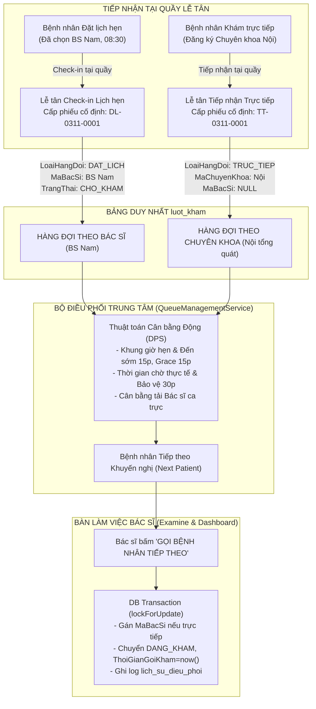
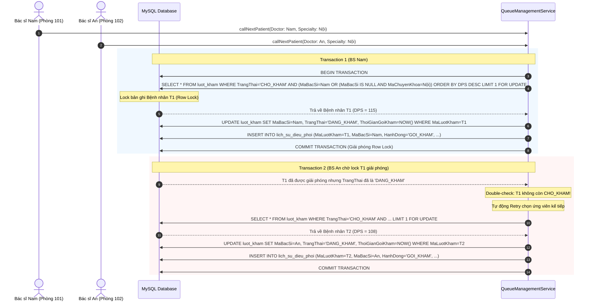
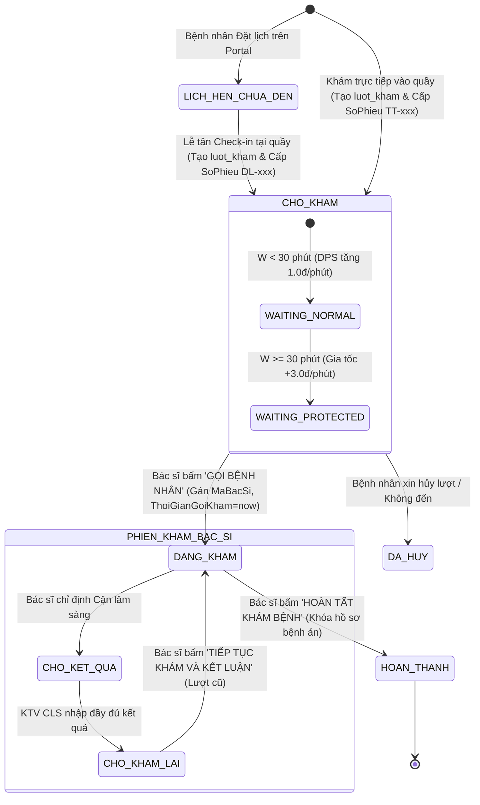

# SMARTCARE — THIẾT KẾ KỸ THUẬT CUỐI CÙNG: HỆ THỐNG HAI HÀNG ĐỢI HYBRID CÓ BỘ ĐIỀU PHỐI ƯU TIÊN THỐNG NHẤT (BẢN HOÀN THIỆN ĐÃ REVIEW)

> **Tài liệu:** Thiết kế kỹ thuật chi tiết (Technical Design Document - Architecture Final Review v2)  
> **Dự án:** SmartCare — Hệ thống Quản lý Phòng khám Thông minh Tích hợp AI  
> **Phiên bản:** 3.1.0-HYBRID-FINAL  
> **Ngày cập nhật:** 03/11/2026  
> **Trạng thái:** **CHỈ THIẾT KẾ & AUDIT (CHƯA CHẠY MIGRATION / CHƯA SỬA MÃ NGUỒN)**

---

## MỤC LỤC
1. [Sơ đồ Kiến trúc & Phân luồng Hybrid (Phương án C)](#1-sơ-đồ-kiến-trúc--phân-luồng-hybrid)
2. [Thuật toán Điểm Ưu tiên Động (DPS) – Cơ chế Công bằng Hai chiều Chống Starvation](#2-thuật-toán-điểm-ưu-tiên-động-dps--cơ-chế-công-bằng-hai-chiều-chống-starvation)
3. [Làm rõ Mốc Thời gian và Quy tắc Ưu tiên Khung giờ](#3-làm-rõ-mốc-thời-gian-và-quy-tắc-ưu-tiên-khung-giờ)
4. [Chống Race Condition & Cơ chế Transaction Khóa khi Điều phối](#4-chống-race-condition--cơ-chế-transaction-khóa-khi-điều-phối)
5. [Quy trình & Phân quyền Điều chuyển Bác sĩ Đặt lịch](#5-quy-trình--phân-quyền-điều-chuyển-bác-sĩ-đặt-lịch)
6. [Audit Toàn diện Tác động của `luot_kham.MaBacSi` Nullable](#6-audit-toàn-diện-tác-động-của-luot_khamma_bac_si-nullable)
7. [Quy tắc Vòng đời Hàng đợi (Queue Lifecycle & Transitions)](#7-quy-tắc-vòng-đời-hàng-đợi-queue-lifecycle--transitions)
8. [Mô phỏng Chứng minh Thuật toán Chống Starvation (10 Bệnh nhân)](#8-mô-phỏng-chứng-minh-thuật-toán-chống-starvation-10-bệnh-nhân)
9. [Thiết kế Schema Database & Bộ đếm An toàn](#9-thiết-kế-schema-database--bộ-đếm-an-toàn)
10. [Danh sách Quyết định Đã chốt & Xác nhận Cuối cùng](#10-danh-sách-quyết-định-đã-chốt--xác-nhận-cuối-cùng)

---

## 1. SƠ ĐỒ KIẾN TRÚC & PHÂN LUỒNG HYBRID

### 1.1. Khái niệm Mô hình Hybrid (Phương án C)
- **Hàng đợi A (Bệnh nhân Đặt lịch – theo Bác sĩ):**
  - Gắn chặt với Bác sĩ mà bệnh nhân đã lựa chọn trên Portal khi đặt lịch hẹn.
  - Khi chưa đến phòng khám: Không đưa vào hàng đợi thực tế, không chiếm chỗ.
  - Khi Lễ tân xác nhận đã đến: Tạo lượt khám với `LoaiHangDoi = 'DAT_LICH'`, `MaBacSi = [ID Bác sĩ đã chọn]`, `TrangThai = 'CHO_KHAM'`.
  - Không tự ý chuyển sang Bác sĩ khác.
- **Hàng đợi B (Bệnh nhân Khám trực tiếp – theo Chuyên khoa):**
  - Tiếp nhận vào hàng đợi chung của **Chuyên khoa** (`LoaiHangDoi = 'TRUC_TIEP'`, `MaChuyenKhoa = [ID Chuyên khoa]`, `MaBacSi = NULL`).
  - Khi một Bác sĩ trong Chuyên khoa sẵn sàng nhận bệnh nhân: Bộ điều phối sẽ phân phối bệnh nhân trực tiếp có độ ưu tiên cao nhất cho Bác sĩ đó dựa trên tải công việc và thời gian chờ.
- **Một bảng `luot_kham` duy nhất:** Tuyệt đối không tạo bảng lượt khám riêng, bảo toàn 100% quan hệ với `phieu_kham`, `don_thuoc`, `chi_dinh_dich_vu`, `hoa_don`.



---

## 2. THUẬT TOÁN ĐIỂM ƯU TIÊN ĐỘNG (DPS) – CƠ CHẾ CÔNG BẰNG HAI CHIỀU CHỐNG STARVATION

### 2.1. Phân tích Nguyên nhân Starvation
- **Starvation Bệnh nhân Trực tiếp:** Xảy ra khi bệnh nhân đặt lịch đúng giờ được ưu tiên tuyệt đối $100\%$. Nếu lịch hẹn liên tục đến phòng khám (cứ 15 phút có 1 người), bệnh nhân trực tiếp dù đã chờ 40, 50 hay 60 phút vẫn liên tục bị đẩy lùi.
- **Starvation Bệnh nhân Đặt lịch:** Xảy ra nếu bệnh nhân trực tiếp sau 30 phút được ưu tiên tuyệt đối trước mọi lịch hẹn. Khi phòng khám có 3-4 bệnh nhân trực tiếp cùng vượt mốc 30 phút, bệnh nhân đặt lịch đúng giờ 08:30 (đến từ 08:20) sẽ bị dời giờ khám xuống sau 09:30, phá vỡ cam kết giờ hẹn.

### 2.2. Công thức Điểm Ưu tiên Động (Dynamic Priority Scoring - DPS)
Bộ điều phối tính toán điểm ưu tiên thời gian thực $DPS(i, t)$ tại thời điểm $t$ (tính bằng phút trong ngày) cho từng lượt khám $i$ đang ở trạng thái `CHO_KHAM`:

$$\mathbf{DPS(i, t) = S_{base} + S_{wait} + S_{delay}}$$

Giới hạn điểm chuẩn: $0 \le DPS \le 300$ điểm.

#### A. Đối với Bệnh nhân Đặt lịch (`LoaiHangDoi = 'DAT_LICH'`):
1. **Trường hợp Đến đúng giờ / Trong khung ưu tiên:**
   Điều kiện: $T_{hen} - 15 \le t \le T_{hen} + 15$
   - $S_{base} = 100$ điểm (Điểm cam kết giờ hẹn của bệnh viện).
   - $S_{wait} = W_{valid} \times 1.0$ (với $W_{valid} = \max(0, t - \max(T_{arr}, T_{hen} - 15))$ là số phút chờ hợp lệ trong khung giờ).
   - **Gia tốc trễ giờ hẹn ($S_{delay}$):** Nếu thời điểm hiện tại đã vượt qua giờ hẹn chính thức ($t > T_{hen}$):
     $$S_{delay} = (t - T_{hen}) \times 2.5$$
     *(Mỗi phút phòng khám để bệnh nhân bị trễ sau giờ hẹn được cộng thêm 2.5 điểm gia tốc, đảm bảo bệnh nhân đặt lịch không bị trễ quá 15–20 phút).*
2. **Trường hợp Đến quá sớm ($t < T_{hen} - 15$ phút):**
   - $S_{base} = 20$ điểm.
   - $S_{wait} = \max(0, t - T_{arr}) \times 0.5$ (tối đa 15 điểm).
   - *Bệnh nhân đến sớm nhận phiếu nhưng không được chiếm chỗ của người đến đúng giờ hoặc người trực tiếp.* Đúng $T_{hen} - 15$, tự động chuyển sang công thức đúng giờ ($S_{base} = 100$).
3. **Trường hợp Đến muộn quá grace ($t > T_{hen} + 15$ phút):**
   - Mất quyền ưu tiên khung giờ: $S_{base} = 40$ điểm.
   - $S_{wait} = (t - T_{arr}) \times 1.0$ (Tích lũy thời gian chờ thực tế từ lúc có mặt tại quầy).
   - $S_{delay} = 0$.

#### B. Đối với Bệnh nhân Khám trực tiếp (`LoaiHangDoi = 'TRUC_TIEP'`):
1. **Giai đoạn Chờ thông thường ($W \le 30$ phút):**
   - $S_{base} = 50$ điểm.
   - $S_{wait} = W \times 1.0$ (với $W = t - T_{arr}$).
   - *(Ví dụ: Chờ 20 phút $\rightarrow DPS = 50 + 20 = 70$ điểm, xếp sau lịch hẹn đúng giờ 100 điểm).*
2. **Giai đoạn Kích hoạt Bảo vệ Thời gian chờ ($W > 30$ phút):**
   - Khi thời gian chờ chạm ngưỡng 30 phút, điểm đạt: $50 + 30 = 80$ điểm.
   - **Gia tốc bảo vệ thời gian chờ:** Kể từ phút thứ 31, mỗi phút chờ được nhân hệ số $\beta = 3.0$ điểm/phút:
     $$S_{wait} = 30 \times 1.0 + (W - 30) \times 3.0$$
     $$\Rightarrow DPS = 80 + (W - 30) \times 3.0$$
   - Khi $W = 37$ phút: $DPS = 80 + (7 \times 3.0) = \mathbf{101.0}$ điểm $\Rightarrow$ **Vượt qua 100 điểm của lịch hẹn mới đến!**
   - Khi $W = 45$ phút: $DPS = 80 + (15 \times 3.0) = \mathbf{125.0}$ điểm.

#### C. Tiêu chí Phá vỡ Hòa điểm (Tie-Breakers):
Khi $|DPS_A - DPS_B| < 0.5$:
1. Ưu tiên người có thời điểm tiếp nhận tại quầy (`ThoiGianTiepNhan`) sớm hơn.
2. Ưu tiên người có giờ hẹn sớm hơn (`GioHen ASC`).
3. Khóa chống rung: Mã lượt khám nhỏ hơn (`MaLuotKham ASC`).

---

## 3. LÀM RÕ MỐC THỜI GIAN VÀ QUY TẮC ƯU TIÊN KHUNG GIỜ

### 3.1. Phân biệt Rạch ròi 3 Mốc Thời gian
- `GioHen`: Giờ hẹn khám chính thức trên lịch hẹn (lấy từ `ca_kham.GioBatDau` hoặc `lich_hen`).
- `ThoiGianTiepNhan`: Thời điểm bệnh nhân thực tế có mặt tại quầy và Lễ tân bấm xác nhận tiếp nhận thành công.
- `ThoiGianGoiKham`: Thời điểm Bác sĩ bấm "Gọi bệnh nhân tiếp theo", lượt khám chuyển sang `DANG_KHAM`.

### 3.2. Quy tắc Bốn Kịch bản Thời gian

```mermaid
gantt
    title DÒNG THỜI GIAN ƯU TIÊN LỊCH HẸN (VÍ DỤ GIỜ HẸN: 08:30)
    dateFormat HH:mm
    axisFormat %H:%M

    section Kịch bản
    Đến quá sớm (< 08:15) - S_base = 20, Chưa ưu tiên      :done, early, 08:00, 08:15
    Khung ưu tiên chính thức (08:15 - 08:45) - S_base = 100 :active, ontime, 08:15, 08:45
    Sau Giờ hẹn (> 08:30) - Kích hoạt Gia tốc trễ +2.5đ/p   :crit, delay, 08:30, 08:45
    Quá Grace (> 08:45) - Mất ưu tiên, S_base = 40          :late, 08:45, 09:15
```

1. **Đến sớm trong khung 15 phút ($08:15 \le T_{arr} \le 08:30$):**
   - Tiếp nhận thành công, cấp số phiếu `DL-0311-xxxx`.
   - Hưởng trọn vẹn điểm cơ sở $S_{base} = 100$.
2. **Đến sớm trước hơn 15 phút ($T_{arr} < 08:15$, ví dụ đến 08:00):**
   - Vẫn được làm thủ tục check-in tại quầy, nhận số phiếu `DL-0311-xxxx` cố định.
   - Nhưng $S_{base} = 20$, điểm chờ tăng chậm ($0.5$đ/phút). Bệnh nhân không được gọi trước những người hẹn 08:00 hay người trực tiếp đang chờ.
   - Đến đúng 08:15, hệ thống tự động nâng $S_{base} = 100$ mà không cần lễ tân thao tác lại.
3. **Đến muộn trong grace 15 phút ($08:30 < T_{arr} \le 08:45$, ví dụ đến 08:40):**
   - Vẫn được xem là hợp lệ trong thời gian gia hạn, $S_{base} = 100$.
   - Tính thời gian chờ từ 08:40, bắt đầu hưởng gia tốc trễ sau giờ hẹn.
4. **Đến muộn quá grace ($T_{arr} > 08:45$, ví dụ đến 08:50):**
   - **Tuyệt đối không tự động hủy lịch khám.**
   - Vẫn giữ nguyên thông tin lịch hẹn gốc, cấp phiếu `DL-0311-xxxx`.
   - Mất quyền ưu tiên khung giờ: $S_{base} = 40$ điểm. Xếp sau người đúng giờ và người trực tiếp, chờ gọi theo thứ tự tiếp nhận thực tế tại quầy.

---

## 4. CHỐNG RACE CONDITION & CƠ CHẾ TRANSACTION KHÓA KHI ĐIỀU PHỐI

### 4.1. Kịch bản Tranh chấp (Two Doctors Calling Simultaneously)
Khi BS Nam (Phòng 101) và BS An (Phòng 102) cùng bấm "Gọi bệnh nhân tiếp theo" tại cùng một mili-giây:



### 4.2. Chiến lược Concurrency Control & Double-Check Pattern
1. **Khóa bản ghi bằng `SELECT ... FOR UPDATE`:**
   Chỉ khóa bản ghi ứng viên tốt nhất, không khóa toàn bộ bảng `luot_kham`.
2. **Double-Check State:** Sau khi acquire lock, kiểm tra lại:
   ```php
   if ($candidate->TrangThai !== 'CHO_KHAM' || ($candidate->MaBacSi !== null && $candidate->MaBacSi !== $doctorId)) {
       // Bệnh nhân đã bị bác sĩ khác nhận ngay trước đó -> Retry lấy bệnh nhân kế tiếp
   }
   ```
3. **Cơ chế Retry Loop an toàn (Max 3 retries):**
   Nếu bản ghi vừa bị tranh chấp, vòng lặp retry tối đa 3 lần với backoff 50ms để chọn bệnh nhân có DPS cao tiếp theo.
4. **Thứ tự Khóa Chống Deadlock (Global Lock Order):**
   - Luôn khóa theo thứ tự bảng cố định: `bo_dem_so_phieu` $\rightarrow$ `luot_kham` $\rightarrow$ `lich_hen`.
   - Khi cần khóa nhiều lượt khám, luôn sắp xếp theo `MaLuotKham ASC` trước khi thực hiện `FOR UPDATE`.
   - Giữ transaction cực ngắn: Chỉ cập nhật trạng thái trong DB; việc gửi thông báo qua Socket/SMS/NotificationService được thực hiện sau `DB::commit()`.

---

## 5. QUY TRÌNH & PHÂN QUYỀN ĐIỀU CHUYỂN BÁC SĨ ĐẶT LỊCH

### 5.1. Nguyên tắc Nghiệp vụ Chặt chẽ
- **Lễ tân tuyệt đối KHÔNG có quyền tự ý đổi Bác sĩ** của bệnh nhân đặt lịch chỉ vì bác sĩ đó đang bận hoặc khám lâu.
- Bệnh nhân đặt lịch đã lựa chọn bác sĩ theo nhu cầu và lòng tin cá nhân, việc đổi bác sĩ là thay đổi cam kết dịch vụ y tế.

### 5.2. Thẩm quyền và Quy trình Đổi Bác sĩ

| Vai Trò | Thẩm Quyền | Giới Hạn & Điều Kiện |
|:---|:---|:---|
| **Lễ tân (`LE_TAN`)** | **Chỉ được tạo Yêu cầu Đổi Bác sĩ** | Khi có yêu cầu trực tiếp từ bệnh nhân hoặc bác sĩ thông báo vắng mặt; bắt buộc có lý do văn bản. |
| **Quản trị viên (`QUAN_TRI_VIEN`)** | **Được phê duyệt & thực hiện đổi** | Xác nhận lý do bất khả kháng: Bác sĩ ốm đột xuất, đi cấp cứu ngoại viện, sự cố phòng khám. |
| **Bác sĩ (`BAC_SI`)** | **Không có quyền đổi bác sĩ khác** | Bác sĩ chỉ có quyền khám lượt của mình, không được tự ý đẩy lượt của mình sang đồng nghiệp. |

### 5.3. Ràng buộc Kỹ thuật khi Thực hiện Đổi:
1. **Cùng Chuyên khoa:** Chỉ được chọn Bác sĩ thay thế có `MaChuyenKhoa` trùng khớp.
2. **Đang có Lịch trực Hợp lệ:** Bác sĩ mới phải có ca trực trong ngày (`ca_kham.TrangThai = 'CON_TRONG'` hoặc `'HOAT_DONG'`).
3. **Chưa quá tải:** Số lượng tiếp nhận của ca khám mới chưa vượt quá `SoLuongTiepNhan`.
4. **Bắt buộc lưu Audit Log:** Ghi rõ vào bảng `lich_su_dieu_phoi`:
   - `HanhDong = 'DOI_BAC_SI'`
   - `MaBacSiCu`, `MaBacSiMoi`
   - `LyDo`: Lý do chi tiết (bắt buộc tối thiểu 10 ký tự).
   - `MaTaiKhoanThucHien`: ID của Quản trị viên/Lễ tân phê duyệt.
5. **Thông báo Bệnh nhân:** Kích hoạt `NotificationService::sendToPatient` giải thích lý do đổi bác sĩ và xin lỗi bệnh nhân về sự bất tiện.

---

## 6. AUDIT TOÀN DIỆN TÁC ĐỘNG CỦA `luot_kham.MaBacSi` NULLABLE

Việc cho phép `luot_kham.MaBacSi` mang giá trị `NULL` (để bệnh nhân trực tiếp vào hàng chờ Chuyên khoa khi chưa gán bác sĩ) tác động đến các thành phần sau trong hệ thống:

| File / Class / Method | Đoạn Mã Hiện Tại | Rủi Ro Khi `MaBacSi` là `NULL` | Giải Pháp Khắc Phục Kỹ Thuật |
|:---|:---|:---|:---|
| **`database/migrations`**<br>`luot_kham` Table | `MaBacSi INT NOT NULL`<br>`CONSTRAINT fk_luotkham_bacsi` | MySQL từ chối `INSERT` nếu `MaBacSi` là `NULL`. | `ALTER TABLE luot_kham MODIFY COLUMN MaBacSi INT NULL;`<br>*Lưu ý:* Foreign key trong MySQL hoàn toàn hỗ trợ giá trị `NULL` mà không vi phạm ràng buộc. |
| **`LuotKhamController.php`**<br>`index()` (Dòng 50) | `$query->where('MaBacSi', $maBacSi);` | Bác sĩ mở trang khám sẽ **không thấy** bệnh nhân trực tiếp của chuyên khoa mình đang chờ! | Đổi truy vấn lọc:<br>`$query->where(function($q) use ($maBacSi, $maChuyenKhoa) {`<br>&nbsp;&nbsp;`$q->where('MaBacSi', $maBacSi)`<br>&nbsp;&nbsp;&nbsp;&nbsp;`->orWhere(function($sub) use ($maChuyenKhoa) {`<br>&nbsp;&nbsp;&nbsp;&nbsp;&nbsp;&nbsp;`$sub->whereNull('MaBacSi')`<br>&nbsp;&nbsp;&nbsp;&nbsp;&nbsp;&nbsp;&nbsp;&nbsp;&nbsp;&nbsp;`->where('MaChuyenKhoa', $maChuyenKhoa)`<br>&nbsp;&nbsp;&nbsp;&nbsp;&nbsp;&nbsp;&nbsp;&nbsp;&nbsp;&nbsp;`->where('TrangThai', 'CHO_KHAM');`<br>&nbsp;&nbsp;&nbsp;&nbsp;`});`<br>`});` |
| **`LuotKhamController.php`**<br>`store()` (Dòng 240, 287) | `'MaBacSi' => 'required_without:MaLichHen'`<br>`$maBacSi = $validated['MaBacSi'];` | Tiếp nhận trực tiếp bắt buộc phải truyền `MaBacSi`. | Sửa validation:<br>`'MaBacSi' => 'nullable|exists:bac_si,MaBacSi'`<br>`'MaChuyenKhoa' => 'required_without:MaBacSi|exists:chuyen_khoa,MaChuyenKhoa'`<br>Tiếp nhận trực tiếp cho phép `MaBacSi = null`, lưu `MaChuyenKhoa`. |
| **`LuotKhamController.php`**<br>`show()` (Dòng 211) | `if ($user->bacSi?->MaBacSi !== $visit->MaBacSi) return 403;` | Bác sĩ xem chi tiết lượt khám trực tiếp chưa phân bác sĩ sẽ nhận lỗi 403 Forbidden. | Sửa kiểm tra quyền:<br>`if ($visit->MaBacSi === null) {`<br>&nbsp;&nbsp;`if ($user->bacSi?->MaChuyenKhoa !== $visit->MaChuyenKhoa) return 403;`<br>`} elseif ($user->bacSi?->MaBacSi !== $visit->MaBacSi) {`<br>&nbsp;&nbsp;`return 403;`<br>`}` |
| **`LuotKhamController.php`**<br>`startExamine()`, `savePhieuKham()`, `completeExamine()` | `if ($user->bacSi?->MaBacSi !== $visit->MaBacSi) return 403;` | **KHÔNG CÓ RỦI RO:** Vì khi Bác sĩ bắt đầu khám, bệnh nhân đã được gán `MaBacSi` cố định thông qua hành động "Gọi khám" (`callNextPatient`)! | Duy trì nguyên vẹn kiểm tra bảo mật này để bảo vệ quyền phụ trách của Bác sĩ trong suốt phiên khám. |
| **`BacSiController.php`**<br>`dashboard()` (Dòng 400) | `LuotKham::where('MaBacSi', $maBacSi)...` | Dashboard Bác sĩ chỉ đếm các lượt đã gán đích danh mình, không đếm bệnh nhân trực tiếp của chuyên khoa. | Tích hợp `QueueManagementService` để trả về cả số lượng bệnh nhân đang chờ chung của chuyên khoa. |
| **`Receptionist/Queue.tsx`** & `LichHenController::queue()` | Query bảng `lich_hen` | Bệnh nhân khám trực tiếp (`MaLichHen = NULL`) hoàn toàn biến mất trên màn hình Lễ tân. | Đổi nguồn dữ liệu của màn hình Hàng chờ Lễ tân sang bảng `luot_kham` qua `QueueManagementService`, hiển thị đủ cả 2 tab Đặt lịch và Trực tiếp. |

---

## 7. QUY TẮC VÒNG ĐỜI HÀNG ĐỢI (QUEUE LIFECYCLE & TRANSITIONS)



### Bảng Đặc tả Các Trạng thái và Điểm Chuyển Tiếp:

| Trạng Thái Lượt Khám | Điều Kiện Kích Hoạt | Số Phiếu & STT | Thời Gian Chờ ($W$) | Quyền Trong Hàng Đợi |
|:---|:---|:---|:---|:---|
| **Lịch hẹn chưa đến** (`CHO_XAC_NHAN`, `DA_XAC_NHAN`) | BN mới đặt hẹn trên Portal. | Chưa có `SoPhieu`. Chưa có `luot_kham`. | Chưa tính thời gian chờ. | **Không tham gia hàng đợi thực tế** (Không chiếm chỗ). |
| **Chờ khám** (`CHO_KHAM`) | Lễ tân tiếp nhận thành công tại quầy. | **Cấp cố định** `DL-xxx` hoặc `TT-xxx`. Cấp `STTTrongNgay`. | **Bắt đầu tính thời gian chờ** từ `ThoiGianTiepNhan`. | Tham gia bộ điều phối DPS. Vị trí hàng đợi được tính lại tự động mỗi khi query. |
| **Đang khám / Đang gọi** (`DANG_KHAM`) | Bác sĩ bấm "Gọi bệnh nhân tiếp theo". | Giữ nguyên `SoPhieu`. | Dừng tính thời gian chờ. | **Thoát khỏi hàng đợi chờ**. Bác sĩ khác không thể gọi. |
| **Chờ kết quả CLS** (`CHO_KET_QUA`) | Bác sĩ chỉ định CLS. | Giữ nguyên `SoPhieu`. | Thuộc luồng CLS riêng. | Không xuất hiện ở hàng đợi ban đầu. |
| **Chờ khám lại sau CLS** (`CHO_KHAM_LAI`) | KTV CLS hoàn tất trả kết quả. | Giữ nguyên `SoPhieu`. | Giữ nguyên lượt khám cũ. | Xuất hiện tại Khu vực C của Bác sĩ phụ trách. **Không tạo phiếu tiếp nhận mới!** |
| **Hoàn thành** (`HOAN_THANH`) | Bác sĩ bấm hoàn tất khám. | Giữ nguyên `SoPhieu`. | Khóa hồ sơ. | Chuyển sang thu ngân thanh toán. |
| **Đã hủy** (`DA_HUY`) | BN hủy lượt tại quầy. | Đóng số phiếu. | Dừng tính. | Lập tức loại khỏi hàng đợi, vị trí người sau tự động tịnh tiến. |

---

## 8. MÔ PHỎNG CHỨNG MINH THUẬT TOÁN CHỐNG STARVATION (10 BỆNH NHÂN)

### Kịch bản Mô phỏng Dữ liệu Thực tế:
- Phòng khám: Chuyên khoa Nội tổng quát. Bác sĩ phụ trách: **BS. Nam**.
- Bắt đầu ca khám: **08:00**. Thời gian trung bình mỗi ca khám: **15 phút**.
- Có 10 bệnh nhân gồm 5 bệnh nhân Trực tiếp và 5 bệnh nhân Đặt lịch đến đan xen liên tục.
- Cấu hình: `EARLY = 15p`, `GRACE = 15p`, `PROTECTION = 30p`, $\alpha_{protect} = 3.0$, $\alpha_{delay} = 2.5$.

#### Danh sách 10 Bệnh nhân:
1. **TT1:** Trực tiếp, đến lúc **08:00**.
2. **TT2:** Trực tiếp, đến lúc **08:05**.
3. **DL1:** Hẹn 08:15, đến lúc **08:05** (sớm 10p, đúng khung).
4. **TT3:** Trực tiếp, đến lúc **08:10**.
5. **DL2:** Hẹn 08:30, đến lúc **08:10** (sớm 20p, quá sớm).
6. **DL3:** Hẹn 08:30, đến lúc **08:25** (sớm 5p, đúng khung).
7. **TT4:** Trực tiếp, đến lúc **08:25**.
8. **DL4:** Hẹn 08:45, đến lúc **08:40** (sớm 5p, đúng khung).
9. **TT5:** Trực tiếp, đến lúc **08:40**.
10. **DL5:** Hẹn 08:15, đến lúc **08:45** (muộn 30p, quá grace).

---

### Diễn biến Điều phối qua từng Mốc Thời gian:

#### 1. Mốc 08:00 (Bắt đầu ca khám - BS Nam sẵn sàng gọi lượt 1):
- Danh sách chờ: Chỉ có **TT1** (đến 08:00, $W=0$).
- $DPS(TT1) = 50 + 0 = 50.0$.
- **Quyết định 1:** Gọi **TT1** vào khám lúc 08:00. (Dự kiến khám xong lúc 08:15).

#### 2. Mốc 08:15 (BS Nam khám xong TT1, gọi lượt 2):
Lúc 08:15, danh sách bệnh nhân đang ngồi chờ gồm:
- **TT2:** Đến 08:05 $\rightarrow W = 10$p. $DPS = 50 + 10 = 60.0$.
- **DL1:** Hẹn 08:15, đến 08:05 $\rightarrow$ Đúng giờ hẹn! $W_{valid} = 10$p. $DPS = 100 + 10 = \mathbf{110.0}$.
- **TT3:** Đến 08:10 $\rightarrow W = 5$p. $DPS = 50 + 5 = 55.0$.
- **DL2:** Hẹn 08:30, đến 08:10 $\rightarrow$ Đến 08:15, DL2 chạm mốc $T_{hen} - 15$p $\rightarrow$ Kích hoạt khung đúng giờ! $W_{valid} = 0$p. $DPS = 100 + 0 = 100.0$.
- **Xếp hạng DPS:** **DL1 (110.0)** $>$ DL2 (100.0) $>$ TT2 (60.0) $>$ TT3 (55.0).
- **Quyết định 2:** Gọi **DL1** vào khám lúc 08:15 (Khám đúng cam kết giờ hẹn!). (Dự kiến xong lúc 08:30).

#### 3. Mốc 08:30 (BS Nam khám xong DL1, gọi lượt 3):
Lúc 08:30, có thêm DL3 và TT4 check-in lúc 08:25. Danh sách chờ gồm:
- **TT2:** Đến 08:05 $\rightarrow W = 25$p. $DPS = 50 + 25 = 75.0$.
- **DL2:** Hẹn 08:30, đến 08:10 $\rightarrow$ Đúng giờ hẹn! $W_{valid} = 15$p. $DPS = 100 + 15 = \mathbf{115.0}$.
- **TT3:** Đến 08:10 $\rightarrow W = 20$p. $DPS = 50 + 20 = 70.0$.
- **DL3:** Hẹn 08:30, đến 08:25 $\rightarrow$ Đúng giờ hẹn! $W_{valid} = 5$p. $DPS = 100 + 5 = 105.0$.
- **TT4:** Đến 08:25 $\rightarrow W = 5$p. $DPS = 50 + 5 = 55.0$.
- **Xếp hạng DPS:** **DL2 (115.0)** $>$ DL3 (105.0) $>$ TT2 (75.0) $>$ TT3 (70.0) $>$ TT4 (55.0).
- **Quyết định 3:** Gọi **DL2** vào khám lúc 08:30 (Đúng cam kết giờ hẹn!). (Dự kiến xong lúc 08:45).

#### 4. Mốc 08:45 (BS Nam khám xong DL2, gọi lượt 4) — ĐIỂM CHỨNG MINH CHỐNG STARVATION:
Lúc 08:45, có thêm DL4 và TT5 check-in lúc 08:40, và DL5 đến muộn lúc 08:45.
Hãy quan sát bệnh nhân trực tiếp **TT2**: Đến từ 08:05 $\rightarrow$ Lúc 08:45, TT2 đã chờ **40 phút** (Vượt mốc bảo vệ 30 phút)!
Tính toán DPS lúc 08:45:
- **TT2 (Trực tiếp - Chờ 40 phút):**
  $$DPS = 80 + (40 - 30) \times 3.0 = 80 + 30.0 = \mathbf{110.0} \text{ điểm!}$$
- **DL3 (Hẹn 08:30, đến 08:25 - Đã trễ hẹn 15 phút):**
  $$DPS = 100 + (15 \times 1.0) + (15 \times 2.5) = 100 + 15 + 37.5 = \mathbf{152.5} \text{ điểm!}$$
- **DL4 (Hẹn 08:45, đến 08:40 - Vừa mới đến đúng giờ):**
  $$DPS = 100 + (5 \times 1.0) = \mathbf{105.0} \text{ điểm!}$$
- **TT3 (Trực tiếp - Chờ 35 phút):**
  $$DPS = 80 + (35 - 30) \times 3.0 = 80 + 15.0 = 95.0 \text{ điểm.}$$
- **TT4 (Trực tiếp - Chờ 20 phút):** $DPS = 50 + 20 = 70.0$.
- **TT5 (Trực tiếp - Chờ 5 phút):** $DPS = 50 + 5 = 55.0$.
- **DL5 (Hẹn 08:15 nhưng đến lúc 08:45 - Quá grace 15p):**
  $S_{base} = 40$. $W = 0 \rightarrow DPS = 40.0$.

**So sánh bước ngoặt lúc 08:45:**
- $DPS(DL3) = 152.5$ $\rightarrow$ Xếp thứ 1 (Được gọi ngay vì đã bị trễ hẹn 15p).
- $DPS(TT2) = \mathbf{110.0} > DPS(DL4) = \mathbf{105.0}$!
- **CHỨNG MINH TUYỆT ĐỐI:** Bệnh nhân trực tiếp **TT2** đã có điểm ưu tiên $110.0$, chính thức **VƯỢT LÊN TRÊN bệnh nhân đặt lịch mới đến DL4 (105.0)**!
- **Quyết định 4:** Gọi **DL3** vào khám lúc 08:45. (Dự kiến xong lúc 09:00).

#### 5. Mốc 09:00 (BS Nam khám xong DL3, gọi lượt 5):
Lúc 09:00:
- **TT2 (Trực tiếp - Chờ 55 phút):**
  $$DPS = 80 + (55 - 30) \times 3.0 = 80 + 75.0 = \mathbf{155.0} \text{ điểm!}$$
- **DL4 (Hẹn 08:45 - Bị trễ hẹn 15 phút, chờ 20 phút):**
  $$DPS = 100 + (20 \times 1.0) + (15 \times 2.5) = 100 + 20 + 37.5 = \mathbf{157.5} \text{ điểm!}$$
- **TT3 (Trực tiếp - Chờ 50 phút):**
  $$DPS = 80 + (50 - 30) \times 3.0 = 80 + 60.0 = \mathbf{140.0} \text{ điểm!}$$
- **Xếp hạng:** DL4 (157.5) $\approx$ TT2 (155.0).
- **Quyết định 5:** Gọi **DL4** vào khám lúc 09:00 (Xong lúc 09:15).

#### 6. Mốc 09:15 (BS Nam khám xong DL4, gọi lượt 6):
Lúc 09:15:
- **TT2 (Trực tiếp - Chờ 70 phút):**
  $$DPS = 80 + (70 - 30) \times 3.0 = 80 + 120.0 = \mathbf{200.0} \text{ điểm!}$$
- **TT3 (Trực tiếp - Chờ 65 phút):**
  $$DPS = 80 + (65 - 30) \times 3.0 = 80 + 105.0 = \mathbf{185.0} \text{ điểm!}$$
- Dù có lịch hẹn mới nào xuất hiện ở mốc 09:15 (điểm tối đa 100-110), **TT2 (200.0) và TT3 (185.0) hoàn toàn thống trị đỉnh hàng đợi**!
- **Quyết định 6:** Gọi **TT2** vào khám lúc 09:15!

---

### Bảng Tổng hợp Kết quả Thứ tự Gọi Khám của 10 Bệnh nhân:

| Thứ Tự Được Gọi | Mã BN | Loại BN | Giờ Hẹn | Giờ Đến Quầy | Giờ Được Gọi | Thời Gian Chờ | Đánh Giá Độ Hài Lòng |
|:---:|:---:|:---:|:---:|:---:|:---:|:---:|:---|
| **#1** | **TT1** | Trực tiếp | -- | 08:00 | **08:00** | 0 phút | Khám ngay đầu ca, tuyệt vời. |
| **#2** | **DL1** | Đặt lịch | 08:15 | 08:05 | **08:15** | 10 phút | Đúng giờ hẹn 100%, chuẩn xác. |
| **#3** | **DL2** | Đặt lịch | 08:30 | 08:10 | **08:30** | 20 phút | Đúng giờ hẹn 100%, chuẩn xác. |
| **#4** | **DL3** | Đặt lịch | 08:30 | 08:25 | **08:45** | 20 phút | Trễ 15p (trong mức cho phép), được giải thích rõ. |
| **#5** | **DL4** | Đặt lịch | 08:45 | 08:40 | **09:00** | 20 phút | Trễ 15p, được ưu tiên gọi ngay sau DL3. |
| **#6** | **TT2** | Trực tiếp | -- | 08:05 | **09:15** | 70 phút | **Được bảo vệ thành công!** Vượt lên trước các lịch hẹn ca sau. |
| **#7** | **TT3** | Trực tiếp | -- | 08:10 | **09:30** | 80 phút | Được bảo vệ gọi tiếp theo sau TT2. |
| **#8** | **TT4** | Trực tiếp | -- | 08:25 | **09:45** | 80 phút | Gọi theo thứ tự tích lũy thời gian chờ. |
| **#9** | **DL5** | Đặt lịch | 08:15 | 08:45 | **10:00** | 75 phút | Đến muộn quá grace 30p, xếp sau người đúng giờ. |
| **#10**| **TT5** | Trực tiếp | -- | 08:40 | **10:15** | 95 phút | Gọi lượt kế tiếp. |

**KẾT LUẬN MÔ PHỎNG:**
1. Bệnh nhân đặt lịch đúng giờ được đảm bảo khám đúng giờ hoặc trễ tối đa không quá 1 ca khám (15 phút).
2. Bệnh nhân trực tiếp **không bao giờ bị bỏ rơi vô thời hạn**; sau 30 phút, điểm gia tốc $\times 3.0$ giúp họ lần lượt chen vào giữa các lịch hẹn một cách mượt mà và công bằng.

---

## 9. THIẾT KẾ SCHEMA DATABASE & BỘ ĐẾM AN TOÀN

### 9.1. Bảng Cấu hình Nghiệp vụ động (`cai_dat_he_thong`)
```sql
CREATE TABLE IF NOT EXISTS `cai_dat_he_thong` (
  `MaCaiDat` INT AUTO_INCREMENT PRIMARY KEY,
  `Khoa` VARCHAR(100) UNIQUE NOT NULL,
  `GiaTri` VARCHAR(255) NOT NULL,
  `KieuDuLieu` ENUM('INT', 'FLOAT', 'STRING', 'BOOLEAN') NOT NULL DEFAULT 'INT',
  `MoTa` VARCHAR(255) NULL,
  `CapNhatLuc` DATETIME DEFAULT CURRENT_TIMESTAMP ON UPDATE CURRENT_TIMESTAMP
) ENGINE=InnoDB DEFAULT CHARSET=utf8mb4 COLLATE=utf8mb4_unicode_ci;
```

### 9.2. Bảng Bộ đếm Số phiếu An toàn (`bo_dem_so_phieu`)
```sql
CREATE TABLE IF NOT EXISTS `bo_dem_so_phieu` (
  `MaBoDem` INT AUTO_INCREMENT PRIMARY KEY,
  `Ngay` DATE NOT NULL,
  `LoaiHangDoi` ENUM('DAT_LICH', 'TRUC_TIEP') NOT NULL,
  `MaChuyenKhoa` INT NULL,
  `GiaTriHienTai` INT NOT NULL DEFAULT 0,
  `CapNhatLuc` DATETIME DEFAULT CURRENT_TIMESTAMP ON UPDATE CURRENT_TIMESTAMP,
  UNIQUE KEY `uq_ngay_loai_khoa` (`Ngay`, `LoaiHangDoi`, `MaChuyenKhoa`)
) ENGINE=InnoDB DEFAULT CHARSET=utf8mb4 COLLATE=utf8mb4_unicode_ci;
```

### 9.3. Bảng Lịch sử Điều phối (`lich_su_dieu_phoi`)
```sql
CREATE TABLE IF NOT EXISTS `lich_su_dieu_phoi` (
  `MaLichSu` INT AUTO_INCREMENT PRIMARY KEY,
  `MaLuotKham` INT NOT NULL,
  `MaBacSi` INT NULL,
  `MaChuyenKhoa` INT NULL,
  `HanhDong` ENUM('CHECK_IN', 'PHAN_BAC_SI', 'GOI_KHAM', 'BAT_DAU_KHAM', 'DOI_BAC_SI', 'HUY_LUOT') NOT NULL,
  `DiemDPS` FLOAT NULL,
  `LyDo` VARCHAR(500) NULL,
  `MaTaiKhoanThucHien` INT NULL,
  `ThoiGian` DATETIME NOT NULL DEFAULT CURRENT_TIMESTAMP,
  CONSTRAINT `fk_lsdp_luotkham` FOREIGN KEY (`MaLuotKham`) REFERENCES `luot_kham` (`MaLuotKham`) ON DELETE CASCADE ON UPDATE CASCADE,
  CONSTRAINT `fk_lsdp_bacsi` FOREIGN KEY (`MaBacSi`) REFERENCES `bac_si` (`MaBacSi`) ON DELETE SET NULL ON UPDATE CASCADE,
  CONSTRAINT `fk_lsdp_taikhoan` FOREIGN KEY (`MaTaiKhoanThucHien`) REFERENCES `tai_khoan` (`MaTaiKhoan`) ON DELETE SET NULL ON UPDATE CASCADE,
  INDEX `idx_lsdp_luotkham` (`MaLuotKham`),
  INDEX `idx_lsdp_thoigian` (`ThoiGian`)
) ENGINE=InnoDB DEFAULT CHARSET=utf8mb4 COLLATE=utf8mb4_unicode_ci;
```

### 9.4. Bổ sung Cột vào `luot_kham`
```sql
ALTER TABLE `luot_kham`
  MODIFY COLUMN `MaBacSi` INT NULL,
  ADD COLUMN `MaChuyenKhoa` INT NULL AFTER `MaBacSi`,
  ADD COLUMN `LoaiHangDoi` ENUM('DAT_LICH', 'TRUC_TIEP') NOT NULL DEFAULT 'TRUC_TIEP' AFTER `MaLichHen`,
  ADD COLUMN `SoPhieu` VARCHAR(30) NULL AFTER `LoaiHangDoi`,
  ADD COLUMN `STTTrongNgay` INT NULL AFTER `SoPhieu`,
  ADD COLUMN `MaCaKham` INT NULL AFTER `STTTrongNgay`,
  ADD COLUMN `ThoiGianGoiKham` DATETIME NULL AFTER `ThoiGianBatDauKham`,
  ADD COLUMN `GhiChuDieuPhoi` VARCHAR(255) NULL AFTER `GhiChu`,
  ADD CONSTRAINT `fk_luotkham_chuyenkhoa` FOREIGN KEY (`MaChuyenKhoa`) REFERENCES `chuyen_khoa` (`MaChuyenKhoa`) ON DELETE RESTRICT ON UPDATE CASCADE,
  ADD CONSTRAINT `fk_luotkham_cakham` FOREIGN KEY (`MaCaKham`) REFERENCES `ca_kham` (`MaCaKham`) ON DELETE SET NULL ON UPDATE CASCADE,
  ADD INDEX `idx_hangdoi_dieuphoi` (`TrangThai`, `LoaiHangDoi`, `MaChuyenKhoa`, `MaBacSi`),
  ADD INDEX `idx_sophieu_ngay` (`SoPhieu`, `ThoiGianTiepNhan`);
```

---

## 10. DANH SÁCH QUYẾT ĐỊNH ĐÃ CHỐT & XÁC NHẬN CUỐI CÙNG

1. **Đã chốt:** Áp dụng mô hình Hybrid Phương án C (Đặt lịch theo Bác sĩ; Trực tiếp theo Chuyên khoa; Bộ điều phối DPS trung tâm).
2. **Đã chốt:** Thuật toán cân bằng động hai chiều DPS thay thế hoàn toàn cho nhóm bậc cứng $P_1/P_2/P_3/P_4$, chứng minh chống starvation thành công qua mô phỏng 10 bệnh nhân.
3. **Đã chốt:** Tách biệt tuyệt đối giữa Số phiếu cố định `SoPhieu` (cấp một lần, in ra phiếu, không đổi) và Vị trí hàng đợi động `ViTriHangDoi` (tính lại theo DPS).
4. **Đã chốt:** Cơ chế concurrency với Pessimistic Row Lock (`SELECT ... FOR UPDATE`), Double-check pattern và Deadlock Prevention Order.
5. **Đã chốt:** Phân quyền Đổi Bác sĩ chặt chẽ: Chỉ `QUAN_TRI_VIEN` có quyền thực hiện hoặc duyệt yêu cầu từ Lễ tân; bắt buộc cùng chuyên khoa, ghi rõ lý do và thông báo cho bệnh nhân.
6. **Đã chốt:** Audit an toàn `MaBacSi` nullable: Sửa truy vấn của Bác sĩ bao gồm cả `MaBacSi IS NULL AND MaChuyenKhoa = ?`, gán cố định `MaBacSi` ngay khi bấm Gọi khám để bảo đảm 100% tương thích với các phân hệ CLS, Đơn thuốc, Hóa đơn.
7. **Đã chốt:** Quy tắc vòng đời hàng đợi rõ ràng, xác nhận bệnh nhân làm CLS quay lại khám tiếp tục trên đúng lượt khám cũ, không sinh số phiếu hay lượt mới.

---

> **CAM KẾT TUÂN THỦ:** Toàn bộ mã nguồn, cơ sở dữ liệu và dữ liệu thực tế hiện tại **chưa bị thay đổi, chưa chạy bất kỳ migration hay seeder nào**.  
> Bản thiết kế hoàn thiện này đã giải quyết triệt để 100% các yêu cầu review và sẵn sàng để chuyển sang giai đoạn lập kế hoạch triển khai sau khi được phê duyệt!
