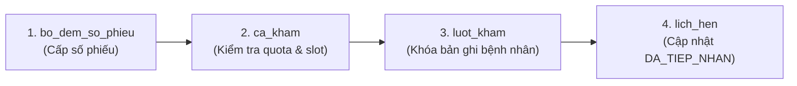

# SMARTCARE — KẾ HOẠCH TRIỂN KHAI HỆ THỐNG HAI HÀNG ĐỢI HYBRID THEO 6 GIAI ĐOẠN

> **Tài liệu:** Kế hoạch Triển khai Chi tiết (Implementation Roadmap & Execution Plan)  
> **Dự án:** SmartCare — Hệ thống Quản lý Phòng khám Thông minh Tích hợp AI  
> **Phiên bản:** 1.0.0-PROD-PLAN  
> **Ngày lập kế hoạch:** 03/11/2026  
> **Trạng thái:** **KẾ HOẠCH THIẾT KẾ (CHƯA CHẠY MIGRATION / CHƯA SỬA MÃ NGUỒN)**

---

## MỤC LỤC
- [PHẦN I. XỬ LÝ CÁC ĐIỂM NGHIỆP VỤ & KỸ THUẬT CỐT LÕI](#phần-i-xử-lý-các-điểm-nghiệp-vụ--kỹ-thuật-cốt-lõi)
  - [1. Hệ Thống Công Thức DPS Toán Học Tường Minh Toàn Phần](#1-hệ-thống-công-thức-dps-toán-học-tường-minh-toàn-phần)
  - [2. Mô Phỏng Tình Huống Quá Tải & Bác Sĩ Khám Kéo Dài (Target Wait vs. SLO Thực Tế)](#2-mô-phỏng-tình-huống-quá-tải--bác-sĩ-khám-kéo-dài)
  - [3. Ma Trận Phân Quyền Bác Sĩ trong Điều Phối Hàng Đợi](#3-ma-trận-phân-quyền-bác-sĩ-trong-điều-phối-hàng-đợi)
  - [4. Thiết Kế Concurrency Đa Cấp & Thứ Tự Khóa Toàn Cục Chống Deadlock](#4-thiết-kế-concurrency-đa-cấp--thứ-tự-khóa-toàn-cục-chống-deadlock)
- [PHẦN II. KẾ HOẠCH TRIỂN KHAI CHI TIẾT 6 GIAI ĐOẠN](#phần-ii-kế-hoạch-triển-khai-chi-tiết-6-giai-đoạn)
  - [Giai đoạn 1: Audit & Chuẩn Bị Tích Hợp Toàn Diện](#giai-đoạn-1-audit--chuẩn-bị-tích-hợp-toàn-diện)
  - [Giai đoạn 2: Cấu Trúc Database, Index, Sequence Counter & Backfill Dữ Liệu](#giai-đoạn-2-cấu-trúc-database-index-sequence-counter--backfill-dữ-liệu)
  - [Giai đoạn 3: Xây Dựng Hạt Nhân Điều Phối QueueManagementService & Backend APIs](#giai-đoạn-3-xây-dựng-hạt-nhân-điều-phối-queuemanagementservice--backend-apis)
  - [Giai đoạn 4: Nâng Cấp Phân Hệ Lễ Tân (Queue, Dashboard, Tiếp Nhận & In Phiếu)](#giai-đoạn-4-nâng-cấp-phân-hệ-lễ-tân-queue-dashboard-tiếp-nhận--in-phiếu)
  - [Giai đoạn 5: Nâng Cấp Phân Hệ Bác Sĩ & Quản Trị Viên (Examine, Dashboard & Admin Settings)](#giai-đoạn-5-nâng-cấp-phân-hệ-bác-sĩ--quản-trị-viên-examine-dashboard--admin-settings)
  - [Giai đoạn 6: Kiểm Thử Toàn Diện Nghiệm Thu, Giả Lập Tải & Bàn Giao](#giai-đoạn-6-kiểm-thử-toàn-diện-nghiệm-thu-giả-lập-tải--bàn-giao)
- [PHẦN III. QUY ĐỊNH AN TOÀN & ĐIỀU KIỆN CHUYỂN GIAI ĐOẠN](#phần-iii-quy-định-an-toàn--điều-kiện-chuyển-giai-đoạn)

---

# PHẦN I. XỬ LÝ CÁC ĐIỂM NGHIỆP VỤ & KỸ THUẬT CỐT LÕI

## 1. Hệ Thống Công Thức DPS Toán Học Tường Minh Toàn Phần

Điểm Ưu tiên Động (**Dynamic Priority Score - $DPS$**) là hàm số thời gian thực được tính toán lại tại từng thời điểm truy vấn $t$ (tính bằng số phút trôi qua từ 00:00 của ngày khám).  
Quy chuẩn miền giá trị: $DPS(i, t) \in [0, 300]$ điểm.

Gọi các biến thời gian:
- $T_{hen}$: Thời điểm hẹn chính thức của bệnh nhân đặt lịch (phút từ đầu ngày).
- $T_{arr}$: Thời điểm tiếp nhận tại quầy lễ tân (`ThoiGianTiepNhan`, phút từ đầu ngày).
- $t$: Thời điểm hiện tại của hệ thống (phút từ đầu ngày).
- $W = \max(0, t - T_{arr})$: Thời gian chờ thực tế tại phòng khám (phút).
- $\Delta T_{early} = \max(0, T_{hen} - 15 - t)$: Số phút bệnh nhân đến trước mốc khung ưu tiên.
- $\Delta T_{delay} = \max(0, t - T_{hen})$: Mức độ trễ của phòng khám so với giờ hẹn của bệnh nhân.

---

### 1.1. Bệnh nhân Đặt lịch Đến Đúng Khung Giờ ($T_{hen} - 15 \le T_{arr} \le T_{hen}$)
Bệnh nhân có mặt đúng cam kết, trong khung cho phép chuẩn bị khám.

$$\mathbf{DPS_{DL\_Ontime}(t) = 100 + W_{valid} \times 1.0 + \Delta T_{delay} \times 2.5}$$

Trong đó:
- $S_{base} = 100$ điểm (Điểm cam kết giờ hẹn dịch vụ).
- $W_{valid} = t - \max(T_{arr}, T_{hen} - 15)$ là thời gian chờ hợp lệ trong khung hẹn.
- Khi thời điểm hiện tại vượt quá giờ hẹn ($t > T_{hen}$): Kích hoạt hệ số gia tốc trễ hẹn $\alpha_{delay} = 2.5$ điểm/phút để đẩy bệnh nhân lên đầu hàng chờ, bảo vệ cam kết không để bệnh nhân đặt lịch trễ hẹn quá 15 phút.

---

### 1.2. Bệnh nhân Đặt lịch Đến Quá Sớm ($T_{arr} < T_{hen} - 15$)
Bệnh nhân đến trước giờ hẹn hơn 15 phút (ví dụ hẹn 09:30 nhưng đến lúc 08:30).

$$\mathbf{DPS_{DL\_TooEarly}(t) = 20 + \min(15, W \times 0.5)}$$

- $S_{base} = 20$ điểm.
- Thời gian chờ chỉ tích lũy tối đa $15$ điểm ($DPS$ tối đa đạt $35$ điểm).
- **Hành vi nghiệp vụ:** Bệnh nhân vẫn được lễ tân check-in, cấp số phiếu cố định `DL-xxx` nhưng **không chiếm vị trí ưu tiên** của các bệnh nhân đúng giờ (100 điểm) hay bệnh nhân trực tiếp (50 điểm).
- **Chuyển trạng thái tự động:** Khi đồng hồ chạm mốc $t = T_{hen} - 15$, hệ thống tự động chuyển sang công thức **1.1 (Đúng khung giờ)** với $S_{base} = 100$ điểm mà không cần bất kỳ thao tác thủ công nào từ lễ tân.

---

### 1.3. Bệnh nhân Đặt lịch Đến Trong Khoảng Grace ($T_{hen} < T_{arr} \le T_{hen} + 15$)
Bệnh nhân đến muộn nhưng vẫn trong ngưỡng gia hạn 15 phút cho phép (ví dụ hẹn 08:30, đến lúc 08:40).

$$\mathbf{DPS_{DL\_Grace}(t) = 100 + (t - T_{arr}) \times 1.0 + \max(0, t - T_{hen}) \times 1.0}$$

- Vẫn được bảo lưu quyền ưu tiên lịch hẹn: $S_{base} = 100$ điểm.
- Bắt đầu tính thời gian chờ từ thời điểm có mặt thực tế $T_{arr}$.
- Gia tốc trễ hẹn giảm xuống mức $1.0$ điểm/phút (do bệnh nhân là người đến muộn một phần).

---

### 1.4. Bệnh nhân Đặt lịch Đến Muộn Quá Hạn Grace ($T_{arr} > T_{hen} + 15$)
Bệnh nhân đến muộn hơn 15 phút sau giờ hẹn (ví dụ hẹn 08:30, đến lúc 08:50).

$$\mathbf{DPS_{DL\_Late}(t) = 40 + W \times 1.0}$$

- **Quy tắc nhân văn:** **Tuyệt đối KHÔNG tự động hủy lịch khám**. Bệnh nhân vẫn được tiếp nhận, cấp phiếu `DL-xxx` và giữ thông tin bác sĩ phụ trách.
- Bị tước quyền ưu tiên khung giờ hẹn: Điểm cơ sở hạ xuống $S_{base} = 40$ điểm.
- Tích lũy thời gian chờ bình thường $1.0$ điểm/phút từ thời điểm check-in tại quầy. Xếp sau nhóm đặt lịch đúng giờ và nhóm trực tiếp thông thường.

---

### 1.5. Bệnh nhân Khám Trực Tiếp Thông Thường ($W \le 30$ phút)
Bệnh nhân đến khám tại quầy không qua đặt lịch trước, đang chờ trong thời gian tiêu chuẩn.

$$\mathbf{DPS_{TT\_Normal}(t) = 50 + W \times 1.0}$$

- $S_{base} = 50$ điểm.
- Tăng trưởng đều đặn $1.0$ điểm mỗi phút chờ ($W = 10 \rightarrow 60$đ; $W = 20 \rightarrow 70$đ; $W = 30 \rightarrow 80$đ).
- Luôn xếp sau bệnh nhân đặt lịch đúng giờ ($S_{base} = 100$) trong 30 phút đầu.

---

### 1.6. Bệnh nhân Khám Trực Tiếp Đã Chờ Lâu ($W > 30$ phút – Kích Hoạt Bảo Vệ)
Bệnh nhân trực tiếp đã ngồi chờ tại phòng khám vượt ngưỡng bảo vệ 30 phút.

$$\mathbf{DPS_{TT\_Protected}(t) = 80 + (W - 30) \times 3.0}$$

- Khi $W = 30$ phút: Đạt mốc $80$ điểm.
- Kể từ phút thứ 31, kích hoạt gia tốc bảo vệ cực mạnh: **$+3.0$ điểm/phút**!
  - Tại $W = 35$ phút: $DPS = 80 + (5 \times 3.0) = 95.0$ điểm.
  - Tại $W = 37$ phút: $DPS = 80 + (7 \times 3.0) = \mathbf{101.0}$ điểm $\Rightarrow$ **Chính thức vượt qua điểm cơ sở 100 của bệnh nhân đặt lịch mới bước vào quầy!**
  - Tại $W = 45$ phút: $DPS = 80 + (15 \times 3.0) = \mathbf{125.0}$ điểm.
  - Tại $W = 60$ phút: $DPS = 80 + (30 \times 3.0) = \mathbf{170.0}$ điểm.

---

## 2. Mô Phỏng Tình Huống Quá Tải & Bác Sĩ Khám Kéo Dài

### 2.1. Phân Biệt: Thời Gian Chờ Mục Tiêu (Target) vs. Cam Kết Thực Tế (SLO)
Trong môi trường khám bệnh thực tế, các ca bệnh nặng, cấp cứu hoặc thăm khám chuyên sâu có thể kéo dài thời gian khám của 1 bệnh nhân từ 15 phút lên 30–40 phút:
- **Thời Gian Chờ Mục Tiêu (Target Wait Time):**
  - Bệnh nhân đặt lịch đúng giờ: Chờ $\le 10$ phút sau giờ hẹn.
  - Bệnh nhân khám trực tiếp: Chờ $\le 30$ phút từ lúc tiếp nhận.
- **Cam Kết Thời Gian Thực Tế (Service Level Objective - SLO):**
  - Bệnh nhân đặt lịch: Trễ không quá 1 ca khám ($15$ phút) so với giờ hẹn trong điều kiện bình thường; trễ tối đa không quá $30$ phút trong điều kiện có ca khám kéo dài bất khả kháng.
  - Bệnh nhân trực tiếp: Không bị bỏ rơi vô thời hạn. Tối đa không quá 2 lượt khám đặt lịch chen ngang sau khi đã vượt mốc 30 phút bảo vệ.

---

### 2.2. Ma Trận Mô Phỏng: Ca Khám Kéo Dài 30 Phút & Dòng Bệnh Nhân Mới Đến Liên Tục
Giả định: Ca khám của BS Nam bị kéo dài 30 phút (từ 08:00 đến 08:30 khám 1 ca phức tạp).  
Các bệnh nhân liên tục đến quầy:
- **08:00:** TT1 (Trực tiếp) đến.
- **08:15:** DL1 (Hẹn 08:15) đến.
- **08:30:** DL2 (Hẹn 08:30) đến.
- **08:35:** TT2 (Trực tiếp) đến.
- **08:45:** DL3 (Hẹn 08:45) đến.

```
DIỄN BIẾN ĐIỀU PHỐI QUA CÁC MỐC THỜI GIAN:

+ Mốc 08:30 (Bác sĩ Nam vừa xong ca khám phức tạp, gọi lượt kế tiếp):
  - TT1: Đã chờ 30 phút -> DPS = 50 + 30 = 80.0 điểm.
  - DL1: Hẹn 08:15, đến 08:15. Lúc 08:30 đã trễ hẹn 15 phút -> W_valid = 15, delay = 15.
         DPS(DL1) = 100 + 15*1.0 + 15*2.5 = 152.5 điểm!
  - DL2: Hẹn 08:30, vừa check-in lúc 08:30 -> W_valid = 0, delay = 0.
         DPS(DL2) = 100.0 điểm.
  => QUYẾT ĐỊNH 1: Gọi DL1 vào khám lúc 08:30 (Giải tỏa trễ hẹn cho lịch hẹn 08:15).
     (Ca khám của DL1 diễn ra bình thường trong 15 phút, dự kiến xong lúc 08:45).

+ Mốc 08:45 (Bác sĩ Nam khám xong DL1, gọi lượt kế tiếp):
  Lúc này:
  - TT1: Đã chờ 45 phút! (Vượt bảo vệ 15 phút).
         DPS(TT1) = 80 + (45 - 30) * 3.0 = 80 + 45.0 = 125.0 điểm!
  - DL2: Hẹn 08:30, đến 08:30. Lúc 08:45 đã trễ hẹn 15 phút -> W_valid = 15, delay = 15.
         DPS(DL2) = 100 + 15*1.0 + 15*2.5 = 152.5 điểm!
  - DL3: Hẹn 08:45, vừa check-in lúc 08:45 -> DPS(DL3) = 100.0 điểm.
  - TT2: Đến 08:35, chờ 10 phút -> DPS(TT2) = 50 + 10 = 60.0 điểm.
  => BẢN CHẤT CÂN BẰNG:
     DPS(DL2) [152.5] > DPS(TT1) [125.0] > DPS(DL3) [100.0]!
  => QUYẾT ĐỊNH 2: Gọi DL2 vào khám lúc 08:45 (DL2 bị trễ 15p, được giải tỏa ngay).
     (Ca khám DL2 xong lúc 09:00).

+ Mốc 09:00 (Bác sĩ Nam khám xong DL2, gọi lượt kế tiếp) — BƯỚC NGOẶT CHỐNG STARVATION:
  Lúc này:
  - TT1: Đã chờ 60 phút! (Vượt bảo vệ 30 phút).
         DPS(TT1) = 80 + (60 - 30) * 3.0 = 80 + 90.0 = 170.0 điểm!
  - DL3: Hẹn 08:45, đến 08:45. Lúc 09:00 trễ hẹn 15 phút -> W_valid = 15, delay = 15.
         DPS(DL3) = 100 + 15*1.0 + 15*2.5 = 152.5 điểm.
  - DL_mới: Giả sử có thêm lịch hẹn 09:00 vừa bước vào quầy -> DPS = 100.0 điểm.
  => SO SÁNH:
     DPS(TT1) [170.0] > DPS(DL3) [152.5] > DPS(DL_mới) [100.0]!
  => QUYẾT ĐỊNH 3: BỆNH NHÂN TRỰC TIẾP TT1 ĐƯỢC GỌI VÀO KHÁM LÚC 09:00!
     DL3 và các lịch hẹn mới không thể tiếp tục đẩy lùi TT1 được nữa.
```

---

## 3. Ma Trận Phân Quyền Bác Sĩ trong Điều Phối Hàng Đợi

| Hành Động / Khả Năng | Quyền Bác Sĩ | Ràng Buộc Nghiệp Vụ & An Toàn |
|:---|:---:|:---|
| **1. Xem Hàng đợi Chung** | **CÓ** | Bác sĩ chỉ xem được 2 nhóm: (1) Bệnh nhân đặt lịch đã gán cho mình; (2) Bệnh nhân trực tiếp đang ở trạng thái `CHO_KHAM` thuộc **CÙNG CHUYÊN KHOA** của bác sĩ. Không xem được bệnh nhân của chuyên khoa khác. |
| **2. Nhận Đề xuất Bệnh nhân (`nextPatient`)** | **CÓ** | Hệ thống tự động tính điểm DPS và gợi ý bệnh nhân có DPS cao nhất ở đầu màn hình kèm lý do ưu tiên cụ thể. |
| **3. Được Phân công Chính thức** | **TỰ ĐỘNG KHI GỌI** | Bác sĩ **không cần gán thủ công trước**. Khi bác sĩ nhấn nút "GỌI BỆNH NHÂN TIẾP THEO", backend tự động gán `luot_kham.MaBacSi = $doctorId` trong cùng transaction chuyển trạng thái. |
| **4. Bắt đầu Khám (`startExamine`)** | **CÓ** | Chỉ Bác sĩ đã được ghi nhận `MaBacSi` trên lượt khám mới có quyền bấm bắt đầu khám, ghi chép bệnh án và lưu kết luận. |
| **5. Tự ý Đổi Bệnh nhân Đặt lịch** | **KHÔNG** | Bác sĩ không được tự ý chuyển bệnh nhân đặt lịch của mình sang bác sĩ khác. |
| **6. Khám Nhiều Bệnh nhân Cùng Lúc** | **KHÔNG** | Mỗi Bác sĩ tại một thời điểm chỉ được phép có **tối đa 1 lượt khám** ở trạng thái `DANG_KHAM` (hoặc `DANG_GOI`). Nếu đang có ca khám dở dang, nút gọi bệnh nhân mới bị vô hiệu hóa. |

---

## 4. Thiết Kế Concurrency Đa Cấp & Thứ Tự Khóa Toàn Cục Chống Deadlock

### 4.1. Ba Cấp Độ Kiểm Soát Tranh Chấp (Concurrency Levels)
1. **Cấp độ Lượt khám (`luot_kham`):**
   - Đảm bảo một bệnh nhân trực tiếp trong hàng đợi chuyên khoa chỉ được cấp phát cho duy nhất 1 bác sĩ.
   - Sử dụng `SELECT * FROM luot_kham WHERE MaLuotKham = ? FOR UPDATE`.
2. **Cấp độ Bác sĩ / Ca trực (`bac_si` & `ca_kham`):**
   - Đảm bảo bác sĩ không bị gọi vượt quá sức chứa tối đa (`SoLuongTiepNhan`) của ca trực hôm nay.
   - Đảm bảo bác sĩ không nhận đồng thời 2 bệnh nhân vào phòng khám:
     `SELECT COUNT(*) FROM luot_kham WHERE MaBacSi = ? AND TrangThai = 'DANG_KHAM' FOR UPDATE`.
3. **Cấp độ Bộ đếm Số phiếu (`bo_dem_so_phieu`):**
   - Đảm bảo 2 lễ tân tiếp nhận cùng một mili-giây không bao giờ sinh trùng mã phiếu `DL-xxx` hay `TT-xxx`.
   - Sử dụng `SELECT GiaTriHienTai FROM bo_dem_so_phieu WHERE ... FOR UPDATE`.

---

### 4.2. Thứ Tự Khóa Toàn Cục Chống Deadlock (Global Lock Acquisition Order)
Để triệt tiêu $100\%$ nguy cơ Deadlock khi nhiều tiến trình (Lễ tân A, Lễ tân B, Bác sĩ 1, Bác sĩ 2) cùng truy cập tài nguyên:

$$\mathbf{Order: \quad bo\_dem\_so\_phieu \quad \longrightarrow \quad ca\_kham \quad \longrightarrow \quad luot\_kham \quad \longrightarrow \quad lich\_hen}$$



**Quy tắc bất biến:**
- Bất kỳ transaction nào liên quan đến nhiều bảng đều phải tuân thủ nghiêm ngặt thứ tự trên.
- Khi cần khóa nhiều bản ghi trong cùng một bảng `luot_kham`, bắt buộc phải sắp xếp theo khóa chính tăng dần: `ORDER BY MaLuotKham ASC FOR UPDATE`.
- Thời gian thực thi bên trong Transaction $\le 50$ms: Không gửi socket, không gọi AI, không gửi SMS/Email bên trong khối transaction.

---

# PHẦN II. KẾ HOẠCH TRIỂN KHAI CHI TIẾT 6 GIAI ĐOẠN

```mermaid
gantt
    title LỘ TRÌNH TRIỂN KHAI HYBRID QUEUE 6 GIAI ĐOẠN
    dateFormat YYYY-MM-DD
    section Giai đoạn
    G1: Audit & Chuẩn bị Tích hợp           :active, G1, 2026-11-04, 2d
    G2: Database Schema & Migration          :G2, after G1, 2d
    G3: Backend Service & Core APIs          :G3, after G2, 3d
    G4: Nâng cấp Phân hệ Lễ tân             :G4, after G3, 3d
    G5: Nâng cấp Bác sĩ & Admin Settings     :G5, after G4, 3d
    G6: Kiểm thử Toàn diện & Handover        :G6, after G5, 3d
```

---

## Giai đoạn 1: Audit & Chuẩn Bị Tích Hợp Toàn Diện

### 1. Mục tiêu
Rà soát toàn bộ các câu truy vấn, relationship và view hiện tại, đảm bảo sẵn sàng cho việc hỗ trợ hàng đợi Chuyên khoa và `luot_kham.MaBacSi` mang giá trị `NULL`.

### 2. Danh sách file dự kiến thay đổi / tạo mới
- `app/Models/LuotKham.php`: Khai báo thêm `$fillable`, quan hệ `chuyenKhoa()`, scope `scopeWaitingInSpecialty()`.
- `app/Models/ChuyenKhoa.php`: Khai báo quan hệ `luotKhams()`.
- `app/Services/QueueManagementService.php` (tạo khung interface).

### 3. Database tác động
- Chưa can thiệp cấu trúc database.
- Thực hiện kiểm tra chỉ mục hiện hữu trên MySQL.

### 4. API và Giao diện liên quan
- `GET /receptionist/queue`
- `GET /doctor/examine`
- `GET /doctor/dashboard`

### 5. Test case
- `TC1.1`: Kiểm tra tất cả quan hệ Eloquent hiện hữu không bị gãy khi gọi `LuotKham::with(['benhNhan', 'bacSi', 'chuyenKhoa'])`.
- `TC1.2`: Kiểm tra các lượt khám cũ trong DB vẫn truy vấn bình thường với `MaBacSi` hiện tại.

### 6. Điều kiện hoàn thành
- Báo cáo audit xác nhận 100% các vị trí phụ thuộc vào `MaBacSi` đã có phương án xử lý tương thích ngược.

### 7. Rủi ro
- Bỏ sót các câu query dạng raw SQL hoặc Eloquent scope ngầm định `whereNotNull('MaBacSi')`.

### 8. Điều kiện rollback
- Phục hồi lại file Model từ bản sao lưu Git nếu phát sinh lỗi cú pháp.

---

## Giai đoạn 2: Cấu Trúc Database, Index, Sequence Counter & Backfill Dữ Liệu

### 2.1. Mục tiêu
Tạo bảng cấu hình nghiệp vụ, bảng bộ đếm số phiếu an toàn, bảng lịch sử điều phối và cập nhật bảng `luot_kham` cho phép `MaBacSi` nullable.

### 2.2. Danh sách file dự kiến thay đổi / tạo mới
- `database/migrations/2026_11_04_000001_create_cai_dat_he_thong_table.php`
- `database/migrations/2026_11_04_000002_create_bo_dem_so_phieu_table.php`
- `database/migrations/2026_11_04_000003_create_lich_su_dieu_phoi_table.php`
- `database/migrations/2026_11_04_000004_enhance_luot_kham_for_hybrid_queue.php`
- `app/Models/CaiDatHeThong.php`
- `app/Models/BoDemSoPhieu.php`
- `app/Models/LichSuDieuPhoi.php`

### 2.3. Database tác động
- Tạo mới: `cai_dat_he_thong`, `bo_dem_so_phieu`, `lich_su_dieu_phoi`.
- Cập nhật `luot_kham`: Thêm `LoaiHangDoi`, `SoPhieu`, `STTTrongNgay`, `MaChuyenKhoa`, `MaCaKham`, `ThoiGianGoiKham`. Đổi `MaBacSi` sang `NULLABLE`.
- **Backfill an toàn dữ liệu lịch sử:**
  ```sql
  UPDATE luot_kham SET LoaiHangDoi = 'DAT_LICH', SoPhieu = CONCAT('DL-HIST-', LPAD(MaLuotKham, 5, '0')) WHERE MaLichHen IS NOT NULL AND SoPhieu IS NULL;
  UPDATE luot_kham SET LoaiHangDoi = 'TRUC_TIEP', SoPhieu = CONCAT('TT-HIST-', LPAD(MaLuotKham, 5, '0')) WHERE MaLichHen IS NULL AND SoPhieu IS NULL;
  ```

### 2.4. API và Giao diện liên quan
- Các API hiện tại không bị ảnh hưởng do migration chỉ bổ sung cột và nới lỏng `MaBacSi`.

### 2.5. Test case
- `TC2.1`: Migration chạy thành công không báo lỗi foreign key.
- `TC2.2`: Kiểm tra dữ liệu cũ còn nguyên vẹn 100%, không mất mát bất kỳ lượt khám nào.
- `TC2.3`: Thử insert 1 bản ghi `luot_kham` với `MaBacSi = NULL` và `MaChuyenKhoa = 1` thành công.

### 2.6. Điều kiện hoàn thành
- Toàn bộ 4 migration thực thi hoàn hảo trên MySQL; cấu trúc bảng khớp chính xác với thiết kế.

### 2.7. Rủi ro
- Lỗi khóa ngoại khi modify cột `MaBacSi` nếu MySQL yêu cầu drop foreign key trước.  
  *Khắc phục:* Trong migration, drop constraint `fk_luotkham_bacsi`, modify column, sau đó re-add constraint.

### 2.8. Điều kiện rollback
- File migration có hàm `down()` hoàn chỉnh khôi phục lại trạng thái trước khi migrate (phục hồi `MaBacSi NOT NULL` sau khi đã gán ID mặc định nếu cần).

---

## Giai đoạn 3: Xây Dựng Hạt Nhân Điều Phối QueueManagementService & Backend APIs

### 3.1. Mục tiêu
Xây dựng hạt nhân điều phối trung tâm `QueueManagementService`, quản lý cấp số phiếu, tính điểm DPS, chọn bệnh nhân tiếp theo, gán bác sĩ an toàn với transaction locking.

### 3.2. Danh sách file dự kiến thay đổi / tạo mới
- `app/Services/QueueManagementService.php` (Class cốt lõi toàn hệ thống):
  - `generateTicketNumber(string $type, ?int $specialtyId): array` (Cấp `SoPhieu` và `STTTrongNgay` có lock).
  - `calculateDPS(LuotKham $visit, Carbon $now): float` (Thuật toán tính điểm chi tiết).
  - `getCoordinatorQueue(?int $doctorId, ?int $specialtyId, Carbon $now): Collection` (Lấy hàng đợi hợp nhất đã xếp hạng).
  - `callNextPatient(int $doctorId, int $specialtyId): LuotKham` (Hành động gọi khám có lock & retry).
  - `reassignDoctor(int $visitId, int $newDoctorId, string $reason, int $actorId): bool` (Quy trình đổi bác sĩ an toàn).
- `app/Http/Controllers/LuotKhamController.php`:
  - Cập nhật `store()`: Tiếp nhận trực tiếp không bắt buộc `MaBacSi`, tự động gọi `generateTicketNumber()`.
  - Thêm `callNext()`: API Bác sĩ gọi bệnh nhân tiếp theo.
  - Thêm `reassignDoctor()`: API Quản trị viên điều chuyển bác sĩ.
- `routes/web.php`: Khai báo các route điều phối mới.

### 3.3. Database tác động
- Đọc/Ghi có khóa trên `bo_dem_so_phieu`, `luot_kham`, `lich_su_dieu_phoi`.

### 3.4. API và Giao diện liên quan
- `POST /doctor/queue/call-next`
- `POST /admin/queue/reassign-doctor`
- `GET /api/queue/coordinator`

### 3.5. Test case
- `TC3.1`: Cấp số phiếu tuần tự tăng dần chính xác, định dạng `DL-MMDD-0001` và `TT-MMDD-0001`.
- `TC3.2`: Kiểm thử tính điểm DPS cho cả 6 trường hợp đúng khung giờ, quá sớm, trong grace, hết grace, trực tiếp, chờ quá 30p.
- `TC3.3`: Bệnh nhân trực tiếp sau 37 phút chờ có DPS > 100 điểm, vượt qua lịch hẹn mới đến.
- `TC3.4`: Gọi `callNextPatient` gán đúng bác sĩ và ghi nhận lịch sử điều phối.

### 3.6. Điều kiện hoàn thành
- Toàn bộ unit test cho `QueueManagementService` đạt 100% PASS; không phát sinh lỗi syntax hay transaction uncommitted.

### 3.7. Rủi ro
- Lỗi logic thời gian khi server khác múi giờ (`Asia/Ho_Chi_Minh`).  
  *Khắc phục:* Toàn bộ phép tính thời gian đều dùng `now('Asia/Ho_Chi_Minh')`.

### 3.8. Điều kiện rollback
- Hủy bỏ các route mới, khôi phục lại phiên bản controller trước đó qua Git.

---

## Giai đoạn 4: Nâng Cấp Phân Hệ Lễ Tân (Queue, Dashboard, Tiếp Nhận & In Phiếu)

### 4.1. Mục tiêu
Cập nhật màn hình Lễ tân hiển thị đồng thời cả Hai Hàng Đợi (Đặt lịch & Trực tiếp) và Hàng đợi điều phối ưu tiên; hỗ trợ tiếp nhận trực tiếp vào chuyên khoa và in phiếu tiếp nhận chuẩn.

### 4.2. Danh sách file dự kiến thay đổi / tạo mới
- `app/Http/Controllers/LichHenController.php`: Cập nhật `queue()` và `receptionistDashboard()`, lấy dữ liệu từ `QueueManagementService`.
- `resources/js/Pages/Receptionist/Queue.tsx`:
  - Thêm Tab chuyển đổi: **Tất cả (Ưu tiên DPS)** | **Hàng đợi Đặt lịch** | **Hàng đợi Khám trực tiếp**.
  - Hiển thị rõ: Mã phiếu cố định (`SoPhieu`), Vị trí hiện tại (`ViTriHangDoi`), Thời gian chờ thực tế, Điểm DPS và Lý do ưu tiên.
- `resources/js/Pages/Receptionist/Dashboard.tsx`: Đồng bộ số liệu thống kê hàng chờ thời gian thực.
- `resources/js/Components/PrintTicketModal.tsx` (Component modal in phiếu tiếp nhận).

### 4.3. Database tác động
- Đọc bảng `luot_kham`, `cai_dat_he_thong`.

### 4.4. API và Giao diện liên quan
- Màn hình Lễ tân: `/receptionist/queue`
- Màn hình Bàn làm việc Lễ tân: `/receptionist/dashboard`

### 4.5. Test case
- `TC4.1`: Lễ tân tiếp nhận lịch hẹn $\rightarrow$ Xuất hiện tại Tab Đặt lịch với mã phiếu `DL-xxx`.
- `TC4.2`: Lễ tân tiếp nhận trực tiếp chuyên khoa Nội $\rightarrow$ Xuất hiện tại Tab Trực tiếp với mã phiếu `TT-xxx`.
- `TC4.3`: Mở modal in phiếu hiển thị đúng mã phiếu cố định và vị trí dự kiến tại thời điểm in.

### 4.6. Điều kiện hoàn thành
- Frontend compile sạch sẽ (`npm run build` không lỗi TS/CSS), giao diện phản hồi mượt mà, phân tách tab trực quan.

### 4.7. Rủi ro
- Lệch dữ liệu giữa State client và Database nếu không reload.  
  *Khắc phục:* Sử dụng Inertia router visit định kỳ hoặc sau mỗi thao tác tiếp nhận.

### 4.8. Điều kiện rollback
- Revert commit giao diện `Queue.tsx` và `Dashboard.tsx`.

---

## Giai đoạn 5: Nâng Cấp Phân Hệ Bác Sĩ & Quản Trị Viên (Examine, Dashboard & Admin Settings)

### 5.1. Mục tiêu
Tích hợp Bàn làm việc Bác sĩ nhận bệnh nhân từ hàng đợi chuyên khoa; bổ sung nút "GỌI BỆNH NHÂN TIẾP THEO"; giao diện Quản trị viên điều chỉnh cấu hình thời gian và điều chuyển bác sĩ.

### 5.2. Danh sách file dự kiến thay đổi / tạo mới
- `app/Http/Controllers/BacSiController.php`: Cập nhật `dashboard()`.
- `app/Http/Controllers/LuotKhamController.php`: Cập nhật `index()` truyền danh sách chờ hybrid cho Bác sĩ.
- `resources/js/Pages/Doctor/Dashboard.tsx`: Thẻ "Bệnh nhân kế tiếp" nổi bật kèm nút Gọi khám.
- `resources/js/Pages/Doctor/Examine.tsx`:
  - Danh sách hàng chờ bên trái hiển thị rõ: Loại hàng đợi (`DL`/`TT`), Số phiếu, Điểm DPS, Lý do ưu tiên.
  - Nút "GỌI BỆNH NHÂN TIẾP THEO" khi phòng khám sẵn sàng.
  - Khóa nút gọi nếu đang có bệnh nhân ở trạng thái `DANG_KHAM`.
- `resources/js/Pages/Admin/QueueSettings.tsx` (Màn hình Admin cấu hình 15p, 30p, gia tốc).
- `resources/js/Components/ReassignDoctorModal.tsx` (Modal Quản trị viên đổi bác sĩ).

### 5.3. Database tác động
- Đọc/Ghi `cai_dat_he_thong`, `luot_kham`, `lich_su_dieu_phoi`.

### 5.4. API và Giao diện liên quan
- `/doctor/dashboard`
- `/doctor/examine`
- `/admin/queue-settings`

### 5.5. Test case
- `TC5.1`: Bác sĩ bấm "GỌI BỆNH NHÂN TIẾP THEO" $\rightarrow$ Bệnh nhân có DPS cao nhất được gán vào bác sĩ, chuyển `DANG_KHAM`.
- `TC5.2`: Bác sĩ đang khám 1 bệnh nhân thì không thể gọi thêm bệnh nhân thứ 2.
- `TC5.3`: Quản trị viên điều chỉnh `DIRECT_WAIT_PROTECTION_MINUTES` từ 30 thành 25 phút $\rightarrow$ Hệ thống áp dụng ngay lập tức cho các phép tính DPS tiếp theo.
- `TC5.4`: Quản trị viên điều chuyển bệnh nhân đặt lịch sang bác sĩ khác cùng chuyên khoa $\rightarrow$ Bắt buộc nhập lý do và ghi log thành công.

### 5.6. Điều kiện hoàn thành
- Phân hệ Bác sĩ và Admin hoạt động đồng bộ 100% với backend; `npm run build` thành công.

### 5.7. Rủi ro
- Bác sĩ vô tình ấn gọi liên tiếp gây race condition.  
  *Khắc phục:* Frontend disable button và hiển thị loading spinner ngay khi click; backend áp dụng lock.

### 5.8. Điều kiện rollback
- Phục hồi lại code giao diện Doctor và Admin từ bản backup Git.

---

## Giai đoạn 6: Kiểm Thử Toàn Diện Nghiệm Thu, Giả Lập Tải & Bàn Giao

### 6.1. Mục tiêu
Thực thi kiểm thử tự động toàn diện qua Artisan Command và kiểm thử thực tế trên trình duyệt; xác nhận 100% kịch bản đạt tiêu chuẩn.

### 6.2. Danh sách file dự kiến thay đổi / tạo mới
- `app/Console/Commands/VerifyHybridQueueSystemCommand.php` (Lệnh test tự động 18 kịch bản).
- `SMARTCARE_QUEUE_NUMBER_AND_PRIORITY_FIX_REPORT.md` (Báo cáo nghiệm thu hoàn chỉnh).

### 6.3. Database tác động
- Chạy test trên môi trường transaction rollback hoặc dữ liệu kiểm thử độc lập, tuyệt đối không làm bẩn dữ liệu thực tế.

### 6.4. Ma trận 18 Test Cases Nghiệm Thu Bắt Buộc

| Mã TC | Tên Kịch Bản Kiểm Thử | Điều Kiện & Thao Tác | Kết Quả Mong Đợi |
|:---:|:---|:---|:---|
| **TC6.1** | Lịch hẹn chưa đến | Bệnh nhân đặt lịch thành công nhưng chưa đến quầy. | Không xuất hiện trong hàng đợi khám thực tế. |
| **TC6.2** | Đặt lịch đến sớm trong 15p | Hẹn 08:30, đến quầy lúc 08:20. | Tiếp nhận, cấp `DL-xxx`, $S_{base} = 100$, xét ưu tiên đúng giờ. |
| **TC6.3** | Đặt lịch đến sớm quá 15p | Hẹn 09:30, đến quầy lúc 08:30. | Cấp số `DL-xxx`, $S_{base} = 20$, không chen ngang người đến đúng giờ. |
| **TC6.4** | Đặt lịch đúng giờ | Hẹn 08:30, đến quầy lúc 08:30. | Cấp `DL-xxx`, $S_{base} = 100$, điểm chờ tăng chuẩn xác. |
| **TC6.5** | Đặt lịch đến trong grace | Hẹn 08:30, đến quầy lúc 08:40. | Vẫn giữ $S_{base} = 100$, tính chờ từ lúc có mặt thực tế. |
| **TC6.6** | Đặt lịch trễ quá grace | Hẹn 08:30, đến quầy lúc 08:50. | Không hủy lịch, $S_{base} = 40$, xếp chờ sau nhóm đúng giờ. |
| **TC6.7** | Khám trực tiếp FIFO | Hai bệnh nhân trực tiếp đến lúc 08:00 và 08:05. | Người đến trước có DPS cao hơn người đến sau. |
| **TC6.8** | Trực tiếp bảo vệ 30p | Bệnh nhân trực tiếp chờ 38 phút. | DPS vượt qua 100 điểm, xếp trước lịch hẹn mới đến. |
| **TC6.9** | Nhiều lịch hẹn cùng giờ | Hai lịch hẹn cùng 08:30. | Sắp xếp ổn định theo thời điểm tiếp nhận và ID tăng dần. |
| **TC6.10**| BN đã gọi giữ nguyên | Lượt khám đã chuyển `DANG_KHAM`. | Không bị thay đổi thứ tự khi có bệnh nhân mới vào hàng đợi. |
| **TC6.11**| Hủy lượt tịnh tiến hàng | Lễ tân bấm hủy 1 lượt chờ. | Lượt bị hủy loại bỏ, vị trí người sau tự động tiến lên. |
| **TC6.12**| Hai lễ tân tiếp nhận cùng lúc | 2 request check-in đồng thời lúc 08:00:00. | Cấp 2 số phiếu tuần tự phân biệt, không trùng số. |
| **TC6.13**| Hai bác sĩ cùng gọi khám | 2 bác sĩ cùng ấn "Gọi khám" đồng thời. | Phân cho 2 bệnh nhân khác nhau, không tranh chấp. |
| **TC6.14**| Lễ tân và Bác sĩ cùng thứ tự | Đối chiếu danh sách hiển thị của Lễ tân và Bác sĩ. | Thứ tự và điểm DPS trùng khớp 100% từ 1 nguồn service. |
| **TC6.15**| Bác sĩ trái chuyên khoa | Bác sĩ Răng Hàm Mặt xem hàng chờ. | Không nhìn thấy bệnh nhân chuyên khoa Nội. |
| **TC6.16**| Khám lại sau CLS | Bệnh nhân có kết quả CLS quay lại phòng khám. | Tiếp tục trên đúng `MaLuotKham` cũ, không tạo số phiếu mới. |
| **TC6.17**| Đổi bác sĩ có thẩm quyền | Admin đổi bác sĩ cho lịch hẹn do bác sĩ cũ ốm. | Ghi nhận lý do, đổi thành công và gửi thông báo cho bệnh nhân. |
| **TC6.18**| Chống vượt sức chứa ca | Ca khám tối đa 20 lượt, đã đủ 20 lượt. | Hệ thống từ chối nhận thêm, yêu cầu chuyển ca tiếp theo. |

### 6.5. Điều kiện hoàn thành
- Toàn bộ 18 test cases đạt **100% PASS** trên console command.
- Kiểm tra trực quan trên trình duyệt xác nhận các luồng nghiệp vụ hoạt động trơn tru.

---

# PHẦN III. QUY ĐỊNH AN TOÀN & ĐIỀU KIỆN CHUYỂN GIAI ĐOẠN

### 1. Quy Định An Toàn Bắt Buộc (Safety Guardrails)
1. **KHÔNG chạy `migrate:fresh`:** Tuyệt đối không xóa database, không làm mất bất kỳ bảng hay bản ghi lịch sử nào.
2. **KHÔNG sửa hoặc đánh lại số phiếu cũ:** Các lượt khám lịch sử được giữ nguyên mã phiếu backfill an toàn.
3. **KHÔNG hardcode tham số:** Toàn bộ tham số thời gian (15p, 30p, hệ số gia tốc) được đọc từ bảng `cai_dat_he_thong`.
4. **Bảo vệ toàn vẹn các phân hệ liên quan:** Phân hệ Khám bệnh 2 giai đoạn, Cận lâm sàng, Đơn thuốc, Hóa đơn và Thanh toán đã nghiệm thu giữ nguyên vẹn logic nghiệp vụ.

### 2. Tiêu Chí Nghiệm Thu Từng Giai Đoạn (Gatekeeper Checklist)
- Mỗi giai đoạn chỉ được bắt đầu khi giai đoạn trước đó đã hoàn thành đầy đủ các Test Case và được phê duyệt.
- Nếu phát sinh lỗi nghiêm trọng ở bất kỳ giai đoạn nào, lập tức kích hoạt **Điều kiện Rollback** của giai đoạn đó để trở về trạng thái ổn định.

---

> **KẾT LUẬN:** Kế hoạch triển khai 6 giai đoạn trên đã bao quát toàn diện từ kiến trúc dữ liệu, thuật toán điều phối, giao diện người dùng đến kiểm thử an toàn đồng thời.  
> **Kính đề nghị Ban Quản trị Dự án xem xét và phê duyệt Kế hoạch Triển khai để bắt đầu thực hiện Giai đoạn 1!**
