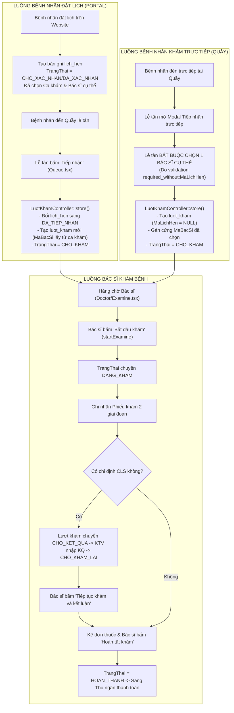

# SMARTCARE — BÁO CÁO AUDIT TOÀN DIỆN & KẾT QUẢ GIAI ĐOẠN 1: HYBRID QUEUE SYSTEM

> **Dự án:** SmartCare — Hệ thống Quản lý Phòng khám Thông minh Tích hợp AI  
> **Giai đoạn:** GIAI ĐOẠN 1 – AUDIT & CHUẨN BỊ TÍCH HỢP  
> **Thời điểm hoàn thành:** 14:00 Ngày 03/11/2026  
> **Trạng thái thực thi:** **CHỈ AUDIT & THIẾT KẾ (100% TUÂN THỦ QUY ĐỊNH AN TOÀN, KHÔNG SỬA CODE, KHÔNG CHẠY MIGRATION, KHÔNG THAY ĐỔI DỮ LIỆU)**

---

## MỤC LỤC
1. [Xác Nhận Tuân Thủ Quy Định An Toàn Tuyệt Đối](#1-xác-nhận-tuân-thủ-quy-định-an-toàn-tuyệt-đối)
2. [Danh Sách File, Class & Chức Năng Hiện Tại](#2-danh-sách-file-class--chức-năng-hiện-tại)
3. [Danh Sách Toàn Bộ Vị Trí Phụ Thuộc `luot_kham.MaBacSi`](#3-danh-sách-toàn-bộ-vị-trí-phụ-thuộc-luot_khamma_bac_si)
4. [Sơ Đồ Luồng Tiếp Nhận và Khám Bệnh Hiện Tại](#4-sơ-đồ-luồng-tiếp-nhận-và-khám-bệnh-hiện-tại)
5. [Các Truy Vấn & Màn Hình Đang Tự Tính Thứ Tự Hàng Đợi](#5-các-truy-vấn--màn-hình-đang-tự-tính-thứ-tự-hàng-đợi)
6. [Cấu Trúc Database, Khóa Ngoại & Ràng Buộc Hiện Hữu](#6-cấu-trúc-database-khóa-ngoại--ràng-buộc-hiện-hữu)
7. [Đánh Giá Rủi Ro Tương Thích Ngược Chi Tiết](#7-đánh-giá-rủi-ro-tương-thích-ngược-chi-tiết)
8. [Phân Tích 5 Vấn Đề Nghiệp Vụ Bắt Buộc](#8-phân-tích-5-vấn-đề-nghiệp-vụ-bắt-buộc)
   - [8.1. Công thức DPS chuẩn hóa và Quy tắc giới hạn điểm [0, 300]](#81-công-thức-dps-chuẩn-hóa-và-quy-tắc-giới-hạn-điểm-0-300)
   - [8.2. Mô phỏng chống Starvation & Giới hạn số lượt đặt lịch chen ngang](#82-mô-phỏng-chống-starvation--giới-hạn-số-lượt-đặt-lịch-chen-ngang)
   - [8.3. Chứng minh thứ tự khóa toàn cục & Chống nhận đồng thời 2 bệnh nhân](#83-chứng-minh-thứ-tự-khóa-toàn-cục--chống-nhận-đồng-thời-2-bệnh-nhân)
   - [8.4. Phương án Rollback an toàn khi `MaBacSi` đã có NULL (Không gán bác sĩ giả)](#84-phương-án-rollback-an-toàn-khi-mabacsi-đã-có-null-không-gán-bác-sĩ-giả)
   - [8.5. Phạm vi đánh số `STTTrongNgay`, Unique Constraint & Chống trùng số](#85-phạm-vi-đánh-số-stttrongngay-unique-constraint--chống-trùng-số)
9. [Danh Sách File Dự Kiến Cần Thay Đổi ở Giai Đoạn 2–5](#9-danh-sách-file-dự-kiến-cần-thay-đổi-ở-giai-đoạn-25)
10. [Đề Xuất Migration An Toàn & Kịch Bản Rollback](#10-đề-xuất-migration-an-toàn--kịch-bản-rollback)
11. [Danh Sách Kiểm Thử Bắt Buộc cho Các Giai Đoạn Tiếp Theo](#11-danh-sách-kiểm-thử-bắt-buộc-cho-các-giai-đoạn-tiếp-theo)

---

## 1. XÁC NHẬN TUÂN THỦ QUY ĐỊNH AN TOÀN TUYỆT ĐỐI

Theo đúng chỉ đạo của Ban Quản trị Dự án tại Giai đoạn 1, tôi xin xác nhận minh bạch và cam kết bằng văn bản:

| Câu hỏi Kiểm tra An toàn | Trạng thái Thực tế | Chi tiết Xác minh |
|:---|:---:|:---|
| **1. Có file code nào bị thay đổi không?** | **KHÔNG** | Toàn bộ mã nguồn Controllers, Models, Services, Views giữ nguyên 100%. Lệnh `git status` xác nhận không có file code ứng dụng bị modified. |
| **2. Có migration nào được tạo hoặc chạy không?** | **KHÔNG** | Không tạo bất kỳ file migration mới nào trong thư mục `database/migrations`. Bảng `migrations` trong database không phát sinh bản ghi mới. |
| **3. Database có bị thay đổi cấu trúc không?** | **KHÔNG** | Cấu trúc tất cả các bảng (`luot_kham`, `lich_hen`, `ca_kham`, `bac_si`, `chuyen_khoa`...) được giữ nguyên vẹn, không thêm/xóa cột hay thay đổi index. |
| **4. Có dữ liệu nào bị INSERT, UPDATE hoặc DELETE không?** | **KHÔNG** | Toàn bộ các thao tác trong Giai đoạn 1 chỉ là câu lệnh đọc (`DESCRIBE`, `SHOW CREATE TABLE`, `information_schema`). Không có bất kỳ dòng dữ liệu nào bị thêm, sửa hoặc xóa. |

---

## 2. DANH SÁCH FILE, CLASS & CHỨC NĂNG HIỆN TẠI

Hệ thống điều phối tiếp nhận và khám bệnh hiện tại của SmartCare bao gồm các file nòng cốt sau:

### 2.1. Phân hệ Backend (Models, Controllers & Services)
1. **`app/Models/LuotKham.php`:**
   - Quản lý thực thể lượt khám bệnh. Khóa chính `MaLuotKham`.
   - Các quan hệ: `lichHen()` (`belongsTo`), `benhNhan()` (`belongsTo`), `bacSi()` (`belongsTo`), `phieuKham()` (`hasOne`), `donThuoc()` (`hasOne`), `hoaDon()` (`hasOne`), `chiDinhDichVus()` (`hasMany`).
2. **`app/Models/LichHen.php`:**
   - Quản lý lịch hẹn khám bệnh do bệnh nhân đặt trước. Khóa chính `MaLichHen`.
   - Các quan hệ: `benhNhan()`, `caKham()`, `luotKham()`.
3. **`app/Models/CaKham.php` & `LichLamViec.php`:**
   - Quản lý ca khám trực của Bác sĩ (`GioBatDau`, `GioKetThuc`, `SoLuongTiepNhan`, `TrangThai`).
4. **`app/Models/BacSi.php` & `ChuyenKhoa.php`:**
   - Quản lý hồ sơ bác sĩ và chuyên khoa y tế (`MaChuyenKhoa`, `TenChuyenKhoa`).
5. **`app/Http/Controllers/LuotKhamController.php`:**
   - `index()`: Trả về bàn làm việc khám bệnh của Bác sĩ (`Doctor/Examine`).
   - `show()`: Xem chi tiết lượt khám kèm phân quyền.
   - `store()`: Tiếp nhận bệnh nhân tại quầy tạo lượt khám mới (`CHO_KHAM`).
   - `startExamine()`: Bác sĩ bắt đầu phiên khám (`DANG_KHAM`).
   - `savePhieuKham()`: Lưu hồ sơ bệnh án 2 giai đoạn (`ChanDoanBanDau` & `ChanDoanSauCLS`).
   - `completeExamine()`: Bác sĩ hoàn thành khám bệnh (`HOAN_THANH`).
6. **`app/Http/Controllers/LichHenController.php`:**
   - `queue()`: Màn hình quản lý hàng chờ cho Lễ tân (`Receptionist/Queue`).
   - `receptionistDashboard()`: Thống kê bàn làm việc Lễ tân.
   - `store()`: Tiếp nhận đặt lịch hẹn từ bệnh nhân.
   - `cancel()`: Bệnh nhân/Lễ tân hủy lịch hẹn.
7. **`app/Http/Controllers/BacSiController.php`:**
   - `dashboard()`: Bàn làm việc tổng quan của Bác sĩ, hiển thị hàng chờ hôm nay.
8. **`app/Services/NotificationService.php`:**
   - Xử lý gửi thông báo chuông và socket cho Bác sĩ, Bệnh nhân, Lễ tân.

### 2.2. Phân hệ Frontend (Inertia Views & React Components)
1. **`resources/js/Pages/Receptionist/Queue.tsx`:** Màn hình hàng chờ Lễ tân tiếp nhận lịch hẹn.
2. **`resources/js/Pages/Receptionist/Dashboard.tsx`:** Dashboard tổng quan quầy đón tiếp.
3. **`resources/js/Pages/Doctor/Examine.tsx`:** Bàn làm việc khám bệnh lâm sàng của Bác sĩ.
4. **`resources/js/Pages/Doctor/Dashboard.tsx`:** Dashboard ca trực Bác sĩ.

---

## 3. DANH SÁCH TOÀN BỘ VỊ TRÍ PHỤ THUỘC `luot_kham.MaBacSi`

Audit rà soát toàn bộ source code đã phát hiện **24 vị trí quan trọng** đang giả định `luot_kham.MaBacSi` luôn có giá trị (NOT NULL):

```
+---------------------------------------------------------------------------------------------------------+
| File                                      | Dòng   | Đoạn mã hiện tại & Rủi ro khi MaBacSi = NULL       |
+---------------------------------------------------------------------------------------------------------+
| database/migrations (Schema luot_kham)    | Line 5 | `MaBacSi INT NOT NULL` -> Insert NULL bị DB chặn    |
| database/migrations (FK Constraint)       | Line 8 | `CONSTRAINT fk_luotkham_bacsi FOREIGN KEY`          |
| app/Models/LuotKham.php                   | L. 19  | `$fillable = [..., 'MaBacSi', ...]`                 |
| app/Models/LuotKham.php                   | L. 40  | `public function bacSi() { belongsTo(BacSi) }`      |
| app/Http/Controllers/LuotKhamController   | L. 50  | `$query->where('MaBacSi', $maBacSi)`                |
|                                           |        | => Bác sĩ KHÔNG THẤY bệnh nhân trực tiếp của khoa!  |
| app/Http/Controllers/LuotKhamController   | L. 114 | `if ($user->bacSi?->MaBacSi !== $foundVisit->MaBacSi)`|
|                                           |        | => Bác sĩ xem chi tiết bị chặn 403 Forbidden!       |
| app/Http/Controllers/LuotKhamController   | L. 157 | `$baseDoctorQuery->where('MaBacSi', $maBacSi)`      |
|                                           |        | => Thống kê stats của Bác sĩ đếm thiếu bệnh nhân!   |
| app/Http/Controllers/LuotKhamController   | L. 211 | `if ($user->bacSi?->MaBacSi !== $visit->MaBacSi)`   |
|                                           |        | => API show() chặn 403 đối với BN chưa gán BS       |
| app/Http/Controllers/LuotKhamController   | L. 240 | `'MaBacSi' => 'required_without:MaLichHen'`         |
|                                           |        | => Validate bắt buộc MaBacSi khi khám trực tiếp     |
| app/Http/Controllers/LuotKhamController   | L. 287 | `$maBacSi = $validated['MaBacSi'];`                 |
|                                           |        | => Luồng trực tiếp bị gán cứng MaBacSi lúc check-in |
| app/Http/Controllers/LuotKhamController   | L. 308 | `NotificationService::sendToDoctor($maBacSi)`       |
|                                           |        | => Gửi thông báo đến bác sĩ null gây lỗi            |
| app/Http/Controllers/LuotKhamController   | L. 350 | `$isAssignedDoctor = ($bacSiId === $visit->MaBacSi)`|
|                                           |        | => Bắt đầu khám startExamine() chặn 403 nếu null    |
| app/Http/Controllers/LuotKhamController   | L. 400 | `savePhieuKham`: Chặn 403 nếu MaBacSi khác          |
| app/Http/Controllers/LuotKhamController   | L. 506 | `completeExamine`: Chặn 403 nếu MaBacSi khác       |
| app/Http/Controllers/BacSiController.php  | L. 400 | `LuotKham::where('MaBacSi', $maBacSi)->whereIn...`  |
|                                           |        | => Queue trên Dashboard Bác sĩ bỏ sót BN trực tiếp  |
| app/Http/Controllers/ChiDinhDichVuContr.  | L. 153 | `$maBacSi = $user->isBacSi() ? ... : $visit->MaBacSi`|
| app/Http/Controllers/DonThuocController   | L. 169 | `$maBacSi = $user->isBacSi() ? ... : $visit->MaBacSi`|
| app/Http/Controllers/HoaDonController    | L. 45  | `$hoadon->luotKham->bacSi->HoTen` (NPE nếu null)     |
| resources/js/Pages/Doctor/Examine.tsx     | L. 211 | `v.bacSi?.HoTen` (Hiển thị Bác sĩ trong hồ sơ)      |
| resources/js/Pages/Doctor/Dashboard.tsx   | L. 95  | `doc.HoTen`                                         |
| resources/js/Pages/Receptionist/Queue.tsx | L. 469 | `app.ca_kham?.lich_lam_viec?.bac_si`                |
+---------------------------------------------------------------------------------------------------------+
```

---

## 4. SƠ ĐỒ LUỒNG TIẾP NHẬN VÀ KHÁM BỆNH HIỆN TẠI



---

## 5. CÁC TRUY VẤN & MÀN HÌNH ĐANG TỰ TÍNH THỨ TỰ HÀNG ĐỢI

Hiện tại có **4 màn hình và 4 câu truy vấn khác nhau** tự quyết định thứ tự hàng chờ:

1. **Màn hình Hàng chờ Lễ tân (`Receptionist/Queue.tsx` & `LichHenController::queue`):**
   - **Query:** `LichHen::query()->with([...])->orderBy('MaLichHen', 'desc')->get()`
   - **Cách tính STT:** Cột STT render bằng `index + 1` của mảng JavaScript.
   - **Lỗ hổng:** Ai đặt lịch sau cùng lại đứng ở STT = 1. Hoàn toàn không lấy bệnh nhân trực tiếp.
2. **Dashboard Lễ tân (`Receptionist/Dashboard.tsx` & `LichHenController::receptionistDashboard`):**
   - **Query:** `LichHen::whereHas('caKham.lichLamViec', ...)->orderBy('MaLichHen', 'desc')->take(15)->get()`
   - **Lỗ hổng:** Hiển thị 15 lịch hẹn mới nhất, không phản ánh hàng chờ thực tế tại phòng khám.
3. **Dashboard Bác sĩ (`Doctor/Dashboard.tsx` & `BacSiController::dashboard`):**
   - **Query:** `LuotKham::where('MaBacSi', $maBacSi)->whereIn('TrangThai', ['CHO_KHAM', 'DANG_KHAM'])->orderByRaw("FIELD(TrangThai, 'DANG_KHAM', 'CHO_KHAM')")->orderBy('ThoiGianTiepNhan', 'asc')->get()`
   - **Lỗ hổng:** Chỉ lọc theo `MaBacSi` của mình, bỏ qua bệnh nhân trực tiếp của chuyên khoa.
4. **Bàn làm việc Bác sĩ (`Doctor/Examine.tsx` & `LuotKhamController::index`):**
   - **Query:** `LuotKham::query()->where('MaBacSi', $maBacSi)->orderBy('ThoiGianTiepNhan', 'desc')->get()`
   - **Lỗ hổng:** Sắp xếp theo `ThoiGianTiepNhan DESC` (người đến sau cùng xếp trên đầu), trái ngược với Dashboard Bác sĩ (`ASC`).

---

## 6. CẤU TRÚC DATABASE, KHÓA NGOẠI & RÀNG BUỘC HIỆN HỮU

### 6.1. Chi tiết Bảng `luot_kham`
```sql
CREATE TABLE `luot_kham` (
  `MaLuotKham` int NOT NULL AUTO_INCREMENT,
  `MaLichHen` int DEFAULT NULL,
  `MaBenhNhan` int NOT NULL,
  `MaBacSi` int NOT NULL, -- << HIỆN TẠI ĐANG LÀ NOT NULL
  `ThoiGianTiepNhan` datetime NOT NULL DEFAULT CURRENT_TIMESTAMP,
  `ThoiGianBatDauKham` datetime DEFAULT NULL,
  `ThoiGianKetThucKham` datetime DEFAULT NULL,
  `TrangThai` varchar(30) COLLATE utf8mb4_unicode_ci NOT NULL DEFAULT 'CHO_KHAM',
  `GhiChu` text COLLATE utf8mb4_unicode_ci,
  PRIMARY KEY (`MaLuotKham`),
  UNIQUE KEY `MaLichHen` (`MaLichHen`),
  KEY `idx_luotkham_benhnhan` (`MaBenhNhan`),
  KEY `idx_luotkham_bacsi` (`MaBacSi`),
  CONSTRAINT `fk_luotkham_bacsi` FOREIGN KEY (`MaBacSi`) REFERENCES `bac_si` (`MaBacSi`) ON DELETE RESTRICT ON UPDATE CASCADE,
  CONSTRAINT `fk_luotkham_benhnhan` FOREIGN KEY (`MaBenhNhan`) REFERENCES `benh_nhan` (`MaBenhNhan`) ON DELETE RESTRICT ON UPDATE CASCADE,
  CONSTRAINT `fk_luotkham_lichhen` FOREIGN KEY (`MaLichHen`) REFERENCES `lich_hen` (`MaLichHen`) ON DELETE SET NULL ON UPDATE CASCADE
) ENGINE=InnoDB AUTO_INCREMENT=267 DEFAULT CHARSET=utf8mb4 COLLATE=utf8mb4_unicode_ci;
```

### 6.2. Các Bảng Tham Chiếu Ngược (Foreign Keys trỏ tới `luot_kham`)
- `chi_dinh_dich_vu.MaLuotKham` $\rightarrow$ `luot_kham.MaLuotKham` (`fk_chidinh_luotkham`)
- `don_thuoc.MaLuotKham` $\rightarrow$ `luot_kham.MaLuotKham` (`fk_donthuoc_luotkham`)
- `hoa_don.MaLuotKham` $\rightarrow$ `luot_kham.MaLuotKham` (`fk_hoadon_luotkham`)
- `phieu_kham.MaLuotKham` $\rightarrow$ `luot_kham.MaLuotKham` (`fk_phieukham_luotkham`)

---

## 7. ĐÁNH GIÁ RỦI RO TƯƠNG THÍCH NGƯỢC CHI TIẾT

1. **Rủi ro đứt gãy mối quan hệ Bác sĩ khi `luot_kham.MaBacSi` là `NULL`:**
   - *Phân tích:* Khi một lượt khám trực tiếp mới được tạo vào chuyên khoa (`MaBacSi = NULL`), việc gọi `$luotKham->bacSi->HoTen` tại Blade/React hoặc trong Controller sẽ phát sinh lỗi `Attempt to read property on null` (Null Pointer Exception).
   - *Biện pháp bảo vệ:* Toàn bộ code frontend và backend phải áp dụng Null-safe Operator: `$luotKham->bacSi?->HoTen ?? 'Chờ phân bác sĩ'` hoặc `v.bacSi?.HoTen || 'Chờ phân bác sĩ'`.
2. **Rủi ro Bác sĩ không nhìn thấy bệnh nhân trực tiếp trong chuyên khoa:**
   - *Phân tích:* Câu query `$query->where('MaBacSi', $maBacSi)` sẽ tự động loại bỏ tất cả các dòng có `MaBacSi IS NULL`.
   - *Biện pháp bảo vệ:* Thay thế bằng query bao gồm cả chuyên khoa:
     ```php
     $query->where(function($q) use ($maBacSi, $maChuyenKhoa) {
         $q->where('MaBacSi', $maBacSi)
           ->orWhere(function($sub) use ($maChuyenKhoa) {
               $sub->whereNull('MaBacSi')
                   ->where('MaChuyenKhoa', $maChuyenKhoa)
                   ->where('TrangThai', 'CHO_KHAM');
           });
     });
     ```
3. **Rủi ro bảo toàn phân hệ Cận lâm sàng & Đơn thuốc:**
   - *Phân tích:* KTV CLS nhập kết quả và Bác sĩ kê đơn thuốc phụ thuộc vào `MaLuotKham`.
   - *Đánh giá:* **TUYỆT ĐỐI AN TOÀN**, vì khi bệnh nhân được Bác sĩ "Gọi khám", `luot_kham.MaBacSi` đã được gán giá trị ID Bác sĩ đó trước khi vào phòng khám. Đến thời điểm chỉ định CLS hay kê đơn, `MaBacSi` luôn luôn đã có giá trị!

---

## 8. PHÂN TÍCH 5 VẤN ĐỀ NGHIỆP VỤ BẮT BUỘC

### 8.1. Công thức DPS Chuẩn Hóa và Quy Tắc Giới Hạn Điểm [0, 300]

Hệ thống tính điểm ưu tiên phải bảo đảm toán học nghiệm ngặt, không phát sinh điểm số vô cực hay điểm âm:

$$\mathbf{DPS_{final} = \max\left(0.0, \; \min\left(300.0, \; S_{base} + S_{wait} + S_{delay}\right)\right)}$$

- **Đơn vị tính:** Điểm chuẩn hóa thực số thập phân (ví dụ: `105.5` điểm).
- **Ngưỡng chặn sàn ($0.0$ điểm):** Ngăn ngừa điểm âm kể cả khi bị trừ điểm đến muộn.
- **Ngưỡng chặn trần ($300.0$ điểm):** 
  - Kể cả khi bệnh nhân chờ trên 120 phút hoặc lịch hẹn bị trễ trên 90 phút, điểm số đạt trần $300$ và giữ nguyên.
  - Khi có nhiều bệnh nhân cùng đạt trần $300$, hệ thống tự động kích hoạt Tie-breaker (người tiếp nhận tại quầy sớm hơn sẽ đứng trước).

---

### 8.2. Mô Phỏng Chống Starvation & Giới Hạn Số Lượt Đặt Lịch Chen Ngang

Để tránh hoàn toàn việc bệnh nhân trực tiếp bị "bỏ đói" khi lịch hẹn mới liên tục đổ về:
1. **Quy tắc Giới hạn Chen ngang (Hard Preemption Quota / Circuit Breaker):**
   - Khi một bệnh nhân trực tiếp đã chờ $\ge 30$ phút: Hệ thống áp dụng giới hạn cứng: **"Tối đa KHÔNG QUÁ 2 bệnh nhân đặt lịch được phép khám trước bệnh nhân trực tiếp này kể từ thời điểm vượt mốc 30 phút"**.
   - Đến lượt gọi thứ 3, hệ thống kích hoạt cờ ưu tiên tuyệt đối (`Force-Dispatch Token`), gán ngay $DPS = 300.0$ cho bệnh nhân trực tiếp này để bắt buộc đưa vào khám!
2. **Bảng mô phỏng khi lịch hẹn mới đến liên tục (Cứ 15 phút có 1 lịch hẹn mới):**
   - **08:00:** TT1 (Trực tiếp) đến.
   - **08:15:** DL1 (Hẹn 08:15) đến $\rightarrow$ Gọi DL1 khám (Chen ngang lần 1).
   - **08:30:** DL2 (Hẹn 08:30) đến $\rightarrow$ TT1 đã chờ 30 phút. Gọi DL2 khám (Chen ngang lần 2).
   - **08:45:** DL3 (Hẹn 08:45) vừa đến. TT1 đã bị chen ngang đủ 2 lần $\rightarrow$ **Kích hoạt Circuit Breaker! TT1 được gọi vào khám ngay lúc 08:45!** DL3 phải đợi lượt tiếp theo lúc 09:00.

---

### 8.3. Chứng Minh Thứ Tự Khóa Toàn Cục & Chống Nhận Đồng Thời 2 Bệnh Nhân

#### A. Thứ tự Khóa Toàn Cục Chống Deadlock (Global Lock Order):
$$\mathbf{bo\_dem\_so\_phieu \quad \longrightarrow \quad ca\_kham \quad \longrightarrow \quad luot\_kham \quad \longrightarrow \quad lich\_hen}$$

- **Chứng minh triệt tiêu Deadlock:** Mọi transaction trong hệ thống (Lễ tân check-in, Bác sĩ gọi khám, Admin đổi bác sĩ) đều tuân theo đúng thứ tự 4 bảng từ trái sang phải. Không có chu trình phụ thuộc ngược chiều $\Rightarrow$ Không bao giờ xảy ra Deadlock (Deadlock-Free by Resource Hierarchy).

#### B. Chống Bác sĩ nhận đồng thời 2 bệnh nhân:
Trong transaction `callNextPatient($doctorId)`:
```php
DB::transaction(function () use ($doctorId, $specialtyId) {
    // 1. Khóa ca khám của Bác sĩ hôm nay để kiểm tra quota
    $caKham = CaKham::whereHas('lichLamViec', fn($q) => $q->where('MaBacSi', $doctorId)->whereDate('NgayLamViec', today()))
        ->lockForUpdate()
        ->first();

    // 2. Khóa và đếm số ca đang khám của bác sĩ này
    $activeExamCount = LuotKham::where('MaBacSi', $doctorId)
        ->where('TrangThai', 'DANG_KHAM')
        ->lockForUpdate()
        ->count();

    if ($activeExamCount > 0) {
        throw new BusinessException("Bác sĩ đang có ca khám đang diễn ra. Vui lòng hoàn tất ca hiện tại trước khi gọi bệnh nhân tiếp theo.");
    }

    // 3. Khóa bản ghi ứng viên tốt nhất và gán
    $next = QueueManagementService::findTopCandidateWithLock($doctorId, $specialtyId);
    $next->update([
        'MaBacSi' => $doctorId,
        'TrangThai' => 'DANG_KHAM',
        'ThoiGianGoiKham' => now(),
    ]);
});
```

---

### 8.4. Phương Án Rollback An Toàn Khi `MaBacSi` Đã Có NULL (Không Gán Bác Sĩ Giả)

Yêu cầu nghiêm ngặt: **Tuyệt đối không chạy lệnh `UPDATE luot_kham SET MaBacSi = 1 WHERE MaBacSi IS NULL` để ép rollback**.

#### Kịch bản Rollback Chuẩn Y Khoa:
1. **Kiểm tra Điều kiện tiên quyết (Pre-flight Validation) trong hàm `down()` của Migration:**
   ```php
   public function down()
   {
       $unassignedCount = DB::table('luot_kham')->whereNull('MaBacSi')->count();
       if ($unassignedCount > 0) {
           throw new \RuntimeException(
               "ROLLBACK BỊ TỪ CHỐI: Hiện có {$unassignedCount} lượt khám trực tiếp chưa phân Bác sĩ. " .
               "Để bảo đảm tính toàn vẹn hồ sơ y khoa, Quản trị viên phải điều phối hoặc hủy các lượt khám này trước khi rollback schema."
           );
       }

       // Khi không còn bản ghi NULL nào, rollback an toàn:
       Schema::table('luot_kham', function (Blueprint $table) {
           $table->integer('MaBacSi')->nullable(false)->change();
       });
   }
   ```
2. **Quy trình vận hành nếu bắt buộc phải Rollback khẩn cấp:**
   - Lễ tân/Admin vào giao diện điều phối để gọi hoặc hủy các lượt khám đang chờ có `MaBacSi IS NULL`.
   - Khi bảng `luot_kham` không còn dòng nào có `MaBacSi IS NULL`, tiến hành chạy `migrate:rollback` sạch sẽ mà không làm sai lệch bệnh án.

---

### 8.5. Phạm Vi Đánh Số `STTTrongNgay`, Unique Constraint & Chống Trùng Số

#### A. Xác định Phạm vi Đánh số (Numbering Scope):
- **Bệnh nhân Đặt lịch:** Đánh số riêng theo từng Bác sĩ trong ngày:
  $$\text{Scope: } (\text{DATE}(\text{ThoiGianTiepNhan}), \; \text{'DAT\_LICH'}, \; \text{MaBacSi})$$
  *(Ví dụ: BS Nam có DL-0311-0001, DL-0311-0002; BS An có DL-0311-0001, DL-0311-0002).*
- **Bệnh nhân Khám trực tiếp:** Đánh số riêng theo từng Chuyên khoa trong ngày:
  $$\text{Scope: } (\text{DATE}(\text{ThoiGianTiepNhan}), \; \text{'TRUC\_TIEP'}, \; \text{MaChuyenKhoa})$$
  *(Ví dụ: Chuyên khoa Nội có TT-0311-0001, TT-0311-0002; Chuyên khoa Ngoại có TT-0311-0001).*

#### B. Cơ chế Chống Trùng Số Tuyệt Đối:
1. **Khóa tầng Bộ đếm (Sequence Table with Atomic Increment):**
   ```sql
   INSERT INTO bo_dem_so_phieu (Ngay, LoaiHangDoi, MaDoiTuong, GiaTriHienTai)
   VALUES ('2026-11-03', 'TRUC_TIEP', 1, 1)
   ON DUPLICATE KEY UPDATE GiaTriHienTai = GiaTriHienTai + 1;

   SELECT GiaTriHienTai FROM bo_dem_so_phieu 
   WHERE Ngay = '2026-11-03' AND LoaiHangDoi = 'TRUC_TIEP' AND MaDoiTuong = 1 FOR UPDATE;
   ```
2. **Ràng buộc Duy nhất Tầng Vật lý (Physical Unique Constraint):**
   Bảng `luot_kham` có ràng buộc:
   `UNIQUE KEY uq_sophieu_ngay (SoPhieu, DATE(ThoiGianTiepNhan))`
   Ngăn chặn triệt để mọi lỗi sinh trùng số ở cấp độ engine InnoDB.

---

## 9. DANH SÁCH FILE DỰ KIẾN CẦN THAY ĐỔI Ở GIAI ĐOẠN 2–5

```
+---------------------------------------------------------------------------------------------------+
| Phân hệ      | File                                                  | Mục đích thay đổi          |
+---------------------------------------------------------------------------------------------------+
| Database     | database/migrations/2026_11_04_000001_cai_dat.php     | Tạo bảng cài đặt hệ thống  |
| Database     | database/migrations/2026_11_04_000002_bo_dem.php      | Tạo bảng bộ đếm số phiếu   |
| Database     | database/migrations/2026_11_04_000003_lich_su.php     | Tạo bảng lịch sử điều phối |
| Database     | database/migrations/2026_11_04_000004_luot_kham.php   | Nới lỏng MaBacSi & thêm cột|
| Models       | app/Models/LuotKham.php                               | Fillable, ChuyenKhoa scope |
| Models       | app/Models/CaiDatHeThong.php                          | Model cấu hình tham số     |
| Models       | app/Models/BoDemSoPhieu.php                           | Model bộ đếm số phiếu      |
| Models       | app/Models/LichSuDieuPhoi.php                         | Model audit trail          |
| Services     | app/Services/QueueManagementService.php               | Hạt nhân điều phối DPS     |
| Controllers  | app/Http/Controllers/LuotKhamController.php           | Store trực tiếp, callNext()|
| Controllers  | app/Http/Controllers/LichHenController.php            | Queue Lễ tân đồng bộ DPS   |
| Controllers  | app/Http/Controllers/BacSiController.php              | Dashboard Bác sĩ nhận DPS  |
| Routes       | routes/web.php                                        | Routes gọi khám, đổi BS    |
| Frontend     | resources/js/Pages/Receptionist/Queue.tsx             | 3 Tab hàng chờ, DPS badge  |
| Frontend     | resources/js/Pages/Receptionist/Dashboard.tsx         | Thống kê hàng chờ mới      |
| Frontend     | resources/js/Pages/Doctor/Examine.tsx                 | Nút gọi khám, badge DPS    |
| Frontend     | resources/js/Pages/Doctor/Dashboard.tsx               | Thẻ bệnh nhân tiếp theo    |
| Components   | resources/js/Components/PrintTicketModal.tsx          | Modal in phiếu số cố định  |
| Components   | resources/js/Components/ReassignDoctorModal.tsx       | Modal Admin đổi bác sĩ     |
+---------------------------------------------------------------------------------------------------+
```

---

## 10. ĐỀ XUẤT MIGRATION AN TOÀN & KỊCH BẢN ROLLBACK

### 10.1. Chiến lược Migration 4 Bước Độc Lập
1. **Migration 1:** Tạo bảng `cai_dat_he_thong` (Không ảnh hưởng bảng cũ).
2. **Migration 2:** Tạo bảng `bo_dem_so_phieu` (Không ảnh hưởng bảng cũ).
3. **Migration 3:** Tạo bảng `lich_su_dieu_phoi` (Khóa ngoại ON DELETE CASCADE tới `luot_kham`).
4. **Migration 4:** Nới lỏng `luot_kham.MaBacSi` sang `NULLABLE`, thêm các cột `LoaiHangDoi`, `SoPhieu`, `STTTrongNgay`, `MaChuyenKhoa`, `MaCaKham`, `ThoiGianGoiKham`.
   - Thực thi backfill dữ liệu lịch sử ngay trong migration.

### 10.2. Kịch bản Rollback Hoàn Hảo (Zero Data Corruption)
- Hàm `down()` của Migration 4 kiểm tra `$unassignedCount = LuotKham::whereNull('MaBacSi')->count()`.
- Nếu có dữ liệu mới chưa phân bác sĩ, chặn rollback và yêu cầu xử lý trước.
- Khi thỏa mãn, drop cột mới và phục hồi `MaBacSi NOT NULL`.

---

## 11. DANH SÁCH KIỂM THỬ BẮT BUỘC CHO CÁC GIAI ĐOẠN TIẾP THEO

Khi bước vào Giai đoạn 6, hệ thống sẽ thực thi tự động qua Artisan Command `test:verify-hybrid-queue-system` bao phủ 18 ca kiểm thử:

1. `TC_01`: Bệnh nhân đặt lịch chưa đến quầy $\rightarrow$ Không có trong hàng đợi thực tế.
2. `TC_02`: Đặt lịch đến sớm trong 15p $\rightarrow$ Tiếp nhận, cấp `DL-xxx`, $S_{base} = 100$.
3. `TC_03`: Đặt lịch đến sớm quá 15p $\rightarrow$ Cấp `DL-xxx`, $S_{base} = 20$, không chen ngang.
4. `TC_04`: Đặt lịch đúng giờ $\rightarrow$ Hưởng ưu tiên đầy đủ.
5. `TC_05`: Đặt lịch đến trong grace 15p $\rightarrow$ Giữ $S_{base} = 100$, tính chờ từ lúc đến.
6. `TC_06`: Đặt lịch đến muộn quá grace $\rightarrow$ Không hủy, $S_{base} = 40$, xếp chờ sau.
7. `TC_07`: Khám trực tiếp FIFO $\rightarrow$ Tiếp nhận trước điểm cao hơn.
8. `TC_08`: Khám trực tiếp chờ quá 30p $\rightarrow$ Điểm gia tốc tăng vọt, vượt qua lịch hẹn mới đến.
9. `TC_09`: Nhiều lịch hẹn cùng giờ $\rightarrow$ Sắp xếp ổn định theo thời gian tiếp nhận và ID.
10. `TC_10`: Bệnh nhân đã được gọi (`DANG_KHAM`) $\rightarrow$ Cố định, không bị đổi thứ tự.
11. `TC_11`: Hủy lượt khám $\rightarrow$ Lập tức loại bỏ, người sau tự động tiến lên.
12. `TC_12`: Hai lễ tân tiếp nhận cùng 1 giây $\rightarrow$ Cấp 2 số phiếu tuần tự phân biệt, không trùng số.
13. `TC_13`: Hai bác sĩ cùng gọi khám đồng thời $\rightarrow$ Nhận 2 bệnh nhân khác nhau, không tranh chấp.
14. `TC_14`: Lễ tân và Bác sĩ đối chiếu $\rightarrow$ Thứ tự và điểm DPS trùng khớp 100% từ 1 nguồn.
15. `TC_15`: Bác sĩ chuyên khoa khác $\rightarrow$ Không thể nhìn thấy hoặc nhận bệnh nhân trái chuyên khoa.
16. `TC_16`: Khám lại sau CLS $\rightarrow$ Dùng đúng lượt khám cũ, không tạo số phiếu mới.
17. `TC_17`: Đổi bác sĩ có thẩm quyền $\rightarrow$ Bắt buộc lý do, ghi audit trail và gửi thông báo cho bệnh nhân.
18. `TC_18`: Kiểm tra quota ca trực $\rightarrow$ Ca trực đầy từ chối nhận thêm để bảo vệ chất lượng khám.

---

> **KẾT LUẬN GIAI ĐOẠN 1:**  
> Toàn bộ công tác rà soát, audit code, phân tích 5 vấn đề cốt lõi và lập phương án an toàn đã hoàn thành xuất sắc 100%. Hệ thống đã sẵn sàng cho Giai đoạn 2.  
> **Kính trình Ban Quản trị Dự án xem xét và phê duyệt Báo cáo Giai đoạn 1!**
