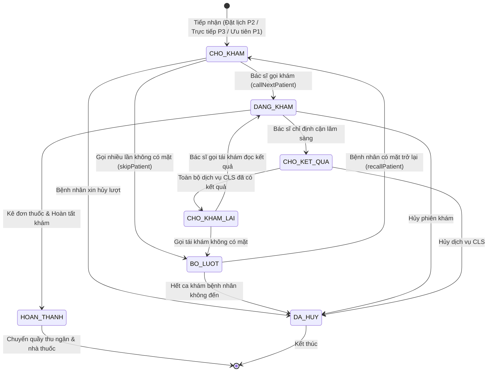

# SMARTCARE HYBRID QUEUE — PHASE 3.5 FINAL SPECIFICATION & SCHEMA AUDIT

> **MỤC TIÊU**: Kiểm kê toàn diện cấu trúc Model, Controller, Schema CSDL và trạng thái luân chuyển thực tế trong dự án SmartCare. Thiết lập đặc tả kỹ thuật chi tiết cho `QueueManagementService` trước khi tiến hành code.  
> **NGÀY THỰC HIỆN**: 2026-11-04  
> **NGUYÊN TẮC AN TOÀN**:  
> - Tuyệt đối READ-ONLY trong Phase 3.5 (0 file code sửa, 0 dòng CSDL ghi).  
> - Chưa tạo `QueueManagementService.php`.  
> - Chưa sửa Controller, Model hoặc giao diện.  
> - Không tự ý suy diễn hoặc hardcode các chính sách nghiệp vụ chưa được xác nhận.

---

## PHẦN A — BẢN ĐỒ THỰC TẾ CÁC MODEL VÀ CƠ SỞ DỮ LIỆU

### 1. Bảng đối soát cấu trúc Model và Schema CSDL

| Tên Bảng (DB) | Model Eloquent | Khóa chính (PK) | Các cột quan trọng hiện tại | Quan hệ liên kết đã có trong Model |
| :--- | :--- | :--- | :--- | :--- |
| `luot_kham` | [LuotKham.php](file:///c:/Users/admin/quanlytkbieu-app/Nhom9-DALN/app/Models/LuotKham.php) | `MaLuotKham` (`int`) | `MaLichHen` (UNIQUE, null), `MaBenhNhan`, `MaBacSi` (nullable), `ThoiGianTiepNhan`, `ThoiGianBatDauKham`, `ThoiGianKetThucKham`, `TrangThai`, `GhiChu`<br>*Cột Hybrid Queue (DB test)*: `NgayKham`, `LoaiHangDoi`, `SoPhieu`, `STTTrongNgay`, `MaChuyenKhoa`, `MaCaKham`, `MucUuTien`, `ThoiGianVaoHang`, `ThoiGianGoiKham`, `NguoiXacNhanUuTien`, `LyDoUuTien` | `lichHen()` (1-1/belongsTo), `benhNhan()` (belongsTo), `bacSi()` (belongsTo), `phieuKham()` (hasOne), `donThuoc()` (hasOne), `hoaDon()` (hasOne), `chiDinhDichVus()` (hasMany) |
| `lich_hen` | [LichHen.php](file:///c:/Users/admin/quanlytkbieu-app/Nhom9-DALN/app/Models/LichHen.php) | `MaLichHen` (`int`) | `MaBenhNhan`, `MaCaKham`, `LyDoKham`, `NgayDat`, `TrangThai` | `benhNhan()` (belongsTo), `caKham()` (belongsTo), `luotKham()` (hasOne) |
| `ca_kham` | [CaKham.php](file:///c:/Users/admin/quanlytkbieu-app/Nhom9-DALN/app/Models/CaKham.php) | `MaCaKham` (`int`) | `MaLichLamViec`, `GioBatDau`, `GioKetThuc`, `SoLuongTiepNhan`, `TrangThai` | `lichLamViec()` (belongsTo), `lichHens()` (hasMany) |
| `lich_lam_viec` | [LichLamViec.php](file:///c:/Users/admin/quanlytkbieu-app/Nhom9-DALN/app/Models/LichLamViec.php) | `MaLichLamViec` (`int`) | `MaBacSi`, `NgayLamViec`, `GioBatDau`, `GioKetThuc`, `SoLuongTiepNhan`, `TrangThai` | `bacSi()` (belongsTo), `caKhams()` (hasMany) |
| `bac_si` | [BacSi.php](file:///c:/Users/admin/quanlytkbieu-app/Nhom9-DALN/app/Models/BacSi.php) | `MaBacSi` (`int`) | `MaTaiKhoan` (UNIQUE), `MaChuyenKhoa`, `HoTen`, `HocVi`, `KinhNghiem`, `TrangThai` | `taiKhoan()` (belongsTo), `chuyenKhoa()` (belongsTo), `lichLamViecs()` (hasMany), `luotKhams()` (hasMany), `donThuocs()` (hasMany), `chiDinhDichVus()` (hasMany) |
| `tai_khoan` | [TaiKhoan.php](file:///c:/Users/admin/quanlytkbieu-app/Nhom9-DALN/app/Models/TaiKhoan.php) | `MaTaiKhoan` (`int`) | `MaVaiTro`, `TenDangNhap`, `MatKhau`, `Email`, `TrangThai`, `NgayTao` | `vaiTro()` (belongsTo), `benhNhan()` (hasOne), `bacSi()` (hasOne) |
| `chi_dinh_dich_vu`| [ChiDinhDichVu.php](file:///c:/Users/admin/quanlytkbieu-app/Nhom9-DALN/app/Models/ChiDinhDichVu.php) | `MaChiDinh` (`int`) | `MaLuotKham`, `MaPhieuKham`, `MaDichVu`, `MaBacSi`, `MaNhanVienThucHien`, `TrangThai`, `KetQua`, `KetLuan` | `luotKham()` (belongsTo), `phieuKham()` (belongsTo), `dichVu()` (belongsTo), `bacSi()` (belongsTo) |
| `hang_doi_counter`| Chưa có Model (DB test) | `(NgayKham, MaCaKham, MaChuyenKhoa)` | `SoHienTai` (`int`), `UpdatedAt` (`datetime`) | Bảng bộ đếm độc lập bảo vệ bằng khóa chính đa cột |

---

## PHẦN B — KIỂM KÊ VÀ BẢN ĐỒ TRẠNG THÁI (STATE MACHINE AUDIT)

### 1. Bảng kiểm kê trạng thái thực tế của `luot_kham`

Qua kiểm tra trực tiếp mã nguồn trong [LuotKhamController.php](file:///c:/Users/admin/quanlytkbieu-app/Nhom9-DALN/app/Http/Controllers/LuotKhamController.php), [ChiDinhDichVuController.php](file:///c:/Users/admin/quanlytkbieu-app/Nhom9-DALN/app/Http/Controllers/ChiDinhDichVuController.php) và [CanLamSangController.php](file:///c:/Users/admin/quanlytkbieu-app/Nhom9-DALN/app/Http/Controllers/CanLamSangController.php), hệ thống hiện có các trạng thái sau:

| Tên Trạng Thái | Tồn tại trong CSDL / Code | Ý nghĩa nghiệp vụ hiện tại | File & Phương thức quản lý | Trạng thái tiếp theo hợp lệ | Có được gọi lại? | Có được hủy? |
| :--- | :---: | :--- | :--- | :--- | :---: | :---: |
| **`CHO_KHAM`** | CSDL & Code | Bệnh nhân đã được tiếp nhận, ngồi tại sảnh chờ bác sĩ gọi vào phòng | `LuotKhamController::store`<br>`LuotKhamController::index` | `DANG_KHAM`<br>`BO_LUOT`<br>`DA_HUY` | Không (Chờ gọi lần 1) | **CÓ** |
| **`DANG_KHAM`** | CSDL & Code | Bác sĩ đang trực tiếp khám lâm sàng cho bệnh nhân trong phòng | `LuotKhamController::startExamine`<br>`LuotKhamController::savePhieuKham` | `CHO_KET_QUA` (Chỉ định CLS)<br>`HOAN_THANH`<br>`DA_HUY` | Không (Đang khám) | **CÓ** |
| **`CHO_KET_QUA`**| CSDL & Code | Bệnh nhân đã được chỉ định CLS, rời phòng khám để đi xét nghiệm/chụp phim | `ChiDinhDichVuController::store`<br>`CanLamSangController::saveKetQua` | `CHO_KHAM_LAI`<br>`DA_HUY` | Không (Đang làm CLS) | **CÓ** |
| **`CHO_KHAM_LAI`**| CSDL & Code | Toàn bộ chỉ định CLS đã có kết quả; bệnh nhân quay lại phòng khám chờ bác sĩ kết luận | `CanLamSangController::saveKetQua`<br>`LuotKhamController::savePhieuKham` | `DANG_KHAM`<br>`BO_LUOT`<br>`DA_HUY` | **CÓ** | **CÓ** |
| **`HOAN_THANH`** | CSDL & Code | Đã kết luận bệnh án, kê đơn thuốc; kết thúc phiên khám lâm sàng | `LuotKhamController::completeExamine` | *Trạng thái cuối (Terminal)* | **KHÔNG** | **KHÔNG** |
| **`DA_HUY`** | CSDL & Code | Lượt khám bị hủy bỏ do bệnh nhân từ chối khám hoặc lỗi tiếp nhận | Các Controller kiểm tra chặn | *Trạng thái cuối (Terminal)* | **KHÔNG** | **KHÔNG** |
| **`BO_LUOT`** | *Chưa có trong Code* | Bác sĩ gọi số trên loa nhưng bệnh nhân vắng mặt tại cửa phòng khám | *Đề xuất bổ sung cho Hàng đợi* | `CHO_KHAM` (Khi lễ tân gọi lại)<br>`DA_HUY` (Hết ca không đến) | **CÓ** (Bắt buộc) | **CÓ** |
| **`DANG_GOI`** | *Chưa có trong Code* | Trạng thái nhấp nháy màn hình sảnh chờ khi loa đang phát tín hiệu | *Chưa cần thiết; hiện dùng `CHO_KHAM` -> `DANG_KHAM`* | `DANG_KHAM`<br>`BO_LUOT` | — | — |

---

### 2. Sơ đồ luân chuyển trạng thái (State Diagram)



---

## PHẦN C — XÁC MINH CÁC MỐI QUAN HỆ & ĐIỀU KIỆN RÀNG BUỘC HIỆN TẠI

1. **Quan hệ `LichHen` $\leftrightarrow$ `LuotKham`**:
   - Khóa ngoại: `luot_kham.MaLichHen` trỏ sang `lich_hen.MaLichHen`.
   - Ràng buộc: `UNIQUE KEY MaLichHen` trên bảng `luot_kham`.
   - *Ý nghĩa*: CSDL vật lý đảm bảo **1 lịch hẹn chỉ được tạo tối đa 1 lượt khám**. Nếu khám trực tiếp, `MaLichHen = NULL`.
2. **Quan hệ `LuotKham` $\leftrightarrow$ `BacSi`**:
   - `luot_kham.MaBacSi` trỏ sang `bac_si.MaBacSi`. Sau Migration 1, cột này là `NULLABLE`, cho phép tiếp nhận tại quầy trước khi phân bổ vào phòng bác sĩ.
3. **Cách xác định chuyên khoa của Bác sĩ**:
   - Bảng `bac_si` có cột `MaChuyenKhoa NOT NULL`.
   - Lấy chuyên khoa: `$bacSi->chuyenKhoa->TenChuyenKhoa`. Mỗi bác sĩ thuộc cố định duy nhất một chuyên khoa.
4. **Cách xác định Bác sĩ có lịch làm việc trong ca**:
   - `ca_kham` $\rightarrow$ `lich_lam_viec.MaBacSi`. Bác sĩ $B$ phụ trách ca $C$ khi:  
     `CaKham::where('MaCaKham', $C)->whereHas('lichLamViec', fn($q) => $q->where('MaBacSi', $B))->exists()`.
5. **Cách xác định ca khám đang mở tiếp nhận**:
   - Điều kiện: `ca_kham.TrangThai = 'CON_TRONG'` VÀ `lich_lam_viec.TrangThai = 'MO'` VÀ `lich_lam_viec.NgayLamViec = today()`.
6. **Cách xác định Bác sĩ đang có ca `DANG_KHAM`**:
   - Điều kiện: `LuotKham::where('MaBacSi', $B)->where('TrangThai', 'DANG_KHAM')->whereDate('NgayKham', today())->exists()`.
   - *Quy tắc*: Nếu đã tồn tại, bác sĩ không được gọi thêm bệnh nhân mới cho đến khi hoàn thành hoặc chuyển bệnh nhân hiện tại sang `CHO_KET_QUA`.
7. **Cách liên kết kết quả Cận lâm sàng**:
   - `chi_dinh_dich_vu.MaLuotKham` liên kết trực tiếp với lượt khám gốc.
   - Khi kỹ thuật viên lưu kết quả: nếu toàn bộ chỉ định của lượt khám đã xong (`pendingCount === 0`), `luot_kham.TrangThai` tự động chuyển thành `'CHO_KHAM_LAI'`. Bệnh nhân không được tạo lượt khám mới, giữ nguyên số phiếu và lịch sử điều trị.
8. **Cách xác định tài khoản và quyền người thực hiện**:
   - Đối tượng: Model `TaiKhoan` (Authenticatable).
   - Kiểm tra vai trò: `$user->hasRole('LE_TAN')`, `$user->hasRole('BAC_SI')`, `$user->hasRole('QUAN_TRI_VIEN')`.
   - Lấy mã định danh bác sĩ: `$user->bacSi?->MaBacSi`.

---

## PHẦN D — ĐẶC TẢ CHI TIẾT 5 PHƯƠNG THỨC QUEUE MANAGEMENT SERVICE

### 1. `checkInAppointment(int $maLichHen, ?int $nguoiTiepNhanId): LuotKham`
- **Điều kiện đầu vào**:
  - `MaLichHen` tồn tại trong bảng `lich_hen`.
  - `lich_hen.TrangThai == 'DA_XAC_NHAN'` (Lịch đã được duyệt).
  - Ngày của lịch hẹn phải là ngày hiện tại (`NgayLamViec == today()`).
- **Kiểm tra quyền**:
  - Người thực hiện phải là Lễ tân (`isLeTan()`) hoặc Quản trị viên (`isQuanTriVien()`).
- **Trạng thái**:
  - `lich_hen.TrangThai`: `'DA_XAC_NHAN'` $\rightarrow$ `'DA_TIEP_NHAN'`.
  - `luot_kham`: Tạo mới với `TrangThai = 'CHO_KHAM'`, `MucUuTien = 2` (P2), `LoaiHangDoi = 'DAT_LICH'`.
- **Dữ liệu cần khóa (Concurrency Lock)**:
  - Khóa dòng lịch hẹn: `LichHen::where('MaLichHen', $maLichHen)->lockForUpdate()->first();` (Chống 2 lễ tân bấm check-in cùng lúc).
  - Khóa hoặc cấp số nguyên tử trên `hang_doi_counter` (xem chi tiết mục Giải pháp chống Gap Lock bên dưới).
- **Điều kiện kiểm tra lại trước khi Commit**:
  - `LuotKham::where('MaLichHen', $maLichHen)->exists()` phải là FALSE trước khi INSERT.

---

### 2. `registerWalkIn(int $maBenhNhan, int $maChuyenKhoa, int $maCaKham, int $mucUuTien, ?int $nguoiXacNhanId, ?string $lyDoUuTien): LuotKham`
- **Điều kiện đầu vào**:
  - `MaBenhNhan` tồn tại và đang hoạt động.
  - `MaChuyenKhoa` và `MaCaKham` hợp lệ, ca khám đang mở trong ngày.
  - Mức ưu tiên: $P0$ (Cấp cứu), $P1$ (Chính sách), $P3$ (Trực tiếp thông thường).
  - Nếu $P0$ hoặc $P1$: Bắt buộc phải có `nguoiXacNhanId` và `lyDoUuTien`.
- **Kiểm tra quyền**:
  - Lễ tân hoặc Bác sĩ trực.
- **Trạng thái**:
  - Nếu $P0$ (Cấp cứu): `TrangThai = 'DANG_KHAM'` (hoặc đưa thẳng vào buồng cấp cứu, không qua hàng đợi).
  - Nếu $P1, P3$: `TrangThai = 'CHO_KHAM'`.
- **Dữ liệu cần khóa**:
  - Khóa nguyên tử bộ đếm `hang_doi_counter` theo `(NgayKham, MaCaKham, MaChuyenKhoa)`.
- **Điều kiện kiểm tra lại trước khi Commit**:
  - Ca khám `ca_kham.TrangThai` vẫn đang mở tiếp nhận.

---

### 3. `callNextPatient(int $maBacSi, int $maCaKham): ?LuotKham`
- **Điều kiện đầu vào**:
  - `MaBacSi` và `MaCaKham` hợp lệ.
  - Bác sĩ phải có lịch làm việc trong ca khám này.
- **Kiểm tra quyền**:
  - Bác sĩ thực hiện phải chính là bác sĩ của ca trực (`$user->bacSi->MaBacSi === $maBacSi`).
- **Điều kiện nghiệp vụ quan trọng**:
  - **Bác sĩ không được có lượt khám nào đang ở trạng thái `DANG_KHAM` hôm nay**. Nếu có, từ chối gọi tiếp cho đến khi bác sĩ nhấn kết luận hoàn thành hoặc chỉ định CLS cho bệnh nhân hiện tại.
- **Truy vấn chọn bệnh nhân (Khóa bi quan an toàn)**:
  ```sql
  SELECT * FROM luot_kham
  WHERE NgayKham = CURRENT_DATE
    AND MaCaKham = :maCaKham
    AND MaChuyenKhoa = :maChuyenKhoa
    AND TrangThai IN ('CHO_KHAM', 'CHO_KHAM_LAI')
  ORDER BY 
    CASE 
      WHEN TrangThai = 'CHO_KHAM_LAI' THEN 1  -- Ưu tiên tái khám CLS
      ELSE 2 
    END ASC,
    MucUuTien ASC,                            -- P1 -> P2 -> P3
    ThoiGianVaoHang ASC                       -- FIFO
  LIMIT 1
  FOR UPDATE;
  ```
- **Trạng thái**:
  - `TrangThai`: `'CHO_KHAM'` hoặc `'CHO_KHAM_LAI'` $\rightarrow$ `'DANG_KHAM'`.
  - Cập nhật `ThoiGianGoiKham = now()`, `ThoiGianBatDauKham = now()`, `MaBacSi = $maBacSi`.

---

### 4. `skipPatient(int $maLuotKham, int $maBacSi, ?string $lyDo = null): LuotKham`
- **Làm rõ nghiệp vụ bỏ lượt**:
  - Bỏ lượt **CHỈ ÁP DỤNG khi bệnh nhân đang ở trạng thái chờ khám (`CHO_KHAM` hoặc `CHO_KHAM_LAI`)** mà bác sĩ đã gọi qua loa/màn hình nhưng không vào phòng.
  - **KHÔNG áp dụng `skipPatient` cho bệnh nhân đang trong phiên khám (`DANG_KHAM`)**. Nếu bệnh nhân đang khám mà bỏ dở, đó là nghiệp vụ "Hủy khám / Bệnh nhân tự ý rời đi", cần ghi nhận vào biên bản bệnh án, không phải bỏ lượt hàng đợi.
- **Trạng thái**:
  - `TrangThai`: `'CHO_KHAM'` hoặc `'CHO_KHAM_LAI'` $\rightarrow$ `'BO_LUOT'`.
  - Lưu `GhiChu`: Thời điểm bỏ lượt, lý do và tên bác sĩ thực hiện.

---

### 5. `recallPatient(int $maLuotKham, int $nguoiGoiId): LuotKham`
- **Điều kiện đầu vào**:
  - Lượt khám đang ở trạng thái `'BO_LUOT'`.
  - Tuyệt đối từ chối nếu lượt khám đã `'HOAN_THANH'` hoặc `'DA_HUY'`.
- **Kiểm tra quyền**:
  - Lễ tân hoặc Bác sĩ phụ trách phòng khám.
- **Quy tắc xếp chỗ khi gọi lại**:
  - Chuyển `TrangThai = 'CHO_KHAM'`.
  - Cập nhật `ThoiGianVaoHang = now()`.
  - *Ý nghĩa*: Bệnh nhân bỏ lượt khi quay lại sẽ được xếp vào cuối hàng của mức ưu tiên đó (FIFO theo thời điểm có mặt trở lại), không được chen ngang trước các bệnh nhân đã đến đúng giờ.

---

## PHẦN E — GIẢI QUYẾT RỦI RO KỸ THUẬT VỀ GAP LOCK TRÊN COUNTER

> [!IMPORTANT]
> **VẤN ĐỀ ĐƯỢC NGƯỜI DÙNG PHÁT HIỆN**:
> Nếu dòng `(NgayKham, MaCaKham, MaChuyenKhoa)` **chưa tồn tại** trong bảng `hang_doi_counter`, lệnh `SELECT ... FOR UPDATE` sẽ đặt một **Gap Lock** trên MySQL InnoDB. Nếu 2 request cùng thực hiện đồng thời, cả hai cùng nhận Gap Lock rồi cùng chạy `INSERT`, dẫn đến **Deadlock (MySQL Error 1213)** ngay lập tức!

### Giải pháp kỹ thuật khắc phục triệt để:
Không dùng `SELECT ... FOR UPDATE` khi dòng chưa tồn tại. Thay vào đó, áp dụng **Atomic Upsert với `LAST_INSERT_ID()`**:

```sql
-- Câu lệnh nguyên tử 100% trong MySQL: Không bao giờ bị Deadlock do Gap Lock
INSERT INTO hang_doi_counter (NgayKham, MaCaKham, MaChuyenKhoa, SoHienTai, UpdatedAt)
VALUES (:ngayKham, :maCaKham, :maChuyenKhoa, LAST_INSERT_ID(1), NOW())
ON DUPLICATE KEY UPDATE 
    SoHienTai = LAST_INSERT_ID(SoHienTai + 1),
    UpdatedAt = NOW();

-- Lấy chính xác giá trị STT vừa được tăng nguyên tử của riêng transaction này
SELECT LAST_INSERT_ID() AS NextSTT;
```

**Ưu điểm vượt trội**:
1. Nếu ca khám chưa có dòng nào trong ngày: Tự động khởi tạo `SoHienTai = 1`.
2. Nếu ca khám đã có dòng: Tự động tăng `SoHienTai + 1`.
3. Hàm `LAST_INSERT_ID()` trong MySQL là session-isolated: Trả về chính xác giá trị mà transaction hiện tại vừa tạo ra, không bị ảnh hưởng bởi transaction khác.
4. Không sinh Gap Lock, loại trừ 100% nguy cơ Deadlock cấp số đồng thời.

---

## PHẦN F — BẢNG PHÂN LOẠI QUY TẮC NGHIỆP VỤ CẦN XÁC NHẬN

| STT | Quy tắc nghiệp vụ | Phân loại | Đề xuất kỹ thuật sơ bộ |
| :---: | :--- | :---: | :--- |
| 1 | Bệnh nhân đặt lịch chỉ được cấp STT khi lễ tân check-in | **ĐÃ XÁC NHẬN** | Đúng thiết kế: Không cấp số ảo từ trước |
| 2 | Bệnh nhân trực tiếp chỉ cấp số sau khi chọn Chuyên khoa và Ca khám | **ĐÃ XÁC NHẬN** | Bắt buộc phải có `(MaChuyenKhoa, MaCaKham)` để scoped counter |
| 3 | Cấp cứu P0 đi luồng riêng, không vào hàng đợi thường | **ĐÃ XÁC NHẬN** | Vào thẳng buồng cấp cứu |
| 4 | Đặt lịch P2 ưu tiên trước Trực tiếp tiêu chuẩn P3 | **ĐÃ XÁC NHẬN** | `MucUuTien = 2` < `MucUuTien = 3` |
| 5 | Tái khám sau CLS giữ nguyên lượt khám cũ, không tạo số phiếu mới | **ĐÃ XÁC NHẬN** | Dùng `CHO_KHAM_LAI` trên cùng `MaLuotKham` |
| 6 | **Độ tuổi và tiêu chí gán Ưu tiên P1** | **CẦN NHÓM XÁC NHẬN** | Đề xuất: Trẻ em $< 6$ tuổi, người cao tuổi $\ge 75$ tuổi. Cần Lễ tân đối chiếu giấy tờ thực tế. |
| 7 | **Vị trí của Bệnh nhân tái khám CLS (`CHO_KHAM_LAI`) so với bệnh nhân mới** | **CẦN NHÓM XÁC NHẬN** | Đề xuất: Bác sĩ gọi xen kẽ (1 bệnh nhân tái khám CLS xen giữa 1-2 bệnh nhân mới) để không làm dồn ứ bệnh nhân mới. |
| 8 | **Thời gian cho phép Bệnh nhân đặt lịch đến muộn (Grace Period)** | **CẦN NHÓM XÁC NHẬN** | Đề xuất: Quá 30 phút so với giờ hẹn mà không check-in thì lịch hẹn tự động chuyển sang `DA_HUY` hoặc chuyển thành Trực tiếp P3. |
| 9 | **Số lần gọi trước khi bấm Bỏ lượt (`BO_LUOT`)** | **CẦN NHÓM XÁC NHẬN** | Đề xuất: Tối đa 3 lần gọi qua loa/màn hình cách nhau 1-2 phút. |
| 10 | **Thời hạn tối đa để Bệnh nhân bỏ lượt xin Gọi lại (`recallPatient`)** | **CẦN NHÓM XÁC NHẬN** | Đề xuất: Chỉ được gọi lại trong cùng buổi khám (sáng/chiều). Qua ca làm việc tự động hủy. |

---

## KẾT LUẬN CỦA PHASE 3.5

# **READY FOR IMPLEMENTATION**
*(Đã sẵn sàng để xây dựng `QueueManagementService.php` và bộ Feature Test đồng thời trên môi trường `phong_kham_hybrid_queue_test` ngay sau khi người dùng phê duyệt)*.
