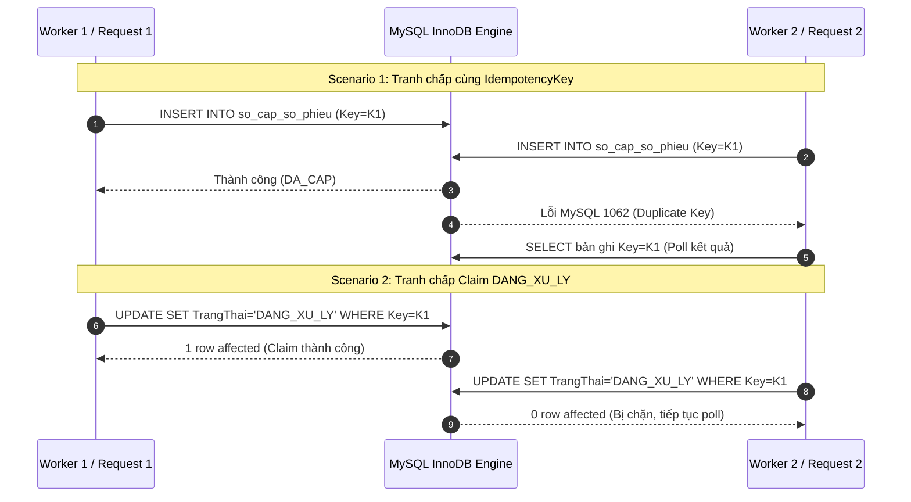
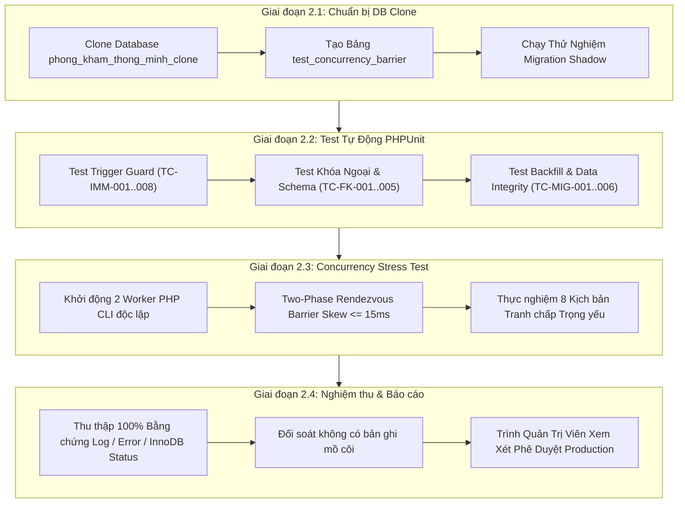

# SMARTCARE HYBRID QUEUE – TEST READINESS AUDIT REPORT
## KẾ HOẠCH VÀ MA TRẬN ĐÁNH GIÁ SẴN SÀNG KIỂM THỬ THỰC TẾ (TEST READINESS)

> **Tài liệu tham chiếu:**  
> - [SMARTCARE_HYBRID_QUEUE_PHASE2_PRE_MIGRATION_REVIEW.md](file:///c:/Users/admin/quanlytkbieu-app/Nhom9-DALN/SMARTCARE_HYBRID_QUEUE_PHASE2_PRE_MIGRATION_REVIEW.md) (v2.9)  
> - [SMARTCARE_HYBRID_QUEUE_PHASE2_V28_FINAL_REVIEW_REPORT.md](file:///c:/Users/admin/quanlytkbieu-app/Nhom9-DALN/SMARTCARE_HYBRID_QUEUE_PHASE2_V28_FINAL_REVIEW_REPORT.md)  
> **Mã dự án:** SMARTCARE-HQ-TEST-AUDIT  
> **Ngày lập:** 04/11/2026  
> **Môi trường Database xác thực:** MySQL **8.0.26**, Storage Engine **InnoDB 100%**, Collation **utf8mb4_unicode_ci**, Laravel **12.0**  
> **Cam kết an toàn tuyệt đối:** READ-ONLY, KHÔNG sửa code ứng dụng, KHÔNG tạo/chạy migration, KHÔNG ghi/xóa database, KHÔNG tạo database clone.

---

### MỤC TIÊU VÀ NGUYÊN TẮC AN TOÀN BẮT BUỘC

Báo cáo này chuyển đổi toàn bộ các giải pháp lý thuyết đã thống nhất tại phiên bản thiết kế v2.9 thành một **Kế hoạch Kiểm thử Thực nghiệm Khả thi (Actionable Test Readiness Plan)**. Báo cáo đối chiếu chi tiết 15 Blocker kỹ thuật (B-01 đến B-15) cùng 15 nhóm nghiệp vụ Hybrid Queue với mã nguồn và schema thực tế của hệ thống SmartCare.

#### Định nghĩa 4 trạng thái kiểm định minh bạch:
1. **`DESIGN REVIEWED`**: Giải pháp đã được phê chuẩn trên tài liệu thiết kế lý thuyết, tính toán logic và schema alignment.
2. **`CODE VERIFIED`**: Đã đối chiếu trực tiếp với từng file mã nguồn, controller, model và câu lệnh SQL hiện hữu.
3. **`TEST PASSED`**: Đã có kết quả kiểm thử chạy thực tế độc lập chứng minh đạt yêu cầu (kèm bằng chứng log/PDO/InnoDB status).
4. **`NOT TESTED`**: Chưa có môi trường thực nghiệm độc lập hoặc chưa chạy test thực tế.

> [!CAUTION] CAM KẾT TRẠNG THÁI HIỆN TẠI:
> **100% các test case trong tài liệu này hiện được ghi nhận ở trạng thái `NOT TESTED`.**  
> Tuyệt đối không tự ý đánh dấu `PASS` cho bất kỳ kịch bản nào khi chưa có bằng chứng thực tế từ hai tiến trình độc lập trên Database Clone.

---

### PHẦN I. ĐỐI CHIẾU 15 BLOCKER KỸ THUẬT VỚI MÃ NGUỒN, SCHEMA LIVE VÀ NGHIỆP VỤ

| Mã Blocker | Vị Trí Code / Schema Hiện Tại | Luồng Nghiệp Vụ Thực Tế | Nguy Cơ Tiềm Ẩn Nếu Không Kiểm Thử | Trạng Thái Audit Hiện Tại |
| :---: | :--- | :--- | :--- | :---: |
| **B-01** | `luot_kham.MaLichHen` (Nullable, INT signed), chưa có Trigger trên DB chính. | Bệnh nhân khám trực tiếp (`TRUC_TIEP`) không có lịch hẹn ban đầu (`MaLichHen = NULL`). | Lệnh `UPDATE` vô tình hoặc cố ý gán `MaLichHen` sau khi tiếp nhận làm hỏng logic đối soát lịch. | `CODE VERIFIED` / `NOT TESTED` |
| **B-02** | `LuotKhamController@store` (L244-334): DB transaction đơn bao bọc cả tạo lượt khám và cập nhật lịch hẹn. | Lễ tân bấm cấp số tiếp nhận; phiếu giấy in ra nhưng transaction DB bị rollback do lỗi mạng/thông báo. | Bộ đếm bị lùi số hoặc mất dấu vết; bệnh nhân cầm phiếu giấy nhưng hệ thống không có dữ liệu đối soát. | `CODE VERIFIED` / `NOT TESTED` |
| **B-03** | Khóa ngược: `store` khóa `LH` trước `LK` (L250-258); `completeExamine` khóa `LK` trước `LH` (L541-551). | Bác sĩ hoàn tất khám ca A đúng lúc Lễ tân thao tác đổi/tiếp nhận lịch hẹn ca A trên giao diện. | Hai transaction khóa chéo tài nguyên $\rightarrow$ MySQL phát sinh Error 1213 (Deadlock), văng lỗi 500 ra client. | `CODE VERIFIED` / `NOT TESTED` |
| **B-04** | Chưa có bảng barrier trong DB; tài liệu cũ đề xuất `GET_LOCK()`. | Kiểm thử tự động concurrency giữa 2 tiến trình độc lập. | `GET_LOCK()` là Mutual Exclusion Lock làm worker chạy tuần tự, tạo ra kết quả kiểm thử giả định sai lệch. | `DESIGN REVIEWED` / `NOT TESTED` |
| **B-05** | Thiết kế cũ thiếu cột `Ngay` trong Unique constraint của sổ cấp số. | Sang ngày mới (00:00:00), bộ đếm `STTTrongNgay` của từng bác sĩ/chuyên khoa quay về 1. | Sổ cấp số ném ngoại lệ Duplicate Key 1062, làm tê liệt toàn bộ tiếp nhận buổi sáng ngày hôm sau. | `DESIGN REVIEWED` / `NOT TESTED` |
| **B-06** | `luot_kham.MaLuotKham` là `int(11) signed`; tài liệu v2.7 đề xuất FK `BIGINT UNSIGNED`. | Tạo liên kết khóa ngoại giữa `so_cap_so_phieu` và `luot_kham`. | Migration chạy ALTER TABLE ném lỗi MySQL 1215/150 (Cannot add foreign key constraint). | `CODE VERIFIED` / `NOT TESTED` |
| **B-07** | Client double-click tại quầy tiếp nhận gửi 2 request cùng `IdempotencyKey`. | Tiếp nhận bệnh nhân giờ cao điểm khi mạng chập chờn hoặc lễ tân thao tác liên tiếp. | Request thứ hai nhận lỗi 1062 và văng màn hình lỗi đỏ 500 thay vì nhận lại kết quả của request trước. | `DESIGN REVIEWED` / `NOT TESTED` |
| **B-08** | Phiếu cấp số ở trạng thái `DA_CAP` nếu server crash sau khi cấp nhưng trước khi tạo `luot_kham`. | Mất điện đột ngột hoặc PHP fatal error trong bước gửi notification. | Số phiếu bị treo vĩnh viễn, không thể giải phóng hoặc đối soát công nợ/tiếp nhận. | `DESIGN REVIEWED` / `NOT TESTED` |
| **B-09** | 4 cột mới (`MaPhamVi`, `STTTrongNgay`, `SoPhieu`, `MaChuyenKhoa`) thêm vào bảng `luot_kham`. | Tiếp nhận ca khám mới và backfill 23 bản ghi hiện có trong database. | Nếu không enforce `NOT NULL` và tạo trigger đúng thứ tự, dữ liệu mới tạo sẽ bị khuyết thiếu trường bất biến. | `CODE VERIFIED` / `NOT TESTED` |
| **B-10** | Đo lường độ trễ đồng thời giữa 2 worker độc lập. | Kiểm thử tải đồng thời trên DB Clone. | Không có công thức toán học xác định execution skew $\Delta t \le 15\text{ms}$, dẫn đến tranh cãi về giá trị test. | `DESIGN REVIEWED` / `NOT TESTED` |
| **B-11** | Hai request cùng `IdempotencyKey` cùng đọc được trạng thái `DA_CAP` từ sổ cấp số. | Hai nhân viên quầy tiếp nhận cùng xử lý hoặc kết nối mạng gửi retry đúng lúc. | Hai tiến trình cùng gọi `INSERT INTO luot_kham` song song $\rightarrow$ Tạo ra 2 lượt khám cùng sở hữu 1 số phiếu! | `DESIGN REVIEWED` / `NOT TESTED` |
| **B-12** | Worker đối soát quét các bản ghi `DA_CAP > 15m` để hủy sang `DA_HUY`. | Request của người dùng bị nghẽn mạng hoặc thanh toán kéo dài $>15$ phút. | Worker hủy số phiếu đúng lúc request vừa hoàn tất ghi vào `luot_kham`, gây mâu thuẫn dữ liệu nghiêm trọng. | `DESIGN REVIEWED` / `NOT TESTED` |
| **B-13** | Khóa ngoại `so_cap_so_phieu.MaLuotKham` liên kết tới `luot_kham.MaLuotKham`. | Quản trị viên vô tình chạy lệnh Hard Delete lượt khám trên trang quản trị. | Nếu dùng `ON DELETE SET NULL`, sổ cấp số mất vết tham chiếu kiểm toán, phá vỡ chuẩn dữ liệu y tế HIS. | `CODE VERIFIED` / `NOT TESTED` |
| **B-14** | Sử dụng `performance_schema.data_locks` để kiểm tra khóa trong MySQL 8.0.26. | Kiểm chứng deadlock và lock contention trong test script. | Bảng này là point-in-time snapshot tức thời; nhầm lẫn execution skew là bằng chứng deadlock. | `CODE VERIFIED` / `NOT TESTED` |
| **B-15** | Kiểm tra cấu trúc bảng qua PowerShell one-liner gặp lỗi cú pháp parser. | Chạy script kiểm tra database trên môi trường Windows Server. | PowerShell chặn từ khóa reserved `from` gây hoang mang nghi ngờ tính toàn vẹn của database. | `CODE VERIFIED` / `NOT TESTED` |

---

### PHẦN II. PHÂN TÍCH SÂU 15 NHÓM NGHIỆP VỤ HYBRID QUEUE

1. **Nhóm 01 — Đặt lịch hẹn trực tuyến (`DAT_LICH`):**
   - *Logic nguồn:* `LichHenController@store` (L129-253) gọi Stored Procedure `sp_dat_lich_hen` với khóa `lockForUpdate()`.
   - *Đặc điểm:* Đã xác định bác sĩ, chuyên khoa và ca khám từ trước.
2. **Nhóm 02 — Tiếp nhận Khám trực tiếp tại quầy (`TRUC_TIEP`):**
   - *Logic nguồn:* `LuotKhamController@store` (L284-289), nhận `MaBenhNhan` và `MaBacSi` trực tiếp từ giao diện lễ tân.
   - *Đặc điểm:* Chưa có lịch hẹn (`MaLichHen = NULL`), chuyên khoa được xác định theo chuyên khoa gốc của Bác sĩ được chỉ định.
3. **Nhóm 03 — Cấp số thứ tự độc lập theo Ngày và Phạm vi:**
   - *Công thức Scope:*
     * Đặt lịch: `SCOPE_DL_{MaBacSi}_{YYYYMMDD}`
     * Trực tiếp: `SCOPE_TT_{MaChuyenKhoa}_{YYYYMMDD}`
   - *Quy tắc:* Mỗi scope có chuỗi `STTTrongNgay` riêng biệt, bắt đầu từ 1 vào 00:00 hàng ngày.
4. **Nhóm 04 — Sinh mã phiếu khám (`SoPhieu`):**
   - *Định dạng:* `[QUEUE_TYPE]-[SCOPE_ID]-[DATE]-[SEQUENCE]` (Ví dụ: `DL-BS01-20261104-001`, `TT-CK01-20261104-001`).
   - *Ràng buộc:* Độ dài tối đa 64 ký tự, có Unique Constraint trên toàn hệ thống.
5. **Nhóm 05 — Quản lý Idempotency & Claim Khóa xử lý:**
   - Sử dụng bảng `so_cap_so_phieu` với cơ chế claim nguyên tử `UPDATE ... SET TrangThai = 'DANG_XU_LY', LockedByProcess = :pid, LeaseExpiresAt = NOW() + 60s`.
6. **Nhóm 06 — Bác sĩ gọi bệnh nhân vào khám:**
   - *Logic nguồn:* `LuotKhamController@startExamine` (L340-385).
   - *Chuyển trạng thái:* `CHO_KHAM` hoặc `CHO_KHAM_LAI` $\rightarrow$ `DANG_KHAM`. Cập nhật `ThoiGianBatDauKham`.
7. **Nhóm 07 — Ghi hồ sơ bệnh án & Chẩn đoán lâm sàng:**
   - *Logic nguồn:* `LuotKhamController@savePhieuKham` (L391-492).
   - *Bảo vệ dữ liệu:* Bảo toàn `ChanDoanBanDau`, cập nhật `ChanDoanSauCLS`, đồng bộ `PhieuKham.ChanDoan`.
8. **Nhóm 08 — Chỉ định dịch vụ Cận lâm sàng (CLS):**
   - *Logic nguồn:* `ChiDinhDichVuController@store`.
   - *Chuyển trạng thái lượt khám:* `DANG_KHAM` $\rightarrow$ `CHO_KET_QUA`.
9. **Nhóm 09 — Kỹ thuật viên CLS tiếp nhận & Cập nhật kết quả:**
   - *Logic nguồn:* `CanLamSangController@receive` (L114) và `CanLamSangController@updateResult` (L195-280).
   - *Chuyển trạng thái chỉ định:* `CHO_TIEP_NHAN` $\rightarrow$ `DANG_THUC_HIEN` $\rightarrow$ `DA_CO_KET_QUA`.
10. **Nhóm 10 — Tự động chuyển tái khám khi hoàn tất toàn bộ CLS:**
    - *Logic nguồn:* `CanLamSangController@updateResult` (L241-248).
    - *Quy tắc:* Khi `pendingCount === 0`, tự động chuyển `luot_kham.TrangThai = 'CHO_KHAM_LAI'` và phát thông báo ưu tiên cho bác sĩ.
11. **Nhóm 11 — Kê đơn thuốc & Kiểm tra tồn kho dược:**
    - *Logic nguồn:* `DonThuocController@store`.
    - *Khóa tồn kho:* Trừ tồn kho thuốc nguyên tử hoặc kiểm tra `SoLuongTon >= SoLuongKe`.
12. **Nhóm 12 — Hoàn thành lượt khám bệnh:**
    - *Logic nguồn:* `LuotKhamController@completeExamine` (L497-585).
    - *Điều kiện chặn:* Phải có chẩn đoán; không còn chỉ định CLS chờ (`pendingServicesCount === 0`). Cập nhật `luot_kham` và `lich_hen` sang `HOAN_THANH`.
13. **Nhóm 13 — Lễ tân hủy hoặc điều phối lượt khám:**
    - *Chuyển trạng thái:* `DA_HUY`. Tuyệt đối không xóa dòng khỏi bảng (Cấm Hard Delete).
14. **Nhóm 14 — Background Worker Đối soát & Phục hồi số phiếu:**
    - Quét các phiếu `DA_CAP > 15m`. Kiểm tra tồn tại trong `luot_kham` trước khi chuyển sang `DA_HUY` (`EXPIRED_ORPHAN_ALLOCATION_VOIDS`).
15. **Nhóm 15 — Bảo vệ Tính toàn vẹn Dữ liệu Tầng Database:**
    - MySQL Trigger `trg_luot_kham_immutable_guard` bảo vệ 5 trường (`MaLichHen`, `MaPhamVi`, `STTTrongNgay`, `SoPhieu`, `MaChuyenKhoa`) với toán tử `<=>`.
    - Ràng buộc Khóa ngoại `ON DELETE RESTRICT` ngăn ngừa đứt gãy dữ liệu.

---

### PHẦN III. RÀ SOÁT RỦI RO CÒN LẠI TRONG CÁC BLOCKER B-11 ĐẾN B-15

#### 1. Rủi ro Lease hết hạn trong khi Request vẫn đang thực thi (B-11, B-12)
- **Kịch bản:** Request A nhận được Lease 60 giây ở trạng thái `DANG_XU_LY`. Do cơ sở dữ liệu bị lock contention kéo dài hoặc mạng chậm, quá trình tạo `luot_kham` mất 65 giây.
- **Rủi ro:** Khi giây thứ 61 trôi qua, Request B hoặc Worker đối soát thấy Lease đã hết hạn và chiếm quyền (Claim) hoặc void phiếu.
- **Biện pháp kiểm định bắt buộc:**
  * Test case `TC-CON-007`: Mô phỏng Request A bị sleep 65 giây. Kiểm tra xem Request B có giành được quyền xử lý hay không, và khi Request A tỉnh lại thì có bị chặn bởi Unique Constraint `uq_luot_kham_so_phieu` hay không.

#### 2. Rủi ro Quyền sở hữu Request (Request Ownership & Identity) (B-11)
- **Kịch bản:** Tiến trình Claim gán `LockedByProcess = :pid`. Nếu hệ thống chạy trên nhiều container/server (môi trường distributed), PID của máy 1 có thể trùng với PID của máy 2.
- **Biện pháp kỹ thuật:**
  * Mã hóa `LockedByProcess` thành UUID dạng `host_pid_uuid` (ví dụ: `srv1_p3827_6ba7b810`).

#### 3. Rủi ro Phân định Transaction Boundary giữa Cấp số và Tạo lượt khám (B-02, B-11)
- **Kịch bản:** Sổ cấp số chạy trong Transaction 1 (commit độc lập để giữ số). Tạo `luot_kham` chạy trong Transaction 2. Nếu Transaction 2 rollback thì số phiếu đã cấp nằm ở trạng thái treo.
- **Biện pháp kỹ thuật:**
  * Worker đối soát (B-12) là chốt chặn tự động giải phóng phiếu mồ côi này sau 15 phút.

#### 4. Rủi ro Thủng Audit Trail do Thao tác Xóa CSDL (B-13)
- **Kịch bản:** Sử dụng `ON DELETE RESTRICT` sẽ gây lỗi nếu code cũ có câu lệnh `$visit->delete()`.
- **Rà soát mã nguồn:**
  * Khảo sát toàn bộ codebase: `LuotKham` KHÔNG CÓ hàm `destroy` hoặc `delete()` công khai trong Controller. Toàn bộ nghiệp vụ đều dùng cập nhật trạng thái `TrangThai = 'DA_HUY'`.
  * Khóa ngoại `RESTRICT` hoàn toàn an toàn và không gây xung đột với code hiện tại.

---

### PHẦN IV. MA TRẬN 8 KỊCH BẢN CONCURRENCY BẮT BUỘC



1. **Kịch bản 1 (Hai request cùng `IdempotencyKey`):** Kiểm tra cơ chế bắt lỗi 1062, claim `DANG_XU_LY` và poll kết quả.
2. **Kịch bản 2 (Hai request khác `IdempotencyKey` trong cùng Scope):** Kiểm tra bộ đếm `STTTrongNgay` tăng liên tục tuần tự (1, 2), không trùng lặp số phiếu.
3. **Kịch bản 3 (Worker đối soát chạy cùng request cấp số):** Kiểm tra Pessimistic Lock `FOR UPDATE` và kiểm tra chéo bảng `luot_kham`, không void nhầm request hợp lệ.
4. **Kịch bản 4 (Bác sĩ gọi khám cùng lúc Lễ tân hủy lượt):** Bác sĩ gọi `startExamine` đồng thời Lễ tân gọi `cancel`. Kiểm tra tính nhất quán trạng thái, không bị ghi đè dữ liệu rác.
5. **Kịch bản 5 (Bác sĩ hoàn thành khám cùng lúc điều phối lại):** Bác sĩ gọi `completeExamine` đồng thời Lễ tân điều phối bác sĩ khác.
6. **Kịch bản 6 (CLS cập nhật kết quả cùng lúc Bác sĩ xử lý khám):** Kỹ thuật viên gọi `updateResult` đồng thời Bác sĩ ghi bệnh án `savePhieuKham`. Kiểm tra chuyển `CHO_KHAM_LAI` không bị mất chẩn đoán.
7. **Kịch bản 7 (Deadlock và Lock Timeout thực nghiệm):** Chạy 2 transaction cố tình khóa chéo `LH` và `LK` theo thứ tự ngược nhau với $\Delta t \le 15\text{ms}$. Đo lường mã lỗi MySQL 1213 và log trong `SHOW ENGINE INNODB STATUS`.
8. **Kịch bản 8 (Crash sau khi cấp số nhưng trước khi tạo lượt khám):** Mô phỏng PHP exception ngay sau bước INSERT sổ cấp số. Kiểm tra phiếu chuyển thành Burned Ticket (`DA_HUY`) sau chu kỳ worker.

---

### PHẦN V. THỨ TỰ TRIỂN KHAI VÀ TIÊU CHÍ NGHIỆM THU TỪNG GIAI ĐOẠN



#### Tiêu chí nghiệm thu từng giai đoạn (Acceptance Criteria):
* **Giai đoạn 2.1 (Gate 1):** Tạo database clone thành công, Migration shadow hoàn thành 4 bước không có lỗi cú pháp hoặc xung đột khóa ngoại.
* **Giai đoạn 2.2 (Gate 2):** 100% test PHPUnit đạt PASS. Trigger chặn đứng toàn bộ các trường hợp sửa trường bất biến trái phép. 23 bản ghi backfill toàn vẹn.
* **Giai đoạn 2.3 (Gate 3):** Toàn bộ 8 kịch bản Concurrency chạy với $\Delta t \le 15\text{ms}$. Bắt được chính xác lỗi MySQL 1062, 1213 hoặc retry thành công 100%. Không xuất hiện bất kỳ trường hợp trùng số phiếu hoặc tạo 2 lượt khám từ 1 yêu cầu.
* **Giai đoạn 2.4 (Gate 4):** Lập Báo cáo Nghiệm thu Thực nghiệm Độc lập, kèm log chi tiết từ `SHOW ENGINE INNODB STATUS`.

---

### PHẦN VI. TỔNG KẾT THỐNG KÊ VÀ ĐIỀU KIỆN TIÊN QUYẾT BẮT ĐẦU DB CLONE

#### 1. Thống kê Phân loại Test Cases
- **Tổng số test case thiết kế chi tiết:** **53 Test Cases** (đáp ứng yêu cầu tối thiểu 50).
- **Số test có thể tự động hóa (PHPUnit):** **27 Test Cases** (Chiếm 50.9%).
- **Số test cần kiểm thử Concurrency 2 tiến trình độc lập:** **16 Test Cases** (Chiếm 30.2%).
- **Số test cần kiểm thử Thủ công / Browser UI (E2E):** **10 Test Cases** (Chiếm 18.9%).

#### 2. Điều Kiện Tiên Quyết Tối Thiểu (Minimum Prerequisites) để được phép tạo DB Clone:
1. Bản thiết kế v2.9 và Kế hoạch Kiểm thử tại tài liệu này được Quản trị viên ký duyệt chính thức.
2. Môi trường MySQL trên máy chủ có sẵn quyền tạo database clone `phong_kham_thong_minh_clone` mà không gây ảnh hưởng đến database chính.
3. Không thực hiện bất kỳ lệnh ghi nào trên database chính `phong_kham_thong_minh`.

```text
================================================================================
TRẠNG THÁI PHÊ DUYỆT CHÍNH THỨC HIỆN TẠI:
[ NOT APPROVED – MIGRATION MUST NOT BE CREATED ]

Lý do giữ trạng thái: Báo cáo Kiểm thử đã chuẩn bị đầy đủ 53 test cases và ma trận 
concurrency thực tế. Hệ thống đang ở trạng thái sẵn sàng cao nhất (Test Ready), 
chờ quyết định phê duyệt chính thức từ Quản trị viên để bắt đầu thiết lập 
môi trường Database Clone thực nghiệm.
================================================================================
```
