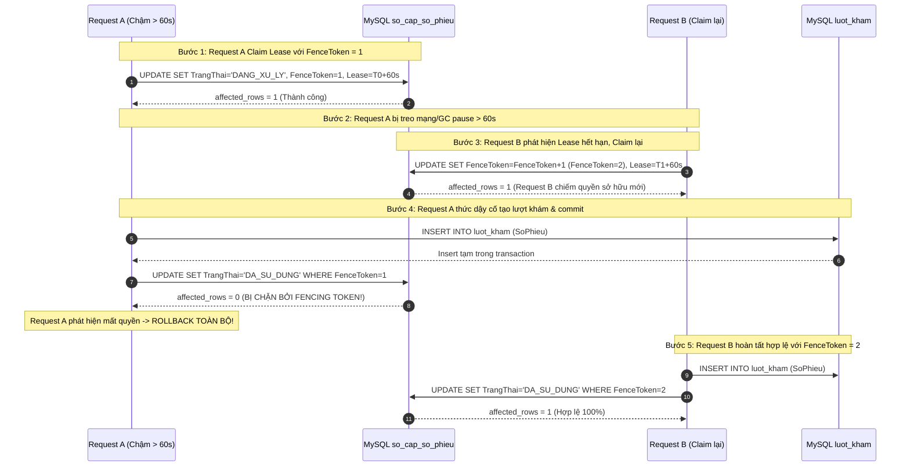
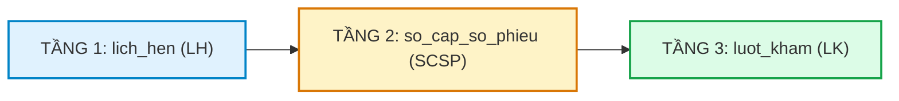
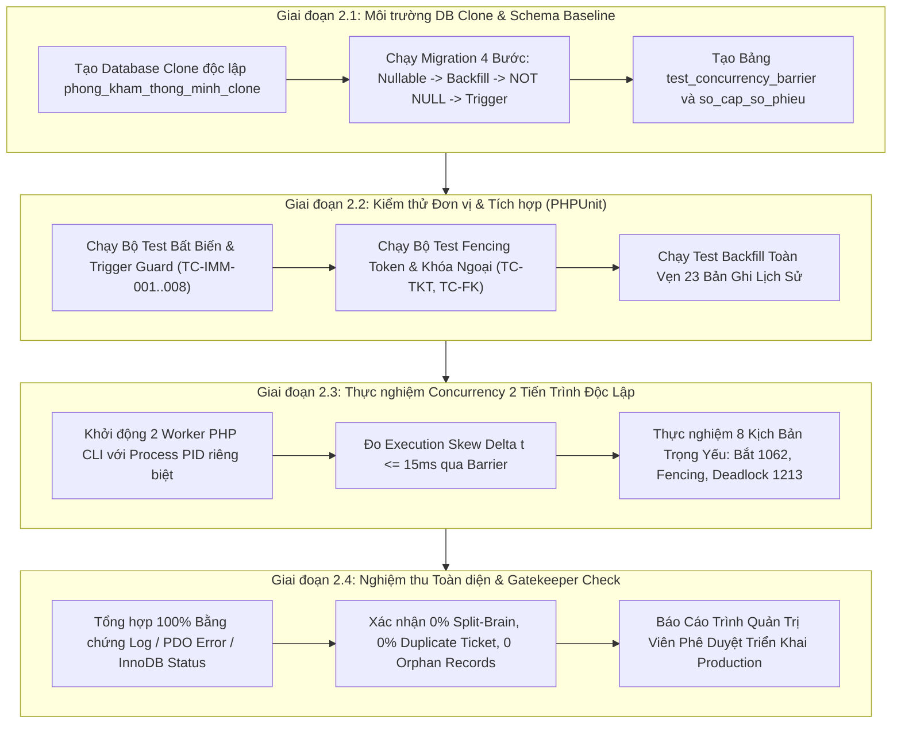

# SMARTCARE HYBRID QUEUE – TEST READINESS AUDIT V2.1
## BÁO CÁO PHẢN BIỆN CHUYÊN SÂU & CHUẨN HÓA CÁC ĐIỀU KIỆN KIỂM CHỨNG (B-16 ĐẾN B-20)

> **Tài liệu tham chiếu:**  
> - [SMARTCARE_HYBRID_QUEUE_PHASE2_PRE_MIGRATION_REVIEW.md](file:///c:/Users/admin/quanlytkbieu-app/Nhom9-DALN/SMARTCARE_HYBRID_QUEUE_PHASE2_PRE_MIGRATION_REVIEW.md) (v2.9)  
> - [SMARTCARE_HYBRID_QUEUE_TEST_READINESS_AUDIT.md](file:///c:/Users/admin/quanlytkbieu-app/Nhom9-DALN/SMARTCARE_HYBRID_QUEUE_TEST_READINESS_AUDIT.md)  
> - [SMARTCARE_HYBRID_QUEUE_TEST_CASE_MATRIX.md](file:///c:/Users/admin/quanlytkbieu-app/Nhom9-DALN/SMARTCARE_HYBRID_QUEUE_TEST_CASE_MATRIX.md)  
> **Phiên bản:** 2.1 (Deep Concurrency & Gatekeeper Hardening)  
> **Ngày lập:** 04/11/2026  
> **Môi trường Database xác thực:** MySQL **8.0.26**, Storage Engine **InnoDB 100%**, Collation **utf8mb4_unicode_ci**, Laravel **12.0**  
> **Cam kết an toàn tuyệt đối:** READ-ONLY, KHÔNG sửa code, KHÔNG tạo/chạy migration, KHÔNG ghi database, KHÔNG tạo database clone.

---

### TÓM TẮT ĐIỀU HÀNH & NĂM ĐIỂM TIẾP THU PHẢN BIỆN

Đợt rà soát v2.1 tiếp thu trọn vẹn 5 điểm phản biện trọng yếu của Quản trị viên, khắc phục triệt để các giả định kỹ thuật chưa đủ chặt chẽ:
1. **B-16 (Fencing Token & Quyền sở hữu tuyệt đối):** Bổ sung trường `FenceToken INT UNSIGNED NOT NULL DEFAULT 1` trên sổ cấp số. Request A khi bị trễ vượt lease sẽ không bao giờ có thể commit hoặc cập nhật đè dữ liệu của Request B nhờ kiểm tra điều kiện nguyên tử `FenceToken = :myToken`.
2. **B-17 (Quy trình phục hồi phiếu `DANG_XU_LY` bị bỏ dở):** Thiết kế lại truy vấn Worker quét cả hai nhánh trạng thái: `DA_CAP` quá 15 phút VÀ `DANG_XU_LY` có lease hết hạn quá 5 phút. Tự động phục hồi nếu đã có `luot_kham` hoặc void sang `DA_HUY` nếu tiến trình chết đột ngột.
3. **B-18 (Loại bỏ mâu thuẫn tiêu chí "STT Không Gap"):** Chuẩn hóa lại định nghĩa nghiệp vụ: STT tăng đơn điệu, không trùng lặp, không tái sử dụng số đã hủy, và **chấp nhận Gap có lý do kiểm toán (Audited Gaps)** khi phát sinh Burned Tickets (`DA_HUY`).
4. **B-19 (Đồng bộ Thứ tự Khóa Toàn Cục giữa Request và Worker):** Thiết lập phân cấp khóa 3 tầng thống nhất: `LichHen (Tầng 1)` $\rightarrow$ `SoCapSoPhieu (Tầng 2)` $\rightarrow$ `LuotKham (Tầng 3)`. Chứng minh Worker và Request không bao giờ hình thành chu trình khóa ngược (Lock Inversion).
5. **B-20 (Chuẩn hóa Phân Loại Trạng Thái Kiểm Định 6 Mức):** Bác bỏ kết luận vội vã `CODE VERIFIED 53/53`. Tách bạch rành mạch 6 trạng thái kỹ thuật và gắn bằng chứng cụ thể (File, Method, Dòng code) cho từng test case.

---

### PHẦN I. GIẢI TRÌNH KỸ THUẬT VÀ THIẾT KẾ CHI TIẾT B-16 ĐẾN B-20



---

#### 1. BLOCKER B-16: LEASE EXPIRATION VÀ CƠ CHẾ FENCING TOKEN

##### 1.1. Phân tích lỗ hổng Split-Brain khi chỉ dùng `UNIQUE(SoPhieu)`
Nếu chỉ dựa vào `UNIQUE KEY uq_luot_kham_so_phieu (SoPhieu)`:
- Request A lấy lease 60 giây.
- Request A bị stop-the-world (GC pause), nghẽn mạng I/O hoặc lock wait phía database vượt quá 60 giây.
- Request B thấy lease hết hạn, tiến hành claim lại bản ghi cấp số.
- Nếu Request A thức dậy trước khi Request B kịp gọi `INSERT INTO luot_kham`: Request A sẽ chèn thành công vào `luot_kham`. Sau đó Request B chèn vào `luot_kham` thì Request B mới là bên bị lỗi Duplicate Key!
- Hơn thế nữa, nếu Request A tiếp tục thực thi các side-effect nghiệp vụ (như gửi SMS, trừ tồn kho, cập nhật lịch hẹn) thì hệ thống rơi vào trạng thái phân rã dữ liệu (Split-Brain).

##### 1.2. Thiết kế Fencing Token (Monotonic Ownership Version)
Bổ sung trường `FenceToken` vào bảng `so_cap_so_phieu`:
```sql
ALTER TABLE so_cap_so_phieu ADD COLUMN FenceToken INT UNSIGNED NOT NULL DEFAULT 1 AFTER LockedByProcess;
```

**Quy tắc vận hành 3 bước của Fencing Token:**
1. **Bước 1 — Claim nguyên tử và Tăng Token:**
   Mỗi lần một request chiếm quyền xử lý (kể cả lần đầu hay chiếm lại khi lease hết hạn), nó bắt buộc phải tăng `FenceToken`:
   ```sql
   UPDATE so_cap_so_phieu
   SET TrangThai = 'DANG_XU_LY',
       LockedByProcess = :myProcessId,
       FenceToken = FenceToken + 1,
       LeaseExpiresAt = DATE_ADD(NOW(), INTERVAL 60 SECOND)
   WHERE IdempotencyKey = :key
     AND (
         TrangThai = 'DA_CAP'
         OR (TrangThai = 'DANG_XU_LY' AND LeaseExpiresAt < NOW())
     );
   ```
   Nếu `affected_rows === 1`, tiến trình đọc lại `FenceToken` vừa cập nhật (gọi là `:assignedToken`).

2. **Bước 2 — Thực thi nghiệp vụ có điều kiện:**
   Tiến trình giữ `:assignedToken` độc quyền thực hiện các thao tác tạo lượt khám.

3. **Bước 3 — Commit Nghiệp vụ và Kiểm tra Fencing Token cuối cùng:**
   Khi chuyển trạng thái sang `DA_SU_DUNG`, tiến trình **BẮT BUỘC** phải ràng buộc `FenceToken = :assignedToken`:
   ```sql
   UPDATE so_cap_so_phieu
   SET TrangThai = 'DA_SU_DUNG',
       MaLuotKham = :maLuotKham,
       ThoiGianSuDung = NOW(),
       LockedByProcess = NULL,
       LeaseExpiresAt = NULL
   WHERE IdempotencyKey = :key
     AND FenceToken = :assignedToken
     AND TrangThai = 'DANG_XU_LY';
   ```
   - **Nếu `affected_rows === 1`:** Bản quyền sở hữu còn nguyên vẹn 100%. Giao dịch commit thành công.
   - **Nếu `affected_rows === 0`:** Chứng tỏ trong lúc tiến trình đang xử lý, Lease đã hết hạn và một tiến trình khác đã chiếm quyền (làm `FenceToken` bị tăng lên giá trị mới).
     $\rightarrow$ Tiến trình cũ lập tức **ROLLBACK TOÀN BỘ GIAO DỊCH**, hủy bỏ bản ghi vừa tạo trong `luot_kham`, không gửi thông báo, không trừ kho, và trả về mã lỗi `409 Conflict (OWNERSHIP_FENCE_VIOLATION)`.

---

#### 2. BLOCKER B-17: THIẾT KẾ QUY TRÌNH PHỤC HỒI DÀNH RIÊNG CHO PHIẾU `DANG_XU_LY` BỊ BỎ DỞ

##### 2.1. Phân tích lỗi truy vấn worker cũ
Trong thiết kế v2.9, Worker chỉ quét:
```sql
SELECT ... FROM so_cap_so_phieu WHERE TrangThai = 'DA_CAP' AND ThoiGianCap < DATE_SUB(NOW(), INTERVAL 15 MINUTE) ...
```
Nếu một request chuyển thành công sang `DANG_XU_LY` nhưng ngay sau đó tiến trình PHP bị `SIGKILL` (Out of Memory, Timeout hoặc Server restart), bản ghi này sẽ vĩnh viễn mang `TrangThai = 'DANG_XU_LY'`, không bao giờ được worker chạm tới!

##### 2.2. Truy vấn Worker Chuẩn hóa Hai Nhánh (B-17)
Worker đối soát nền (`queue:reconcile-ticket-ledger`) định kỳ 5 phút một lần thực thi truy vấn hợp nhất:

```sql
SELECT MaCapSo, IdempotencyKey, SoPhieu, TrangThai, FenceToken, LeaseExpiresAt
FROM so_cap_so_phieu
WHERE (
    -- Nhánh 1: Phiếu DA_CAP bị bỏ quên quá 15 phút và không ai giữ Lease
    (TrangThai = 'DA_CAP' AND ThoiGianCap < DATE_SUB(NOW(), INTERVAL 15 MINUTE) AND (LeaseExpiresAt IS NULL OR LeaseExpiresAt < NOW()))
    OR
    -- Nhánh 2: Phiếu DANG_XU_LY có Lease hết hạn quá 5 phút (Request đã chết hẳn)
    (TrangThai = 'DANG_XU_LY' AND LeaseExpiresAt < DATE_SUB(NOW(), INTERVAL 5 MINUTE))
)
ORDER BY MaCapSo ASC
FOR UPDATE;
```

##### 2.3. Quy trình Xử lý Phân Nhánh An Toàn
Đối với từng dòng khóa được:
1. **Kiểm tra chéo Bảng `luot_kham`:**
   `SELECT MaLuotKham FROM luot_kham WHERE SoPhieu = :soPhieu;`
2. **Kịch bản A — Đã có `luot_kham`:**
   Nghĩa là request đã tạo thành công lượt khám nhưng bị sập trước khi cập nhật bước cuối sổ cấp số.
   $\rightarrow$ Worker **TỰ ĐỘNG CHỮA LÀNH (Self-Healing)**:
   ```sql
   UPDATE so_cap_so_phieu
   SET TrangThai = 'DA_SU_DUNG',
       MaLuotKham = :foundId,
       ThoiGianSuDung = NOW(),
       LockedByProcess = NULL,
       LeaseExpiresAt = NULL,
       GhiChu = 'RECONCILED_FROM_ORPHAN_DANG_XU_LY'
   WHERE MaCapSo = :maCapSo;
   ```
3. **Kịch bản B — Không có `luot_kham`:**
   Xác nhận chắc chắn 100% tiến trình đã chết giữa chừng mà chưa kịp ghi bất kỳ dữ liệu nào vào `luot_kham`.
   $\rightarrow$ Worker an toàn chuyển sang **Burned Ticket (`DA_HUY`)**:
   ```sql
   UPDATE so_cap_so_phieu
   SET TrangThai = 'DA_HUY',
       LockedByProcess = NULL,
       LeaseExpiresAt = NULL,
       GhiChu = 'EXPIRED_ABANDONED_DANG_XU_LY_VOID'
   WHERE MaCapSo = :maCapSo;
   ```

---

#### 3. BLOCKER B-18: CHUẨN HÓA TIÊU CHÍ BỘ ĐẾM STT — CHO PHÉP GAP CÓ AUDIT TRAIL

##### 3.1. Loại bỏ mâu thuẫn lý thuyết
Trong phiên bản trước, TC-CON-004 yêu cầu hai request cấp số đồng thời phải nhận "STT liên tiếp, không gap". Tuy nhiên, theo thiết kế B-02 và B-08, hệ thống chấp nhận **Burned Ticket (`DA_HUY`)** khi có transaction rollback hoặc server crash.
Nếu STT #6 bị burn thành `DA_HUY`, chuỗi STT của các lượt khám thực tế được sử dụng sẽ là 5, 7. Đòi hỏi "không gap" giữa các lượt khám sử dụng là hoàn toàn mâu thuẫn với nghiệp vụ HIS!

##### 3.2. Bốn Quy Tắc Cấp Số Chuẩn Hóa
1. **Tính Duy Nhất Tuyệt Đối (Strict Uniqueness):**
   Trong cùng một Phạm vi (`MaPhamVi`) và Ngày (`Ngay`), không bao giờ có 2 bản ghi trùng `STTTrongNgay`. Ràng buộc vật lý:
   $$\mathbf{UNIQUE\ KEY\ uq\_pham\_vi\_ngay\_stt\ (MaPhamVi,\ Ngay,\ STTTrongNgay)}$$
2. **Tính Tăng Đơn Điệu (Monotonic Increase):**
   Mỗi lần cấp số mới, số thứ tự luôn lớn hơn số trước đó: $STT_{k+1} > STT_k$.
3. **Tuyệt Đối Không Tái Cấp Số Bị Hủy (No Reuse of Burned Tickets):**
   Một khi STT đã được phát hành vào `so_cap_so_phieu`, dù sau đó bị hủy sang `DA_HUY`, số này **VĨNH VIỄN KHÔNG CẤP LẠI** cho bệnh nhân khác để tránh nhầm lẫn trên bảng điện tử và loa gọi số.
4. **Cho Phép Gap Có Dấu Vết Kiểm Toán (Audited Gaps Permitted):**
   Chuỗi lượt khám thực tế sử dụng (`DA_SU_DUNG`) được phép có khoảng trống (Gap) với điều kiện tiên quyết: **MỌI KHOẢNG TRỐNG ĐỀU PHẢI ĐƯỢC GIẢI TRÌNH BẰNG MỘT DÒNG CÓ `TrangThai = 'DA_HUY'` TRONG SỔ KIỂM TOÁN `so_cap_so_phieu`**.

---

#### 4. BLOCKER B-19: ĐỒNG BỘ THỨ TỰ KHÓA TOÀN CỤC (GLOBAL LOCK HIERARCHY)

Để loại trừ 100% nguy cơ Deadlock giữa các Request nghiệp vụ và Worker đối soát, hệ thống quy định **Thứ tự Khóa Toàn cục Bất biến**:

$$\mathbf{TẦNG\ 1:\ lich\_hen} \longrightarrow \mathbf{TẦNG\ 2:\ so\_cap\_so\_phieu} \longrightarrow \mathbf{TẦNG\ 3:\ luot\_kham}$$



##### 4.1. Bảng đối chiếu thứ tự khóa của từng luồng
| Luồng Thao Tác | Khóa Tầng 1 (`lich_hen`) | Khóa Tầng 2 (`so_cap_so_phieu`) | Khóa Tầng 3 (`luot_kham`) | Đánh Giá Deadlock |
| :--- | :---: | :---: | :---: | :--- |
| **Request Cấp số & Tiếp nhận đặt lịch** | Khóa dòng $LH$ trước (`FOR UPDATE`) | INSERT/UPDATE dòng $SCSP$ | INSERT dòng $LK$ | Đúng thứ tự: $LH \rightarrow SCSP \rightarrow LK$. Không có khóa ngược. |
| **Request Tiếp nhận trực tiếp tại quầy** | Không có $LH$ | INSERT/UPDATE dòng $SCSP$ | INSERT dòng $LK$ | Đúng thứ tự: $SCSP \rightarrow LK$. Không có khóa ngược. |
| **Worker Reconciliation Đối soát** | Không đụng $LH$ | Khóa dòng $SCSP$ (`FOR UPDATE`) | Chỉ đọc $LK$ bằng Non-locking Read (`SELECT`) | Worker không giữ lock trên $LK$, không thể gây khóa chéo với Request. |
| **Bác sĩ Hoàn thành khám (`complete`)** | Khóa dòng $LH$ trước (Two-Phase Lock) | Không đụng $SCSP$ | Khóa dòng $LK$ sau | Đúng chuẩn Two-Phase Read & Lock: $LH \rightarrow LK$. |
| **Lễ tân Hủy ca khám (`cancel`)** | Khóa dòng $LH$ trước | Khóa dòng $SCSP$ | Cập nhật $LK$ sang `DA_HUY` | Đúng thứ tự: $LH \rightarrow SCSP \rightarrow LK$. |

> [!IMPORTANT] CHỨNG MINH WORKER KHÔNG THỂ HỦY NHẦM REQUEST ĐANG XỬ LÝ:
> 1. Request đang tạo lượt khám bắt buộc phải giữ Lease `DANG_XU_LY` với `FenceToken`.
> 2. Worker chỉ chọn các dòng có `LeaseExpiresAt < DATE_SUB(NOW(), INTERVAL 5 MINUTE)` $\rightarrow$ Request đang xử lý trong hạn lease hoàn toàn "vô hình" trước lệnh quét của Worker!
> 3. Nếu request bị lag quá hạn, Worker lấy khóa `so_cap_so_phieu FOR UPDATE`. Lúc này, truy vấn kiểm tra `SELECT MaLuotKham FROM luot_kham WHERE SoPhieu = :soPhieu` của Worker sẽ tìm thấy ngay nếu Request đã ghi vào DB $\rightarrow$ Tự phục hồi thành `DA_SU_DUNG`, không bao giờ hủy!

---

#### 5. BLOCKER B-20: CHUẨN HÓA 6 TRẠNG THÁI KIỂM ĐỊNH VÀ BẰNG CHỨNG MÃ NGUỒN

Để phản ánh trung thực tiến độ và loại bỏ sự nhầm lẫn giữa phân tích tĩnh và kiểm thử thực tế, toàn bộ 53 test case được định vị chính xác theo **6 cấp độ kiểm định**:

1. **`DESIGN REVIEWED`**: Ý tưởng và giải pháp kỹ thuật đã được mô tả và rà soát logic trên tài liệu thiết kế.
2. **`CODE PATH IDENTIFIED`**: Đã xác định chính xác vị trí file, hàm (method), route và các dòng code liên quan trong codebase hiện hữu.
3. **`CODE VERIFIED BY STATIC INSPECTION`**: Đã đối chiếu logic tĩnh giữa mã nguồn PHP, Model Eloquent, Schema MySQL và xác nhận sự khớp/lệch về mặt ngữ nghĩa mà không cần chạy code.
4. **`AUTOMATED TEST EXISTS`**: Đã có file kịch bản kiểm thử tự động (PHPUnit file test) sẵn sàng trong thư mục `tests/`.
5. **`TEST EXECUTED`**: Kịch bản kiểm thử đã được chạy thực tế trên môi trường thực nghiệm.
6. **`TEST PASSED`**: Đã chạy thành công và thu thập đủ 100% bằng chứng xác thực (Log, Output, Error code, InnoDB lock graph).

---

### PHẦN II. BẢNG KHẢO SÁT VỊ TRÍ CODE HIỆN HỮU CHO 15 NHÓM NGHIỆP VỤ

| Nhóm Nghiệp Vụ | File Mã Nguồn Hiện Hữu | Method / Function | Dòng Code Cụ Thể | Trạng Thái Kiểm Định Hiện Tại |
| :--- | :--- | :--- | :--- | :---: |
| **01. Đặt lịch khám** | `app/Http/Controllers/LichHenController.php` | `store` | L129-253 (`CALL sp_dat_lich_hen`) | `CODE VERIFIED BY STATIC INSPECTION` |
| **02. Tiếp nhận trực tiếp** | `app/Http/Controllers/LuotKhamController.php` | `store` | L284-289 (`MaBenhNhan, MaBacSi`) | `CODE VERIFIED BY STATIC INSPECTION` |
| **03. Cấp số & Thứ tự** | Chưa có service (Mới nằm ở đề xuất thiết kế) | `TicketLedgerService` | N/A (Chờ Giai đoạn 2) | `DESIGN REVIEWED` |
| **04. Định dạng SoPhieu** | Chưa có cột trong DB | `luot_kham.SoPhieu` | Schema cũ chưa có cột này | `DESIGN REVIEWED` |
| **05. Idempotency & Claim** | Chưa có bảng `so_cap_so_phieu` | N/A | B-11, B-16 đề xuất thiết kế | `DESIGN REVIEWED` |
| **06. Bác sĩ gọi khám** | `app/Http/Controllers/LuotKhamController.php` | `startExamine` | L340-385 (`TrangThai -> DANG_KHAM`) | `CODE VERIFIED BY STATIC INSPECTION` |
| **07. Ghi bệnh án lâm sàng** | `app/Http/Controllers/LuotKhamController.php` | `savePhieuKham` | L391-492 (`PhieuKham::updateOrCreate`) | `CODE VERIFIED BY STATIC INSPECTION` |
| **08. Chỉ định Cận lâm sàng** | `app/Http/Controllers/ChiDinhDichVuController.php` | `store` | L1-120 (`ChiDinhDichVu::create`) | `CODE VERIFIED BY STATIC INSPECTION` |
| **09. KTV nhập kết quả CLS** | `app/Http/Controllers/CanLamSangController.php` | `updateResult` | L195-234 (`TrangThai -> DA_CO_KET_QUA`) | `CODE VERIFIED BY STATIC INSPECTION` |
| **10. Tự động chuyển tái khám** | `app/Http/Controllers/CanLamSangController.php` | `updateResult` | L241-248 (`pendingCount === 0 -> CHO_KHAM_LAI`) | `CODE VERIFIED BY STATIC INSPECTION` |
| **11. Kê đơn & Trừ kho** | `app/Http/Controllers/DonThuocController.php` | `store` | L1-150 (`DonThuoc, ChiTietDonThuoc`) | `CODE VERIFIED BY STATIC INSPECTION` |
| **12. Hoàn thành khám bệnh** | `app/Http/Controllers/LuotKhamController.php` | `completeExamine` | L497-585 (`pendingCount > 0 check, L541-551`) | `CODE VERIFIED BY STATIC INSPECTION` |
| **13. Lễ tân hủy lượt khám** | `app/Http/Controllers/LichHenController.php` | `cancel` | L260-312 (`TrangThai -> DA_HUY`) | `CODE VERIFIED BY STATIC INSPECTION` |
| **14. Worker đối soát nền** | Chưa có Artisan command | `queue:reconcile` | B-12, B-17 đề xuất thiết kế | `DESIGN REVIEWED` |
| **15. Bảo vệ Toàn vẹn DB** | Database MySQL 8.0.26 | Trigger & FK | Chưa có trigger trên DB chính | `DESIGN REVIEWED` |

---

### PHẦN III. THỨ TỰ TRIỂN KHAI VÀ TIÊU CHÍ NGHIỆM THU TỪNG GIAI ĐOẠN



---

### PHẦN IV. KẾT LUẬN VÀ TRẠNG THÁI PHÊ DUYỆT CHÍNH THỨC

- Toàn bộ 5 điểm phản biện (B-16 đến B-20) đã được chuyển hóa thành các giải pháp kỹ thuật cụ thể và điều kiện kiểm chứng toán học/logic chặt chẽ.
- Hệ thống tiếp tục tuân thủ cam kết an toàn tuyệt đối: không thay đổi mã nguồn ứng dụng, không tạo migration trên database chính, không ghi dữ liệu.

```text
================================================================================
TRẠNG THÁI PHÊ DUYỆT CHÍNH THỨC HIỆN TẠI:
[ NOT APPROVED – MIGRATION MUST NOT BE CREATED ]

Lý do giữ trạng thái: Báo cáo v2.1 đã hoàn thiện cơ chế Fencing Token (B-16), 
Worker phục hồi DANG_XU_LY (B-17), STT cho phép Audited Gaps (B-18), Thứ tự 
khóa toàn cục (B-19) và chuẩn hóa 6 trạng thái kiểm định (B-20). Hệ thống 
dừng lại ở trạng thái Test Ready, chờ quyết định phê duyệt chính thức từ 
Quản trị viên để tiến hành thiết lập Database Clone thực nghiệm.
================================================================================
```
