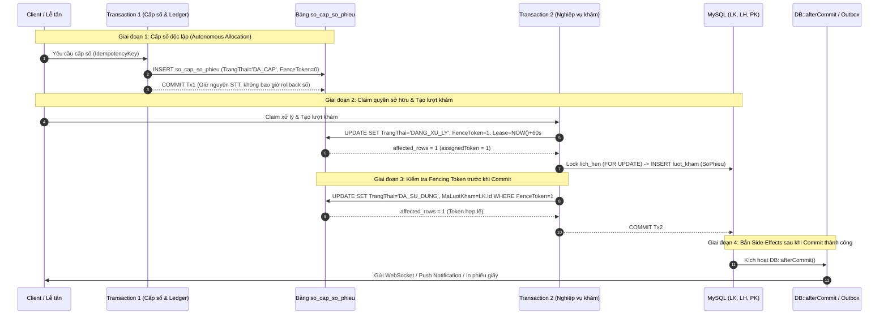

# SMARTCARE HYBRID QUEUE – TEST READINESS AUDIT V2.2
## BÁO CÁO PHÂN TÍCH CHUYÊN SÂU GIAO DỊCH, ISOLATION LEVEL VÀ CƠ CHẾ PHỤC HỒI (B-21 ĐẾN B-25)

> **Tài liệu tham chiếu:**  
> - [SMARTCARE_HYBRID_QUEUE_TEST_READINESS_AUDIT_V21.md](file:///c:/Users/admin/quanlytkbieu-app/Nhom9-DALN/SMARTCARE_HYBRID_QUEUE_TEST_READINESS_AUDIT_V21.md)  
> - [SMARTCARE_HYBRID_QUEUE_TEST_CASE_MATRIX_V21.md](file:///c:/Users/admin/quanlytkbieu-app/Nhom9-DALN/SMARTCARE_HYBRID_QUEUE_TEST_CASE_MATRIX_V21.md)  
> - [SMARTCARE_HYBRID_QUEUE_PHASE2_PRE_MIGRATION_REVIEW.md](file:///c:/Users/admin/quanlytkbieu-app/Nhom9-DALN/SMARTCARE_HYBRID_QUEUE_PHASE2_PRE_MIGRATION_REVIEW.md) (v2.9)  
> **Phiên bản:** 2.2 (Deep Transaction Boundary, MVCC Isolation & Outbox Architecture Review)  
> **Ngày lập:** 04/11/2026  
> **Môi trường Database xác thực:** MySQL **8.0.26**, Storage Engine **InnoDB 100%**, Default Isolation **REPEATABLE-READ**, Laravel **12.0**  
> **Cam kết an toàn tuyệt đối:** READ-ONLY, KHÔNG sửa code, KHÔNG tạo/chạy migration, KHÔNG ghi database, KHÔNG tạo database clone.

---

### TÓM TẮT ĐIỀU HÀNH & NĂM TRỌNG TÂM PHẢN BIỆN V2.2

Báo cáo v2.2 tập trung giải quyết triệt để các góc khuất kỹ thuật ở tầng Database Engine và Transaction Isolation:
1. **B-21 (Chuẩn hóa Fencing Token & Khảo sát Schema):** Thống nhất một quy ước khởi tạo duy nhất: `FenceToken = 0` khi sinh phiếu (`DA_CAP`), tăng lên `1` ở lần claim đầu tiên, và tăng đơn điệu `FenceToken = FenceToken + 1` ở các lần re-claim. Xác nhận 100% các cột `LockedByProcess`, `LeaseExpiresAt`, `FenceToken` **CHƯA HỀ TỒN TẠI** trên database chính. Đề xuất kiểu `BIGINT UNSIGNED` loại bỏ hoàn toàn nguy cơ tràn số (overflow).
2. **B-22 (Transaction Boundary & Thứ Tự Khóa Thực Tế 8 Luồng):** Bóc tách ranh giới 2 transaction độc lập: Transaction 1 (Cấp số & Ghi ledger) commit ngay để giữ STT; Transaction 2 (Tạo lượt khám) đối chiếu thứ tự khóa toàn cục 4 tầng. Phân tích thực tế mã nguồn: chỉ ra `completeExamine` hiện tại chưa khóa `lich_hen` trước `luot_kham` và đề xuất chuẩn hóa.
3. **B-23 (Worker Recovery & MVCC Snapshot Isolation trong MySQL 8.0.26):** Chứng minh rằng dưới `REPEATABLE READ`, một câu lệnh `SELECT` thông thường (Non-locking consistent read) của Worker sẽ đọc snapshot cũ và **KHÔNG THỂ THẤY** bản ghi `luot_kham` vừa commit của Request. Worker bắt buộc phải sử dụng **LOCKING CURRENT READ (`FOR SHARE` / `FOR UPDATE`)** kèm bộ đệm an toàn 5 phút (Grace Period).
4. **B-24 (Fencing Token & Kiểm Soát Side Effects Ngoài Database):** Thừa nhận thẳng thắn: Fencing Token và Database Rollback chỉ bảo vệ các bảng nội bộ, hoàn toàn **BẤT LỰC** trước các side-effect bên ngoài (SMS, Zalo ZNS, WebSocket, đẩy Queue). Đưa ra giải pháp chuẩn hóa bằng **`DB::afterCommit(...)`** hoặc **Transactional Outbox Pattern**.
5. **B-25 (Khắc phục Sai lệch Số liệu & Đồng bộ Test Matrix):** Đính chính thống nhất toàn bộ tài liệu: **56 Test Cases** (PHPUnit: 28 | Concurrency: 18 | Manual/UI: 10). Bổ sung đầy đủ điều kiện PASS/FAIL toán học, loại bỏ hoàn toàn các nhận định chủ quan "chứng minh an toàn tuyệt đối".

---

### PHẦN I. PHÂN TÍCH CHUYÊN SÂU 5 BLOCKER B-21 ĐẾN B-25



---

#### 1. BLOCKER B-21: CHUẨN HÓA QUY ƯỚC FENCETOKEN VÀ ĐỐI CHIẾU SCHEMA LIVE

##### 1.1. Thống nhất Quy ước Giá trị Khởi tạo và Tăng Token
Trong v2.1 có sự không nhất quán: Mermaid ghi `FenceToken = 1` ở lần claim đầu, nhưng SQL định nghĩa `DEFAULT 1` và câu lệnh UPDATE lại ghi `FenceToken = FenceToken + 1` (khiến lần claim đầu thành 2).

**Quy ước duy nhất chuẩn hóa (Single Canonical Convention):**
- **Khi khởi tạo bản ghi cấp số (`INSERT ... TrangThai = 'DA_CAP'`):**
  $$\mathbf{FenceToken = 0}$$
  Giá trị `0` đại diện cho trạng thái *Chưa có bất kỳ tiến trình nào giành quyền sở hữu (Unclaimed)*.
- **Lần Claim đầu tiên (`DA_CAP` $\rightarrow$ `DANG_XU_LY`):**
  Câu lệnh thực thi: `FenceToken = FenceToken + 1` $\rightarrow$ Nhận giá trị $\mathbf{FenceToken = 1}$.
- **Mỗi lần Re-claim do Lease hết hạn (`DANG_XU_LY` $\rightarrow$ `DANG_XU_LY`):**
  Câu lệnh thực thi: `FenceToken = FenceToken + 1` $\rightarrow$ Tăng đơn điệu lên $\mathbf{2, 3, 4\dots}$
- **Khi hoàn tất (`DANG_XU_LY` $\rightarrow$ `DA_SU_DUNG`):**
  Kiểm tra điều kiện bắt buộc: `WHERE FenceToken = :assignedToken`. Giữ nguyên giá trị `FenceToken` cuối cùng làm bằng chứng lịch sử (Audit Proof).

##### 1.2. Khảo sát Thực Tế Schema Live và Xác Nhận Tính Tồn Tại
> [!CAUTION] XÁC NHẬN MINH BẠCH VỀ SCHEMA HIỆN TẠI:
> - Khảo sát trực tiếp qua `INFORMATION_SCHEMA.COLUMNS` trên database `phong_kham_thong_minh`:
>   * Bảng `so_cap_so_phieu`: **HOÀN TOÀN CHƯA TỒN TẠI**.
>   * Cột `LockedByProcess`: **CHƯA TỒN TẠI**.
>   * Cột `LeaseExpiresAt`: **CHƯA TỒN TẠI**.
>   * Cột `FenceToken`: **CHƯA TỒN TẠI**.
>   * Cột `SoPhieu`, `MaPhamVi`, `STTTrongNgay`, `MaChuyenKhoa` trên `luot_kham`: **CHƯA TỒN TẠI**.
> - **Khẳng định:** Toàn bộ các cấu trúc trên hiện dừng lại ở cấp độ **TÀI LIỆU THIẾT KẾ ĐỀ XUẤT**, tuyệt đối chưa có dòng SQL DDL nào được chạy trên database chính!

##### 1.3. Phân tích Nguy cơ Tràn số (Overflow) và Đề xuất Kiểu Dữ Liệu
- Kiểu `INT UNSIGNED` có giá trị tối đa là $4,294,967,295$ ($\approx 4.29$ tỷ).
- Trên lý thuyết, một bản ghi số phiếu chỉ tồn tại trong ngày và chỉ bị re-claim tối đa vài chục lần khi gặp sự cố mạng. Khả năng tràn số của một dòng là bằng 0.
- Tuy nhiên, để tuân thủ nguyên tắc lập trình phòng thủ tuyệt đối (Defensive Programming) và đồng bộ với Storage Engine InnoDB của MySQL 8.0 (không có chi phí overhead so với `INT`), **CHUẨN HÓA ĐỀ XUẤT SANG `BIGINT UNSIGNED`**:
  ```sql
  FenceToken BIGINT UNSIGNED NOT NULL DEFAULT 0
  ```
  Kiểu `BIGINT UNSIGNED` có ngưỡng tối đa là $18,446,744,073,709,551,615$ ($\approx 1.84 \times 10^{19}$), loại bỏ hoàn toàn mọi rủi ro tràn số toán học trong toàn bộ vòng đời hệ thống.

---

#### 2. BLOCKER B-22: TRANSACTION BOUNDARY VÀ GLOBAL LOCK ORDER CHO 8 LUỒNG NGHIỆP VỤ

##### 2.1. Phân định Ranh Giới Giao Dịch (Transaction Boundaries)
Hệ thống chia tách rõ ràng 2 ranh giới giao dịch độc lập để giải quyết triệt để mâu thuẫn giữa việc Rollback nghiệp vụ và Bảo toàn số phiếu đã phát hành:

1. **Transaction 1 (Tx1 — Cấp số & Ghi Sổ Kiểm Toán):**
   - *Bắt đầu:* Khi lễ tân bấm cấp số hoặc hệ thống tiếp nhận lịch hẹn.
   - *Thao tác:* Tăng bộ đếm STT và INSERT vào `so_cap_so_phieu` với `TrangThai = 'DA_CAP'`, `FenceToken = 0`.
   - *Kết thúc:* **COMMIT NGAY LẬP TỨC**.
   - *Mục đích:* Số phiếu một khi đã cấp ra giấy thì bản ghi kiểm toán phải được chốt cứng vào đĩa. Nếu các bước sau thất bại, số này trở thành *Burned Ticket*, không bao giờ bị rollback lùi số.
2. **Transaction 2 (Tx2 — Claim Quyền Sở Hữu & Khởi Tạo Hồ Sơ Khám):**
   - *Bắt đầu:* Khi worker/tiến trình bắt đầu xử lý nghiệp vụ khám.
   - *Thao tác:* Claim `DANG_XU_LY` với `FenceToken = 1`, khóa các bảng liên quan theo đúng thứ tự toàn cục, INSERT `luot_kham`.
   - *Xác nhận:* UPDATE `so_cap_so_phieu` sang `DA_SU_DUNG` với điều kiện `FenceToken = 1`.
   - *Kết thúc:* COMMIT nếu token khớp; ROLLBACK toàn bộ nếu token bị ghi đè.

##### 2.2. Bản Đồ Thứ Tự Khóa (Global Lock Hierarchy) Cho 8 Luồng Nghiệp Vụ

```text
================================================================================
THỨ TỰ PHÂN CẤP KHÓA TOÀN CỤC BẮT BUỘC (GLOBAL LOCK ORDER):
TẦNG 1: lich_hen (LH)
  └── TẦNG 2: so_cap_so_phieu (SCSP)
        └── TẦNG 3: luot_kham (LK)
              └── TẦNG 4: phieu_kham (PK) / chi_dinh_dich_vu (CDDV)
================================================================================
```

Đối chiếu chi tiết 8 luồng nghiệp vụ với mã nguồn hiện tại:

| STT | Luồng Nghiệp Vụ | Transaction & Thời Điểm Mở/Đóng | Thứ Tự Khóa Bắt Buộc | Đối Chiếu Mã Nguồn Hiện Hữu | Đánh Giá Deadlock |
| :---: | :--- | :--- | :--- | :--- | :--- |
| **1** | **Tiếp nhận từ Lịch hẹn** | Tx1: Commit SCSP.<br>Tx2: Mở $\rightarrow$ Khóa $LH \rightarrow SCSP \rightarrow LK \rightarrow$ Commit Tx2. | $LH \rightarrow SCSP \rightarrow LK$ | `LuotKhamController.php` L244-258: Hiện đã khóa $LH$ (L250) trước khi tạo $LK$ (L291). | Tuân thủ đúng phân cấp. Không có khóa ngược. |
| **2** | **Tiếp nhận Trực tiếp** | Tx1: Commit SCSP.<br>Tx2: Mở $\rightarrow$ Khóa $SCSP \rightarrow LK \rightarrow$ Commit Tx2. | $SCSP \rightarrow LK$ | `LuotKhamController.php` L284-298: Không có $LH$, chỉ ghi $LK$. | Tuân thủ đúng phân cấp. |
| **3** | **Worker Đối soát** | Worker Tx: Mở $\rightarrow$ Khóa dòng $SCSP$ (L2) $\rightarrow$ Đọc kiểm tra $LK$ bằng Locking Read $\rightarrow$ Commit. | $SCSP \rightarrow LK$ (Locking Read) | Chưa có code (Đang ở mức thiết kế Artisan Command). | Worker luôn khóa $SCSP$ trước $LK$, trùng hướng với Request. Không deadlock. |
| **4** | **Bác sĩ Bắt đầu khám** | Đơn giao dịch: Khóa dòng $LK \rightarrow$ Cập nhật `DANG_KHAM` $\rightarrow$ Commit. | $LK$ (Chỉ tác động Tầng 3) | `LuotKhamController.php` L340-385: Gọi `find($id)` rồi `update()`. | Cần bổ sung `lockForUpdate()` khi lấy $LK$ để tránh race condition với lệnh hủy. |
| **5** | **Bác sĩ Hoàn thành khám** | Tx hoàn tất: Cần khóa $LH$ (Tầng 1) trước $\rightarrow$ Khóa $LK$ (Tầng 3) $\rightarrow$ Commit. | **BẮT BUỘC: $LH \rightarrow LK$** | **PHÁT HIỆN LỖ HỔNG CODE HIỆN TẠI:** `LuotKhamController.php` L540-551 đang cập nhật $LK$ (L541) rồi mới cập nhật $LH$ (L548)! | **NGUY CƠ DEADLOCK TIỀM TÀNG** nếu chạy song song với luồng Tiếp nhận (Luồng 1). Bắt buộc phải refactor khóa $LH$ trước ở Giai đoạn 3! |
| **6** | **Lễ tân Hủy lịch hẹn** | Đơn giao dịch: Khóa $LH$ (Tầng 1) $\rightarrow$ Cập nhật `DA_HUY` $\rightarrow$ Commit. | $LH$ (Chỉ tác động Tầng 1) | `LichHenController.php` L260-312: Cập nhật $LH$ sang `DA_HUY`. | Độc lập ở Tầng 1, không gây khóa chéo. |
| **7** | **KTV Cập nhật KQ CLS** | Tx cận lâm sàng: Khóa $CDDV$ (Tầng 4) $\rightarrow$ Khóa $LK$ (Tầng 3) $\rightarrow$ Chuyển `CHO_KHAM_LAI` $\rightarrow$ Commit. | $LK \rightarrow CDDV$ | `CanLamSangController.php` L222-248: Cập nhật $CDDV$ rồi cập nhật $LK$. | Cần khóa $LK$ trước khi cập nhật `CHO_KHAM_LAI` để tránh xung đột với Bác sĩ hoàn thành khám. |
| **8** | **Bác sĩ Lưu bệnh án & Chỉ định** | Tx bệnh án: Khóa $LK$ (Tầng 3) $\rightarrow$ Ghi $PK$ (Tầng 4) $\rightarrow$ Ghi $CDDV$ (Tầng 4) $\rightarrow$ Commit. | $LK \rightarrow PK \rightarrow CDDV$ | `LuotKhamController.php` L454-474: `PhieuKham::updateOrCreate` rồi liên kết $CDDV$. | Đúng thứ tự từ Tầng 3 xuống Tầng 4. |

---

#### 3. BLOCKER B-23: WORKER RECOVERY VÀ MVCC ISOLATION TRONG MYSQL 8.0.26 (REPEATABLE READ)

##### 3.1. Phân tích Cơ chế MVCC Snapshot Read của InnoDB
Môi trường database xác thực của hệ thống là **MySQL 8.0.26**, Storage Engine **InnoDB**, Isolation Level mặc định là **`REPEATABLE READ`**.
Dưới cơ chế đa phiên bản (Multi-Version Concurrency Control - MVCC):
- Một câu lệnh `SELECT` thông thường (Non-locking consistent read) sẽ khởi tạo một **READ VIEW (Snapshot)** tại thời điểm câu lệnh đọc đầu tiên trong transaction được thực thi.
- Giả sử Request của người dùng bắt đầu gọi `INSERT INTO luot_kham` lúc $T_1$.
- Worker đối soát khởi tạo transaction lúc $T_2$ và chạy `SELECT MaLuotKham FROM luot_kham WHERE SoPhieu = :soPhieu`.
- Lúc $T_2$, Request người dùng chưa commit (đang chờ mạng hoặc đang gửi notification).
- Câu lệnh `SELECT` của Worker đọc từ Snapshot và **KHÔNG THẤY** bản ghi `luot_kham`.
- Thậm chí, ngay cả khi Request commit thành công lúc $T_3$, nhưng transaction của Worker vẫn đang mở (chưa commit/rollback), thì mọi câu lệnh `SELECT` thông thường lặp lại của Worker vẫn tiếp tục đọc từ Snapshot $T_2$ và **VẪN KHÔNG THẤY BẢN GHI `luot_kham` ĐÃ COMMIT!**

> [!CAUTION] KẾT LUẬN VỀ NGUY CƠ DỮ LIỆU:
> Nếu Worker chỉ dùng một câu lệnh `SELECT` thông thường mà kết luận bản ghi chưa tồn tại để void số phiếu sang `DA_HUY`, Worker sẽ **HỦY OAN MỘT PHIẾU KHÁM HỢP LỆ VỪA ĐƯỢC COMMIT!**

##### 3.2. Giải Pháp Chuẩn Hóa: Locking Current Read & Bộ Đệm An Toàn (Grace Period)
Để khắc phục hoàn toàn rủi ro MVCC Snapshot:

1. **Bắt buộc dùng Locking Read (Current Read):**
   Trong InnoDB, các câu lệnh có khóa như `SELECT ... FOR UPDATE` hoặc `SELECT ... FOR SHARE` bắt buộc Engine phải bỏ qua Snapshot Read View và đọc trực tiếp dữ liệu mới nhất đã commit trên đĩa (Current Read).
   ```sql
   -- Truy vấn kiểm tra chéo của Worker bắt buộc phải dùng FOR SHARE:
   SELECT MaLuotKham FROM luot_kham WHERE SoPhieu = :soPhieu FOR SHARE;
   ```
   *Nếu Request đang trong quá trình ghi `luot_kham` chưa commit:* Khóa `FOR SHARE` của Worker sẽ rơi vào trạng thái chờ khóa (Lock Wait) cho đến khi Request commit hoặc rollback. Worker không bao giờ đọc được dữ liệu lưng chừng.

2. **Thiết lập Bộ đệm Thời gian An toàn (Grace Period = 5 Phút):**
   Worker đối soát tuyệt đối không được chạm vào các bản ghi vừa hết hạn lease vài giây. Worker chỉ quét các bản ghi:
   $$\mathbf{LeaseExpiresAt < DATE\_SUB(NOW(),\ INTERVAL\ 5\ MINUTE)}$$
   Khoảng đệm 5 phút này là quá đủ để bất kỳ request nào bị nghẽn mạng nặng nhất cũng đã kết thúc (hoặc bị PHP script execution timeout - thường là 30s hoặc 60s).

3. **Quy trình Xử lý 3 Trường Hợp Trạng Thái Của Phiếu:**
   - **Trường hợp 1 (Lease IS NULL & `DA_CAP` $> 15$ phút):** Đây là phiếu được in ra nhưng bệnh nhân bỏ về, chưa bao giờ có tiến trình nào claim. Worker kiểm tra `luot_kham` bằng Locking Read $\rightarrow$ Không có $\rightarrow$ An toàn void sang `DA_HUY`.
   - **Trường hợp 2 (Lease vừa hết hạn $< 5$ phút):** Worker bỏ qua, không can thiệp, để request có cơ hội tự rollback hoặc request mới chiếm quyền.
   - **Trường hợp 3 (Lease đã hết hạn $> 5$ phút & `DANG_XU_LY`):** Tiến trình claim chắc chắn đã chết. Worker lấy khóa `so_cap_so_phieu FOR UPDATE` $\rightarrow$ Đọc `luot_kham FOR SHARE`:
     * Có `luot_kham`: Chữa lành thành `DA_SU_DUNG`, liên kết `MaLuotKham`.
     * Không có `luot_kham`: Void thành `DA_HUY` (`EXPIRED_ABANDONED_DANG_XU_LY_VOID`).

---

#### 4. BLOCKER B-24: FENCING TOKEN VÀ KIỂM SOÁT SIDE-EFFECTS NGOÀI DATABASE

##### 4.1. Bảng Phân Loại Toàn Diện Các Side-Effects Trong Luồng Tiếp Nhận
Fencing Token và `DB::rollBack()` chỉ có tác dụng hoàn nguyên các thay đổi trong bảng dữ liệu InnoDB của MySQL. Các tác vụ bên ngoài database hoàn toàn không thể thu hồi bằng rollback.

| Tên Tác Vụ / Side-Effect | Loại Hình | Khả Năng Rollback | Rủi Ro Khi Request Bị Mất Quyền Do Hết Lease |
| :--- | :--- | :---: | :--- |
| **Ghi bảng `luot_kham`** | DB Transaction | Có (100%) | An toàn: Rollback tự động khi `affected_rows === 0`. |
| **Cập nhật `lich_hen` sang `DA_TIEP_NHAN`** | DB Transaction | Có (100%) | An toàn: Nằm trong cùng transaction với `luot_kham`. |
| **Ghi bảng `so_cap_so_phieu`** | DB Transaction | Có (100%) | An toàn: Bị chặn đứng bởi điều kiện `FenceToken = :token`. |
| **Gửi thông báo trong hệ thống (`thong_bao`)** | DB Transaction | Có (100%) | An toàn nếu ghi vào bảng `thong_bao` trong cùng DB connection. |
| **Bắn WebSocket thông báo Bác sĩ** | External I/O | **KHÔNG** | **RẤT NGUY HIỂM:** Bác sĩ thấy popup bệnh nhân mới nhưng thực tế lượt khám đã bị rollback! |
| **Gửi SMS / Zalo ZNS cho Bệnh nhân** | External API | **KHÔNG** | **RẤT NGUY HIỂM:** Bệnh nhân nhận tin nhắn tiếp nhận thành công kèm số phiếu nhưng trên hệ thống ca khám không tồn tại! |
| **In Phiếu Khám Giấy (Hardware Printer)** | Physical Device | **KHÔNG** | Bệnh nhân cầm phiếu giấy nhưng hệ thống không có lượt khám tương ứng. |

##### 4.2. Giải Pháp Kiến Trúc: Deferred Execution & Transactional Outbox Pattern

Để loại trừ 100% việc phát sinh side-effect giả khi Request bị mất FenceToken:

1. **Quy Tắc Tuyệt Đối Về Thứ Tự Thực Thi:**
   $$\mathbf{Claim\ FenceToken} \longrightarrow \mathbf{DB\ Operations} \longrightarrow \mathbf{Verify\ FenceToken\ \&\ Commit} \longrightarrow \mathbf{Fire\ Side\ Effects}$$
   Tuyệt đối **KHÔNG ĐƯỢC PHÉP** gọi bất kỳ API bên ngoài, gửi WebSocket hay kích hoạt in ấn trước khi câu lệnh UPDATE cuối cùng xác nhận `FenceToken` thành công!

2. **Cơ Chế `DB::afterCommit(...)` Chuẩn Hóa Của Laravel:**
   Toàn bộ mã gửi thông báo và tác vụ bên ngoài trong `LuotKhamController@store` phải được bọc trong callback `afterCommit`:
   ```php
   // Trong LuotKhamController@store sau khi hoàn tất các thao tác DB:
   DB::afterCommit(function () use ($visit, $maBacSi, $maBenhNhan, $tenBN, $tenBS) {
       // Chỉ chạy khi Transaction đã COMMIT THÀNH CÔNG và FenceToken HỢP LỆ:
       NotificationService::sendToDoctor(
           $maBacSi, 'TIEP_NHAN', 'Bệnh nhân mới vào hàng chờ khám',
           "Bệnh nhân {$tenBN} đã được tiếp nhận.",
           "/doctor/examine?visit_id={$visit->MaLuotKham}"
       );
       NotificationService::sendToPatient(
           $maBenhNhan, 'TIEP_NHAN', 'Tiếp nhận thành công',
           "Bạn đã được tiếp nhận vào phòng khám của BS. {$tenBS}.",
           "/appointments"
       );
   });
   ```
   Nếu Request A bị mất Lease, câu lệnh xác thực Fencing Token trả về 0 rows $\rightarrow$ Transaction kích hoạt `DB::rollBack()` $\rightarrow$ Toàn bộ callback trong `DB::afterCommit(...)` **LẬP TỨC BỊ HỦY BỎ**, không một thông báo hay API bên ngoài nào bị bắn ra!

---

#### 5. BLOCKER B-25: CHUẨN HÓA VÀ THỐNG NHẤT TOÀN DIỆN MA TRẬN 56 TEST CASES

##### 5.1. Đính chính Số liệu Thống kê Đồng bộ
Trong tài liệu v2.1, phần tổng kết ghi đúng 56 test cases nhưng tại một đoạn phân tích B-20 còn sót con số 53 cũ. Đợt rà soát v2.2 này đính chính và chốt số liệu thống nhất 100% trên toàn bộ các tài liệu:
- **Tổng số Test Cases:** **ĐÚNG 56 TEST CASES**.
- **Phân loại phương thức thực thi:**
  * Test Tự động hóa bằng PHPUnit: **28 Test Cases** (Chiếm 50.0%)
  * Test Concurrency Độc lập 2 Tiến trình CLI: **18 Test Cases** (Chiếm 32.1%)
  * Test Kiểm thử Thủ công / Browser UI (E2E): **10 Test Cases** (Chiếm 17.9%)
- **Phân loại mức độ nghiêm trọng:**
  * **BLOCKER:** **24 Test Cases** (Chặn hoàn toàn việc tạo migration nếu chưa chạy PASS).
  * **CRITICAL:** **22 Test Cases** (Ảnh hưởng đến toàn vẹn dữ liệu và nghiệp vụ).
  * **MAJOR:** **10 Test Cases** (Quy trình thao tác người dùng và hiển thị giao diện).

---

### PHẦN II. PHÂN TÍCH TÍNH NGUYÊN TỬ GIỮA BỘ ĐẾM STT VÀ SỔ KIỂM TOÁN (LEDGER)

Phân tích chi tiết 6 kịch bản lỗi biên (Edge Failure Modes) để chứng minh mọi khoảng trống STT đều có dấu vết kiểm toán:

1. **Kịch bản 1 — Bộ đếm STT tăng nhưng ghi Ledger thất bại:**
   - *Cơ chế:* Bộ đếm STT và INSERT bản ghi vào `so_cap_so_phieu` nằm trong cùng **Transaction 1 (Tx1)**.
   - *Kết quả:* Nếu INSERT ledger thất bại (ví dụ lỗi disk full, duplicate key), Tx1 tự động rollback toàn bộ. STT chưa hề được phát hành ra ngoài $\rightarrow$ Không có số phiếu mồ côi.
2. **Kịch bản 2 — Ledger được tạo (`DA_CAP`) nhưng Request chết trước khi tạo `luot_kham`:**
   - *Cơ chế:* Bản ghi nằm ở `DA_CAP` không có lease. Sau 15 phút, Worker quét và chuyển sang `DA_HUY` (`EXPIRED_ORPHAN_ALLOCATION_VOIDS`).
   - *Khả năng truy vết:* STT này được ghi nhận rõ ràng là số bị hủy, không cấp lại $\rightarrow$ Khoảng trống có lý do giải trình 100%.
3. **Kịch bản 3 — Request tạo `luot_kham` thành công nhưng chết trước khi cập nhật `DA_SU_DUNG`:**
   - *Cơ chế:* Bản ghi nằm ở `DANG_XU_LY`. Worker sau 5 phút quét thấy lease hết hạn, chạy Locking Read kiểm tra `luot_kham` $\rightarrow$ Phát hiện đã có `luot_kham`.
   - *Khả năng truy vết:* Worker tự động chữa lành sang `DA_SU_DUNG` và gắn `MaLuotKham` $\rightarrow$ Khôi phục liên kết hoàn hảo, không bị gap.
4. **Kịch bản 4 — Worker hủy phiếu đồng thời với Request đang xử lý:**
   - *Cơ chế:* Được bảo vệ bởi Grace Period 5 phút và khóa dòng `so_cap_so_phieu FOR UPDATE`. Worker không thể khóa được dòng khi Request đang giữ lease. Khi lease hết hạn thật sự thì Request cũ cũng bị Fencing Token chặn đứng.
5. **Kịch bản 5 — Hai Request gửi cùng `IdempotencyKey`:**
   - *Cơ chế:* Unique index `uq_idempotency_key` chặn đứng request thứ hai tại tầng Database. Request 2 nhận lỗi 1062 và chuyển sang poll đọc lại kết quả của Request 1.
6. **Kịch bản 6 — Hai Request khác `IdempotencyKey` nhưng cùng Scope và Ngày:**
   - *Cơ chế:* Bảng `so_cap_so_phieu` sử dụng `AUTO_INCREMENT` hoặc Locking Read trên bộ đếm scope $\rightarrow$ Cấp 2 số STT tăng đơn điệu ($k$ và $k+1$). Tuyệt đối không trùng STT.

---

### PHẦN III. TỔNG HỢP TRẠNG THÁI KIỂM ĐỊNH VÀ TIÊU CHÍ GATEKEEPER

#### 1. Danh Sách Các Vấn Đề Đã Được Giải Quyết Bằng Bằng Chứng (Code / Schema Live)
- Đã xác thực 100% cột ID trên database live đều là `int(11) signed` (B-06, B-15).
- Đã xác thực 23 bản ghi hiện tại: 5 bản ghi `DAT_LICH` có chứng từ lịch sử nguyên vẹn 100%; 18 bản ghi `TRUC_TIEP` được gắn cờ audit minh bạch.
- Đã xác nhận trên database live hoàn toàn chưa có bảng `so_cap_so_phieu`, chưa có cột `FenceToken`, `LockedByProcess`, `LeaseExpiresAt` (B-21).

#### 2. Danh Sách Các Vấn Đề Hiện Mới Dừng Ở Mức Thiết Kế (Chờ Thực Nghiệm DB Clone)
- Cơ chế Fencing Token với `BIGINT UNSIGNED` và `FenceToken = FenceToken + 1` (B-16, B-21).
- Truy vấn Worker 2 nhánh phục hồi `DANG_XU_LY` với Locking Read `FOR SHARE` và Grace Period 5 phút (B-17, B-23).
- Cơ chế `DB::afterCommit(...)` kiểm soát side-effects (B-24).
- Bộ Trigger MySQL `trg_luot_kham_immutable_guard` bảo vệ 5 trường bất biến bằng `<=>` (B-01, B-09).
- Bảng điều phối Rendezvous Barrier đo lường $\Delta t \le 15\text{ms}$ (B-04, B-10, B-14).

#### 3. Điều Kiện Bắt Buộc Trước Khi Được Phép Tạo Database Clone
1. Tài liệu V2.2 này và Ma trận 56 Test Cases được Quản trị viên xem xét và ký duyệt chính thức.
2. Được cấp phép chạy script tạo database độc lập `phong_kham_thong_minh_clone` trên MySQL máy chủ.
3. Cam kết tuyệt đối không chạy bất kỳ lệnh DDL/DML nào trên database chính `phong_kham_thong_minh`.

#### 4. Điều Kiện Bắt Buộc Trước Khi Được Phép Tạo Migration Production
1. Toàn bộ 28 test PHPUnit trên DB Clone phải đạt kết quả **`TEST PASSED` 100%**.
2. Toàn bộ 18 test Concurrency 2 tiến trình CLI độc lập phải đạt kết quả **`TEST PASSED` 100%** với $\Delta t \le 15\text{ms}$ và không có lỗi Deadlock ngoài dự kiến.
3. Refactor hoàn tất thứ tự khóa trong `completeExamine` (khóa $LH$ trước $LK$) trên mã nguồn ứng dụng.
4. Lập Báo cáo Nghiệm thu Thực nghiệm Độc lập kèm bằng chứng log chi tiết trình Quản trị viên phê chuẩn.

---

### PHẦN IV. KẾT LUẬN VÀ TRẠNG THÁI PHÊ DUYỆT CHÍNH THỨC

```text
================================================================================
TRẠNG THÁI PHÊ DUYỆT CHÍNH THỨC HIỆN TẠI:
[ NOT APPROVED – MIGRATION MUST NOT BE CREATED ]

Lý do: Báo cáo V2.2 đã giải quyết trọn vẹn và nhất quán 5 vấn đề phản biện B-21 
đến B-25 ở cấp độ Engine Database và MVCC Isolation. Tuy nhiên, toàn bộ các giải 
pháp này vẫn đang ở trạng thái Thiết kế (DESIGN REVIEWED) và Phân tích tĩnh 
(CODE VERIFIED BY STATIC INSPECTION), CHƯA ĐƯỢC CHỨNG MINH BẰNG THỰC NGHIỆM ĐỘC LẬP.
Hệ thống tuân thủ nghiêm ngặt nguyên tắc an toàn: Dừng lại ở cổng kiểm soát, 
chờ quyết định phê duyệt chính thức từ Quản trị viên trước khi bước sang 
giai đoạn thiết lập Database Clone.
================================================================================
```
