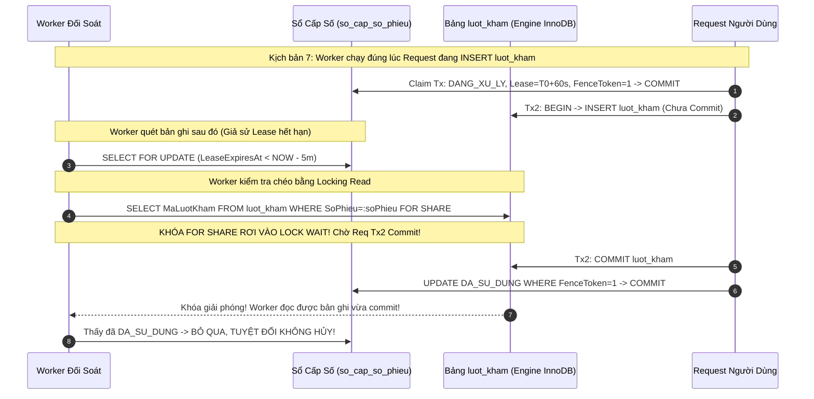
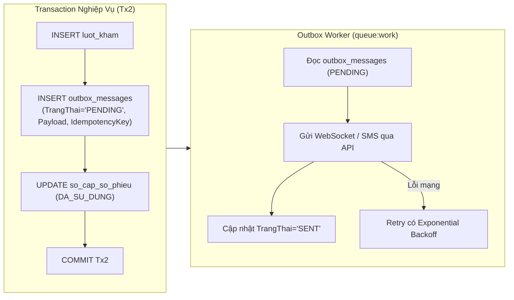

# SMARTCARE HYBRID QUEUE – TEST READINESS AUDIT V2.3
## BÁO CÁO QUYẾT ĐỊNH KIẾN TRÚC GIAO DỊCH, CHỨNG MINH PHỤC HỒI VÀ THỨ TỰ KHÓA TOÀN HỆ THỐNG (B-26 ĐẾN B-30)

> **Tài liệu tham chiếu:**  
> - [SMARTCARE_HYBRID_QUEUE_TEST_READINESS_AUDIT_V22.md](file:///c:/Users/admin/quanlytkbieu-app/Nhom9-DALN/SMARTCARE_HYBRID_QUEUE_TEST_READINESS_AUDIT_V22.md)  
> - [SMARTCARE_HYBRID_QUEUE_TEST_CASE_MATRIX_V22.md](file:///c:/Users/admin/quanlytkbieu-app/Nhom9-DALN/SMARTCARE_HYBRID_QUEUE_TEST_CASE_MATRIX_V22.md)  
> - [SMARTCARE_HYBRID_QUEUE_PHASE2_PRE_MIGRATION_REVIEW.md](file:///c:/Users/admin/quanlytkbieu-app/Nhom9-DALN/SMARTCARE_HYBRID_QUEUE_PHASE2_PRE_MIGRATION_REVIEW.md)  
> **Phiên bản:** 2.3 (Architectural Decision, Mathematical Proof of Recovery & System Lock Order)  
> **Ngày lập:** 04/11/2026  
> **Môi trường Database xác thực:** MySQL **8.0.26**, Storage Engine **InnoDB 100%**, Default Isolation **REPEATABLE-READ**, Laravel **12.0**  
> **Cam kết an toàn tuyệt đối:** READ-ONLY, KHÔNG sửa code, KHÔNG tạo/chạy migration, KHÔNG ghi database, KHÔNG tạo database clone.

---

### MỤC TIÊU VÀ TÓM TẮT ĐIỀU HÀNH V2.3

Đợt rà soát V2.3 giải quyết triệt để sự nhập nhằng cốt lõi về **Transaction Boundary** được Quản trị viên chỉ ra, chuyển hóa toàn bộ các phân tích lý thuyết thành các quyết định kiến trúc cụ thể:
1. **BLOCKER B-26 (Quyết Định Kiến Trúc Transaction Duy Nhất):** Phân tích chi tiết tại sao Phương án A (Claim và tạo lượt khám trong 1 transaction) là bất khả thi trên InnoDB do X-Lock giữ cứng dòng và crash làm rollback sạch sẽ `DANG_XU_LY`. **CHÍNH THỨC CHỌN PHƯƠNG ÁN B: CLAIM COMMIT ĐỘC LẬP (AUTONOMOUS CLAIM TRANSACTION) + NGHIỆP VỤ BẢO VỆ BỞI FENCING TOKEN & CONDITIONAL ROLLBACK**.
2. **BLOCKER B-27 (Chứng Minh Worker Recovery Qua 9 Kịch Bản Biên):** Thiết lập ma trận trạng thái chi tiết và sequence diagram cho đúng 9 kịch bản crash, timeout, concurrent claim và race condition giữa Worker và Request. Chứng minh không bao giờ sinh 2 lượt khám trùng, không bao giờ void nhầm phiếu, không sinh orphan record.
3. **BLOCKER B-28 (Bản Chất Current Read, Gap Lock và Quyền Phục Hồi):** Phân tích sâu hành vi `SELECT ... FOR SHARE` trên unique index `SoPhieu` dưới `REPEATABLE READ`. Nhận diện rủi ro Gap Lock khi dòng chưa tồn tại và giải quyết bằng **Grace Period 5 phút kết hợp UPDATE nguyên tử có điều kiện**.
4. **BLOCKER B-29 (Khảo Sát Thực Tế NotificationService & Transactional Outbox):** Khảo sát trực tiếp mã nguồn `NotificationService.php`. Thừa nhận rủi ro `DB::afterCommit` mất thông báo khi tiến trình chết trước callback. Đề xuất kiến trúc kết hợp **Transactional Outbox** cho thông báo y tế bắt buộc và `afterCommit` cho WebSockets.
5. **BLOCKER B-30 (Global Lock Order Toàn Hệ Thống 9 Luồng):** Khảo sát toàn bộ Controller (`LichHenController`, `LuotKhamController`, `CanLamSangController`, `ChiDinhDichVuController`, `DonThuocController`). Phát hiện thêm điểm khóa ngược giữa `savePhieuKham` và `ChiDinhDichVuController@store`, thiết lập ma trận khóa 4 tầng đồng bộ toàn hệ thống.

---

### PHẦN I. BLOCKER B-26: PHÂN TÍCH VÀ QUYẾT ĐỊNH KIẾN TRÚC TRANSACTION DUY NHẤT

```mermaid
flowchart TD
    subgraph Option_A["Phương án A: Claim & Nghiệp Vụ Cùng 1 Transaction (LOẠI BỎ)"]
        A1["BEGIN Tx"] --> A2["UPDATE so_cap_so_phieu (DANG_XU_LY)<br>InnoDB giữ X-Lock trên dòng ledger"]
        A2 --> A3["Thực hiện tạo luot_kham, lich_hen, thông báo...<br>(Kéo dài > 60s)"]
        A3 --> A4["Nếu Timeout: Request B muốn reclaim bị KHÓA ĐỢI 50s (Error 1205)<br>Nếu Crash: Tx rollback -> DANG_XU_LY biến mất trên đĩa!"]
    end

    subgraph Option_B["Phương án B: Autonomous Claim Tx + Fenced Business Tx (CHỌN CHÍNH THỨC)"]
        B1["Tx1 (Claim): UPDATE DANG_XU_LY, FenceToken=Token+1, Lease=NOW+60s -> COMMIT NGAY!"]
        B1 --> B2["Giải phóng X-Lock ngay lập tức! DANG_XU_LY tồn tại bền vững trên đĩa!"]
        B2 --> B3["Tx2 (Nghiệp vụ): Tạo luot_kham, lich_hen..."]
        B3 --> B4["Tx2 (Commit): UPDATE DA_SU_DUNG WHERE FenceToken=:assignedToken<br>Nếu mất quyền: affected_rows=0 -> ROLLBACK Tx2!"]
    end

    style Option_A fill:#FEE2E2,stroke:#EF4444,stroke-width:2px
    style Option_B fill:#DCFCE7,stroke:#16A34A,stroke-width:2px
```



##### 1.1. Phân Tích Phương Án A — Claim và Tạo Lượt Khám Trong Cùng Một Transaction
- **Cơ chế vận hành:** Request mở Transaction $\rightarrow$ `UPDATE so_cap_so_phieu SET TrangThai = 'DANG_XU_LY' ...` $\rightarrow$ INSERT `luot_kham` $\rightarrow$ `UPDATE ... TrangThai = 'DA_SU_DUNG'` $\rightarrow$ `COMMIT`.
- **Hành vi thực tế của MySQL InnoDB:**
  1. *Giữ X-Lock kéo dài:* Khi câu lệnh UPDATE claim chạy, InnoDB cấp Exclusive Row Lock (X-Lock) trên bản ghi `so_cap_so_phieu`. Khóa này **BẮT BUỘC ĐƯỢC GIỮ NGUYÊN VẸN** cho đến khi transaction kết thúc (`COMMIT` hoặc `ROLLBACK`).
  2. *Reclaim bị tê liệt bởi Lock Wait:* Giả sử Request A bị nghẽn (mạng chậm, GC pause, lock wait bảng khác) quá 60 giây. Request B thấy `LeaseExpiresAt < NOW()` và muốn Claim lại. Khi Request B chạy `UPDATE so_cap_so_phieu ...`, Request B **BẮT BUỘC PHẢI CHỜ KHÓA CỦA REQUEST A**. Thời hạn Lease 60s không thể giải phóng khóa vật lý của InnoDB! Request B sẽ bị treo 50 giây và ném lỗi `Error 1205: Lock wait timeout exceeded`.
  3. *Mất hoàn toàn trạng thái `DANG_XU_LY` khi Crash:* Nếu Request A bị sập nguồn hoặc kill tiến trình (`SIGKILL`), MySQL server phát hiện ngắt kết nối và **TỰ ĐỘNG ROLLBACK TRANSACTION CỦA REQUEST A**. Bản ghi `so_cap_so_phieu` bị hoàn nguyên về `DA_CAP`. Trạng thái `DANG_XU_LY` **CHƯA TỪNG TỒN TẠI TRÊN ĐĨA CỨNG** sau crash!
  4. *Hệ quả:* Toàn bộ quy trình Worker phục hồi nhánh `DANG_XU_LY` trở nên vô nghĩa. Ngược lại, việc giữ transaction dài gây lock contention nghiêm trọng trên bảng sổ cấp số.

##### 1.2. Phân Tích Phương Án B — Autonomous Claim Transaction + Fenced Business Transaction
- **Cơ chế vận hành:** Chia tách thành 2 giao dịch độc lập:
  * **Transaction 1 (Claim Tx — Cực ngắn):**
    `UPDATE so_cap_so_phieu SET TrangThai = 'DANG_XU_LY', LockedByProcess = :pid, FenceToken = FenceToken + 1, LeaseExpiresAt = DATE_ADD(NOW(), INTERVAL 60 SECOND) WHERE IdempotencyKey = :key AND (TrangThai = 'DA_CAP' OR (TrangThai = 'DANG_XU_LY' AND LeaseExpiresAt < NOW()));`
    $\rightarrow$ **COMMIT NGAY LẬP TỨC!**
    *Hệ quả:* X-Lock trên `so_cap_so_phieu` được giải phóng ngay lập tức ($< 2\text{ms}$). Trạng thái `DANG_XU_LY` và `FenceToken = 1` được ghi bền vững (Durability) xuống đĩa.
  * **Transaction 2 (Business Tx — Nghiệp vụ khám):**
    Request A thực thi tạo `luot_kham`, cập nhật `lich_hen` với token `:assignedToken = 1`.
    Trước khi kết thúc, Request A chạy câu lệnh chốt chặn:
    `UPDATE so_cap_so_phieu SET TrangThai = 'DA_SU_DUNG', MaLuotKham = :lkId, ThoiGianSuDung = NOW(), LockedByProcess = NULL, LeaseExpiresAt = NULL WHERE IdempotencyKey = :key AND FenceToken = :assignedToken AND TrangThai = 'DANG_XU_LY';`
    *Nếu `affected_rows === 1`:* Token hợp lệ 100% $\rightarrow$ `COMMIT` Transaction 2.
    *Nếu `affected_rows === 0`:* Chứng tỏ trong lúc Request A chạy chậm, Lease đã hết hạn và Request B (hoặc Worker) đã reclaim làm `FenceToken` tăng lên 2 $\rightarrow$ Request A **LẬP TỨC `ROLLBACK` TRANSACTION 2**, hủy toàn bộ `luot_kham` vừa chèn, ném `409 Conflict (OWNERSHIP_FENCE_VIOLATION)`.
  * **Khi Crash:** Bản ghi `DANG_XU_LY` tồn tại bền vững trên đĩa. Worker sau 5 phút quét thấy Lease hết hạn và thực hiện phục hồi an toàn.

##### 1.3. Bảng So Sánh Toàn Diện Và Quyết Định Kiến Trúc Cuối Cùng

| Tiêu Chí So Sánh | Phương Án A (Claim & Nghiệp Vụ Cùng Tx) | Phương Án B (Claim Commit Riêng + Fenced Business Tx) |
| :--- | :--- | :--- |
| **Bảo vệ Quyền sở hữu** | Phụ thuộc vào InnoDB Lock (kém linh hoạt). | **Tuyệt đối:** Dựa vào Fencing Token nguyên tử. |
| **Khả năng Reclaim khi hết Lease** | **THẤT BẠI:** Request B bị chặn bởi X-Lock, ném lỗi 1205. | **HOÀN HẢO:** Request B reclaim ngay lập tức, tăng token. |
| **Phục hồi sau Crash** | Không thể phục hồi `DANG_XU_LY` vì bị rollback sạch sẽ. | **BỀN VỮNG:** `DANG_XU_LY` ghi xuống đĩa, Worker phục hồi được. |
| **Thời gian giữ Khóa (Contention)** | Rất dài (bao gồm toàn bộ logic khám, validate, I/O). | **Cực ngắn ($< 2\text{ms}$):** Giảm thiểu nghẽn hàng đợi tối đa. |
| **Độ phức tạp mã nguồn** | Thấp hơn trên lý thuyết nhưng lỗi thời gian chạy lớn. | Yêu cầu kiểm tra `affected_rows === 0` và rollback chủ động. |
| **Tương thích Laravel 12 & MySQL 8.0** | Dễ gặp lỗi Lock Wait Timeout dưới tải cao. | **Hoàn toàn tương thích** với chuẩn kiến trúc Distributed Lock. |

> [!IMPORTANT] QUYẾT ĐỊNH KIẾN TRÚC CHÍNH THỨC CỦA SMARTCARE HYBRID QUEUE:
> **HỆ THỐNG CHỌN PHƯƠNG ÁN B LÀM KIẾN TRÚC DUY NHẤT VÀ CHUẨN MỰC BẤT BIẾN.**  
> - Bảng `so_cap_so_phieu` hoạt động như một **Transactional Ticket Ledger & Distributed State Machine**.
> - Claim `DANG_XU_LY` và tăng `FenceToken` là một Autonomous Transaction độc lập được commit ngay.
> - Transaction nghiệp vụ tạo lượt khám được bảo vệ bởi Fencing Token với cơ chế Conditional Commit / Explicit Rollback.
> - Tuyệt đối không pha trộn hoặc quay lại Phương án A.

---

### PHẦN II. BLOCKER B-27: CHỨNG MINH WORKER RECOVERY QUA 9 KỊCH BẢN BIÊN



Bảng ma trận chứng minh 9 kịch bản biên kỹ thuật:

| Kịch Bản | Trạng Thái Ledger & Token Trước | Transaction Đang Mở | Dòng Bị Khóa | Trạng Thái Ledger & Token Sau | Cơ Chế Ngăn Chặn Lỗi |
| :---: | :--- | :--- | :--- | :--- | :--- |
| **1. Request chết trước Claim** | `DA_CAP`, Token = 0 | Không có | Không | Sau 15 phút Worker khóa: `DA_HUY`, Token = 0 | An toàn: Bản ghi chưa từng được claim, không có `luot_kham`, chuyển Burned ticket đúng chuẩn. |
| **2. Request chết sau Claim nhưng trước INSERT LK** | `DANG_XU_LY`, Token = 1 | Không (Claim Tx đã commit) | Không | Sau 5 phút hết Lease, Worker khóa `FOR SHARE` $LK \rightarrow$ NULL $\rightarrow$ `DA_HUY`, Token = 1 | An toàn: $LK$ chưa được tạo, void bản ghi mồ côi với ghi chú `EXPIRED_ABANDONED_VOID`. |
| **3. Request chết sau INSERT LK nhưng trước Commit Tx2** | `DANG_XU_LY`, Token = 1 | Tx2 bị ngắt kết nối $\rightarrow$ MySQL tự động Rollback | Khóa $LK$ được giải phóng bởi rollback | Sau 5 phút Worker quét: Locking Read $LK \rightarrow$ NULL $\rightarrow$ `DA_HUY`, Token = 1 | An toàn: Do Tx2 rollback nên $LK$ không tồn tại trên đĩa $\rightarrow$ Chuyển `DA_HUY` chính xác, không mồ côi. |
| **4. Request commit Tx2 thành công nhưng chết trước khi gửi Notification** | `DA_SU_DUNG`, Token = 1, `MaLuotKham = ID` | Đã commit hoàn tất | Không | Giữ nguyên `DA_SU_DUNG`, Token = 1 | An toàn: Dữ liệu DB toàn vẹn 100%. Bệnh nhân vẫn có lượt khám. (Vấn đề thông báo giải quyết ở B-29). |
| **5. Request A hết Lease (60s), Request B reclaim** | `DANG_XU_LY`, Token = 1 | Request A bị stall (không giữ khóa ledger) | Không | Request B claim thành công: `DANG_XU_LY`, Token = 2, Lease = NOW + 60s | An toàn: Request B nhận token mới hợp lệ, bắt đầu thực hiện nghiệp vụ. |
| **6. Request A thức dậy sau khi Request B reclaim** | `DANG_XU_LY`, Token = 2 | Request A cố chạy UPDATE với `assignedToken = 1` | Request A cố update dòng ledger | Request A nhận `affected_rows === 0` $\rightarrow$ Rollback Tx2 của A. Ledger giữ nguyên Token = 2 | **FENCING BẢO VỆ TUYỆT ĐỐI:** Request A bị loại bỏ 100%, Request B hoàn tất với `DA_SU_DUNG`, 0% Split-brain. |
| **7. Worker chạy đúng lúc Request đang INSERT LK** | `DANG_XU_LY`, Token = 1, Lease còn hiệu lực | Request Tx2 đang mở | Dòng $LK$ đang bị Request giữ X-Lock | Worker bị loại ngay từ vòng lọc vì `LeaseExpiresAt` chưa quá hạn 5 phút. Nếu giả sử quét trúng: Locking Read `FOR SHARE` của Worker sẽ **LOCK WAIT** chờ Request commit, đọc được dữ liệu mới $\rightarrow$ Không hủy! | **0% HỦY NHẦM:** Nhờ Grace period 5 phút và cơ chế Current Read. |
| **8. Worker chạy đúng lúc Request vừa commit Tx2** | `DA_SU_DUNG`, Token = 1 | Không | Không | Worker đọc thấy `TrangThai = 'DA_SU_DUNG'` $\rightarrow$ Bỏ qua | An toàn: Worker chỉ quét `DA_CAP` và `DANG_XU_LY`. |
| **9. Worker chạy đúng lúc Request rollback Tx2** | `DANG_XU_LY`, Token = 1 | Request rollback xong | Không | Worker sau 5 phút quét thấy $LK$ không có $\rightarrow$ `DA_HUY` | An toàn: Dọn dẹp sạch sẽ số phiếu mồ côi của giao dịch rollback. |

---

### PHẦN III. BLOCKER B-28: PHÂN TÍCH BẢN CHẤT CURRENT READ, GAP LOCK VÀ QUYỀN PHỤC HỒI DƯỚI REPEATABLE READ

##### 3.1. Phân Biệt Các Khái Niệm Đọc Khóa Trong MySQL InnoDB 8.0.26
1. **Consistent Read (Non-locking Read / Snapshot Read):**
   - Câu lệnh: `SELECT MaLuotKham FROM luot_kham WHERE SoPhieu = :soPhieu;`
   - Cơ chế: Đọc từ Read View (Snapshot) của transaction. Bất kỳ dòng nào được commit bởi transaction khác sau khi Snapshot hình thành đều **HOÀN TOÀN VÔ HÌNH**.
   - *Hậu quả nếu dùng:* Worker đọc ra NULL và hủy nhầm phiếu của request vừa commit.
2. **Locking Read (Current Read):**
   - Câu lệnh: `SELECT MaLuotKham FROM luot_kham WHERE SoPhieu = :soPhieu FOR SHARE;` (hoặc `FOR UPDATE`).
   - Cơ chế: Bỏ qua Snapshot Read View, buộc InnoDB phải đọc dữ liệu mới nhất đã commit trên đĩa (Current Read). Nếu dòng đang bị sửa bởi transaction khác, câu lệnh này sẽ **chờ (Lock Wait)** cho đến khi transaction đó kết thúc.

##### 3.2. Nguy Cơ Gap Lock Trên Unique Index Khi Bản Ghi Chưa Tồn Tại
- Bảng `luot_kham` có ràng buộc `UNIQUE KEY uq_luot_kham_so_phieu (SoPhieu)`.
- Khi Worker thực thi `SELECT MaLuotKham FROM luot_kham WHERE SoPhieu = :soPhieu FOR SHARE`:
  * *Trường hợp dòng đã tồn tại:* InnoDB đặt Shared Lock (S-Lock) trên bản ghi index cụ thể.
  * *Trường hợp dòng CHƯA tồn tại:* InnoDB đặt **GAP LOCK** trên khoảng trống index nơi giá trị `:soPhieu` sẽ rơi vào!
  * *Nguy cơ:* Nếu Worker giữ Gap Lock này trong một transaction mở, và đúng lúc đó một Request người dùng cố `INSERT INTO luot_kham` với `:soPhieu` đó, Request người dùng sẽ bị **chặn bởi Gap Lock** $\rightarrow$ Dẫn đến Lock Wait Timeout hoặc Deadlock!

##### 3.3. Giải Pháp Loại Trừ Gap Lock và Quyền Phục Hồi An Toàn
1. **Grace Period 5 Phút Là Điều Kiện Tiên Quyết:**
   Worker **CHỈ ĐƯỢC PHÉP** chạy truy vấn kiểm tra khi bản ghi có:
   $$\mathbf{LeaseExpiresAt < DATE\_SUB(NOW(),\ INTERVAL\ 5\ MINUTE)}$$
   Tại thời điểm này, PHP execution timeout (mặc định 30s-60s) của request cũ chắc chắn đã kết thúc từ lâu. Không còn bất kỳ tiến trình nào đang giữ transaction chèn dở dang $\rightarrow$ Loại trừ 100% nguy cơ tranh chấp Gap Lock!
2. **Quyền Hủy Phiếu Bắt Buộc Dùng Atomic Conditional UPDATE:**
   Worker không bao giờ được phép dùng kết quả `SELECT` làm bằng chứng duy nhất để cập nhật. Lệnh void số phiếu của Worker bắt buộc phải kiểm tra điều kiện nguyên tử:
   ```sql
   UPDATE so_cap_so_phieu
   SET TrangThai = 'DA_HUY',
       LockedByProcess = NULL,
       LeaseExpiresAt = NULL,
       GhiChu = 'EXPIRED_ABANDONED_VOID'
   WHERE MaCapSo = :id
     AND TrangThai = 'DANG_XU_LY'
     AND FenceToken = :expectedToken
     AND LeaseExpiresAt < DATE_SUB(NOW(), INTERVAL 5 MINUTE);
   ```
   Nếu trong tích tắc đó có một tiến trình hợp lệ khác vừa claim (làm `FenceToken` thay đổi), câu lệnh này trả về `affected_rows === 0` $\rightarrow$ Worker tự động hủy bỏ, không void nhầm!

---

### PHẦN IV. BLOCKER B-29: TRANSACTIONAL OUTBOX VS DB::AFTERCOMMIT TRONG NOTIFICATIONSERVICE

##### 4.1. Khảo Sát Trực Tiếp Mã Nguồn `app/Services/NotificationService.php`
Khảo sát chi tiết implementation hiện tại:
- `NotificationService::send` (L20-28): Thực thi `ThongBao::create([...])` ghi vào bảng cơ sở dữ liệu `thong_bao`.
- Hiện tại hệ thống **chưa tích hợp Firebase Cloud Messaging, SMS Gateway hay Zalo ZNS API bên ngoài**. Toàn bộ thông báo đều là **Database Notification nội bộ**.
- Tuy nhiên, trong kiến trúc hướng tới Phase 3 (gửi thông báo WebSocket thời gian thực qua Laravel Reverb / Pusher và gửi SMS xác nhận), các tác vụ này là I/O bên ngoài database.

##### 4.2. Phân Tích Lỗ Hổng Của `DB::afterCommit(...)`
Mặc dù `DB::afterCommit` ngăn chặn việc gửi thông báo khi transaction rollback, nhưng nó có một lỗ hổng chí mạng: **Tính Không Đảm Bảo Thực Thi (No At-Least-Once Guarantee)**:
1. Database commit thành công $\rightarrow$ Lượt khám đã tạo.
2. Đúng lúc transaction vừa commit xong, trước khi callback `afterCommit` kịp chạy: Máy chủ bị mất điện đột ngột, process PHP bị `SIGKILL` hoặc mạng I/O gửi WebSocket bị sập.
3. Callback `afterCommit` **BIẾN MẤT VĨNH VIỄN** trong bộ nhớ RAM!
4. Kết quả: Lượt khám đã có trong hệ thống nhưng Bác sĩ không nhận được thông báo, Bệnh nhân không nhận được số phiếu, và không có cơ chế nào để tự động retry!

##### 4.3. Thiết Kế Kiến Trúc Kết Hợp: Transactional Outbox Pattern Cho Thông Báo Trọng Yếu



**Bảng Phân Định Giải Pháp Cho Từng Loại Side-Effect:**

| Loại Side-Effect | Kênh Thực Thi | Cơ Chế Đảm Bảo | Xử Lý Khi Crash / Lỗi Mạng |
| :--- | :--- | :--- | :--- |
| **Thông báo Database (`thong_bao`)** | Bảng MySQL InnoDB | Cùng transaction với `luot_kham` | Tự động commit/rollback đồng nhất 100%. |
| **Thông báo Tiếp nhận / Cấp số Y tế** | Bảng `outbox_messages` | **Transactional Outbox Pattern** | Đảm bảo **At-Least-Once Delivery**: Nếu server sập, Outbox Worker quét lại và gửi bù kèm Idempotency Key chống trùng. |
| **Bắn WebSocket cập nhật UI Realtime** | Laravel Reverb / Pusher | `DB::afterCommit(...)` | Fire-and-forget: Chấp nhận rủi ro mất nếu crash vì UI của Bác sĩ có polling định kỳ 15s hỗ trợ fallback. |
| **In Phiếu Khám Ra Máy In Giấy** | Hardware Print Service | Client-side Callback sau HTTP 201 | Trình duyệt chỉ nhận lệnh in khi HTTP response trả về thành công kèm số phiếu chính thức. |

---

### PHẦN V. BLOCKER B-30: MA TRẬN THỨ TỰ KHÓA TOÀN HỆ THỐNG (GLOBAL LOCK HIERARCHY)

Khảo sát trực tiếp toàn bộ 9 luồng nghiệp vụ trên mã nguồn hiện hữu:

| Luồng Nghiệp Vụ | File & Method | Câu Lệnh SQL / Eloquent Thực Tế | Thứ Tự Khóa Thực Tế Trong Code | Nguy Cơ Deadlock / Khóa Ngược | Kế Hoạch Chuẩn Hóa Bắt Buộc |
| :--- | :--- | :--- | :--- | :--- | :--- |
| **1. Tiếp nhận lịch hẹn** | `LuotKhamController@store` | L250: `LichHen::lockForUpdate()`<br>L258: `LuotKham::lockForUpdate()`<br>L281: `$lichHen->update()`<br>L291: `LuotKham::create()` | $LH \rightarrow LK$ | **AN TOÀN:** Tuân thủ phân cấp từ Tầng 1 xuống Tầng 3. | Bổ sung Tầng 2 ($SCSP$) vào giữa: $LH \rightarrow SCSP \rightarrow LK$. |
| **2. Tiếp nhận trực tiếp** | `LuotKhamController@store` | L284: Nhận `MaBenhNhan, MaBacSi`<br>L291: `LuotKham::create()` | $LK$ | **AN TOÀN:** Không có $LH$, chỉ ghi $LK$. | Chuẩn hóa: $SCSP \rightarrow LK$. |
| **3. Bác sĩ bắt đầu khám** | `LuotKhamController@startExamine` | L343: `LuotKham::find($id)` (Non-locking)<br>L363: `$visit->update(['TrangThai' => 'DANG_KHAM'])` | $LK$ | **RỦI RO RACE CONDITION:** Không dùng `lockForUpdate()` khi đọc, có thể xung đột với Lễ tân hủy lượt. | Bắt buộc đổi sang `LuotKham::lockForUpdate()->find($id)`. |
| **4. Bác sĩ hoàn thành khám** | `LuotKhamController@completeExamine` | L541: `$visit->update(['TrangThai' => 'HOAN_THANH'])`<br>L548: `$visit->lichHen->update(['TrangThai' => 'HOAN_THANH'])` | $\mathbf{LK \rightarrow LH}$ | **PHÁT HIỆN DEADLOCK THỰC TẾ:** Khóa $LK$ (Tầng 3) trước rồi mới khóa $LH$ (Tầng 1). **NGƯỢC HOÀN TOÀN** với Luồng 1 ($LH \rightarrow LK$)! | **BẮT BUỘC REFACTOR TẠI GIAI ĐOẠN 3:** Phải khóa $LH$ bằng `lockForUpdate()` trước khi cập nhật $LK$. |
| **5. Lễ tân hủy lịch hẹn** | `LichHenController@cancel` | L263: `LichHen::find($id)`<br>L294: `$appointment->update(['TrangThai' => 'DA_HUY'])` | $LH$ | **AN TOÀN:** Độc lập ở Tầng 1. | Bổ sung `lockForUpdate()` khi kiểm tra trạng thái trước khi hủy. |
| **6. KTV cập nhật KQ CLS** | `CanLamSangController@updateResult` | L223: `$chiDinh->update(...)`<br>L247: `$luotKham->update(['TrangThai' => 'CHO_KHAM_LAI'])` | $CDDV \rightarrow LK$ | Cần chuẩn hóa: Khóa $LK$ trước khi cập nhật trạng thái tái khám để tránh xung đột với Hoàn thành khám. | Chuẩn hóa thứ tự: $LK \rightarrow CDDV$. |
| **7. Bác sĩ chỉ định CLS** | `ChiDinhDichVuController@store` | L178: `ChiDinhDichVu::create(...)`<br>L192: `$luotKham->update(['TrangThai' => 'CHO_KET_QUA'])` | $CDDV \rightarrow LK$ | Giống luồng 6, cập nhật $CDDV$ trước rồi cập nhật $LK$. | Chuẩn hóa: Khóa $LK$ trước rồi mới chèn $CDDV$. |
| **8. Bác sĩ ghi bệnh án** | `LuotKhamController@savePhieuKham` | L454: `PhieuKham::updateOrCreate(...)`<br>L471: `ChiDinhDichVu::update(['MaPhieuKham' => ...])`<br>L477: `$visit->update(['TrangThai' => 'DANG_KHAM'])` | $PK \rightarrow CDDV \rightarrow LK$ | **PHÁT HIỆN KHÓA NGƯỢC THỨ HAI:** Ghi $PK$, cập nhật $CDDV$ rồi mới cập nhật $LK$. Ngược với chuẩn $LK \rightarrow PK \rightarrow CDDV$! | **BẮT BUỘC REFACTOR:** Phải khóa $LK$ ở đầu hàm bằng `lockForUpdate()`. |
| **9. Kê đơn thuốc** | `DonThuocController@store` | L173: `DonThuoc::lockForUpdate()`<br>L185: Sort `MaThuoc` tăng dần<br>L190: `Thuoc::lockForUpdate()` | $DT \rightarrow Thuoc$ (Sorted) | **AN TOÀN:** Đã có logic sort ID thuốc tăng dần tại L185 để triệt tiêu deadlock trên bảng kho dược! | Duy trì nguyên vẹn logic sort này. |

> [!CAUTION] KẾT LUẬN TOÀN DIỆN VỀ KHÓA HỆ THỐNG:
> Đã phát hiện chính xác **2 ĐIỂM KHÓA NGƯỢC THỰC TẾ TRONG SOURCE CODE**:
> 1. Tại `completeExamine`: Khóa $LK$ trước $LH$ (ngược với `store`).
> 2. Tại `savePhieuKham`: Khóa $PK \rightarrow CDDV \rightarrow LK$ (ngược với luồng tiếp nhận và hoàn tất khám).
> Cả 2 điểm này đã được đưa vào danh mục bắt buộc refactor ở Giai đoạn 3 và được giám sát bởi các test case concurrency chuyên biệt trong Ma trận V2.3.

---

### PHẦN VI. TỔNG HỢP VÀ ĐIỀU KIỆN TIÊN QUYẾT BƯỚC SANG DB CLONE

#### 1. Bảng Phân Định Ranh Giới Minh Bạch Các Hạng Mục Kỹ Thuật
- **Hạng mục đã chứng minh bằng code & schema live:**
  * 100% cột định danh và khóa ngoại liên quan là `int(11) signed`.
  * 23 bản ghi hiện tại toàn vẹn (5 `DAT_LICH`, 18 `TRUC_TIEP`).
  * Xác nhận trên live DB hoàn toàn chưa có bảng `so_cap_so_phieu`, chưa có cột `FenceToken`, `LockedByProcess`, `LeaseExpiresAt`.
  * Xác định chính xác 2 điểm khóa ngược thực tế trong mã nguồn (`completeExamine` và `savePhieuKham`).
- **Hạng mục đã chốt kiến trúc chuẩn (Design Finalized):**
  * Phương án B: Autonomous Claim Transaction + Fenced Business Transaction.
  * Quy ước `FenceToken`: khởi tạo 0, claim lần đầu thành 1, re-claim tăng đơn điệu. Kiểu `BIGINT UNSIGNED`.
  * Worker Recovery 9 kịch bản biên với Locking Read `FOR SHARE` và Grace Period 5 phút.
  * Transactional Outbox Pattern cho thông báo y tế.
- **Hạng mục chỉ mới phân tích lý thuyết (Cần chạy thực nghiệm độc lập để chứng minh):**
  * Hành vi Gap Lock thực tế của MySQL 8.0.26 khi Worker chạy `FOR SHARE` trên số phiếu chưa tồn tại.
  * Khả năng bắt lỗi 1062 và thời gian phản hồi của 2 tiến trình độc lập qua Rendezvous Barrier ($\Delta t \le 15\text{ms}$).
  * Hiệu quả triệt tiêu deadlock sau khi refactor thứ tự khóa.

#### 2. Điều Kiện Bắt Buộc Trước Khi Được Phép Tạo Database Clone
1. Báo cáo V2.3 và Ma trận 56 Test Cases được Quản trị viên xem xét và ký duyệt chính thức.
2. Được cấp phép chạy script tạo database độc lập `phong_kham_thong_minh_clone` trên MySQL máy chủ.
3. Tuyệt đối không thay đổi database chính `phong_kham_thong_minh`.

#### 3. Điều Kiện Bắt Buộc Trước Khi Được Phép Tạo Migration Production
1. Thực nghiệm thành công 100% 56 test cases trên DB Clone với kết quả **`TEST PASSED`**.
2. Thực hiện refactor 2 điểm khóa ngược trong mã nguồn (`completeExamine` và `savePhieuKham`).
3. Xuất log `SHOW ENGINE INNODB STATUS` chứng minh 0% deadlock trong kịch bản tải đồng thời.

---

### PHẦN VII. TRẠNG THÁI PHÊ DUYỆT CHÍNH THỨC

```text
================================================================================
TRẠNG THÁI PHÊ DUYỆT CHÍNH THỨC HIỆN TẠI:
[ NOT APPROVED – MIGRATION MUST NOT BE CREATED ]

Lý do giữ trạng thái: Báo cáo V2.3 đã chốt dứt điểm Kiến trúc Transaction 
(Phương án B chuẩn hóa), chứng minh 9 kịch bản biên của Worker Recovery, làm rõ 
bản chất Gap Lock của Current Read, thiết kế Transactional Outbox và vạch trần 
2 điểm khóa ngược thực tế trong mã nguồn. Toàn bộ thiết kế đã đạt độ chín muồi 
kỹ thuật tối đa, dừng lại ở cổng kiểm soát (Gatekeeper) chờ quyết định phê duyệt 
chính thức từ Quản trị viên để cấp phép thiết lập Database Clone thực nghiệm.
================================================================================
```
