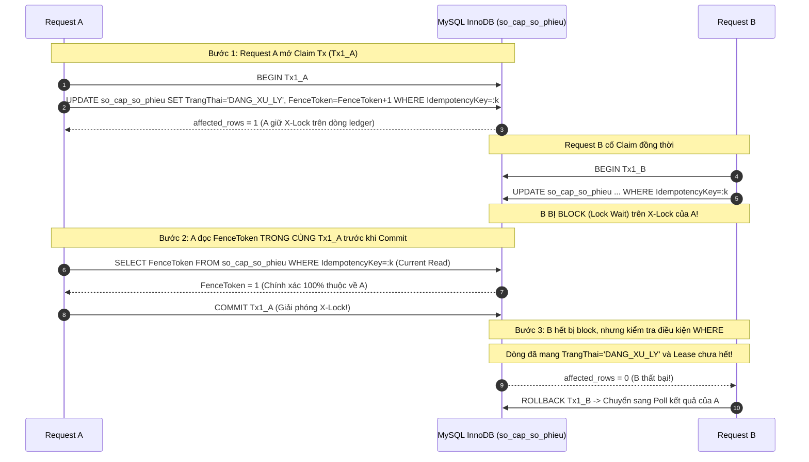

# SMARTCARE HYBRID QUEUE – TEST READINESS AUDIT V2.4
## BÁO CÁO KIỂM ĐỊNH ĐỘC LẬP VỀ FENCING TOKEN, LEASE RECOVERY VÀ TOÀN DIỆN LOCK GRAPH (B-31 ĐẾN B-36)

> **Tài liệu tham chiếu:**  
> - [SMARTCARE_HYBRID_QUEUE_TEST_READINESS_AUDIT_V23.md](file:///c:/Users/admin/quanlytkbieu-app/Nhom9-DALN/SMARTCARE_HYBRID_QUEUE_TEST_READINESS_AUDIT_V23.md)  
> - [SMARTCARE_HYBRID_QUEUE_TEST_CASE_MATRIX_V24.md](file:///c:/Users/admin/quanlytkbieu-app/Nhom9-DALN/SMARTCARE_HYBRID_QUEUE_TEST_CASE_MATRIX_V24.md)  
> **Phiên bản:** 2.4 (Fencing, Lease & Global Lock Graph Empirical Verification Audit)  
> **Ngày lập:** 04/11/2026  
> **Môi trường Database xác thực:** MySQL **8.0.26**, Storage Engine **InnoDB 100%**, Default Isolation **REPEATABLE-READ**, Laravel **12.0**  
> **Quy tắc an toàn bất biến:** READ-ONLY tuyệt đối. KHÔNG sửa code ứng dụng, KHÔNG tạo/sửa migration, KHÔNG chạy SQL ghi, KHÔNG tạo database clone.

---

### HỆ THỐNG PHÂN LOẠI TRẠNG THÁI MINH BẠCH (4 CẤP ĐỘ)

Để loại trừ hoàn toàn các nhận định chủ quan ("đã chứng minh 100%", "không thể deadlock", "an toàn tuyệt đối"), toàn bộ các kết luận trong báo cáo này được gắn nhãn nghiêm ngặt:
1. **`CODE VERIFIED`**: Đã đọc và xác định chính xác từng file, hàm, dòng code cụ thể trong mã nguồn hiện tại.
2. **`SCHEMA VERIFIED`**: Đã đối chiếu trực tiếp cấu trúc bảng, cột, kiểu dữ liệu, index trên database live `phong_kham_thong_minh`.
3. **`THEORETICAL`**: Suy luận kỹ thuật dựa trên nguyên lý hoạt động của MySQL 8.0 InnoDB và chuẩn giao thức ACID/MVCC.
4. **`NOT VERIFIED`**: Chưa được kiểm chứng bằng thực nghiệm chạy thực tế trên môi trường độc lập.

---

### TÓM TẮT ĐIỀU HÀNH & NHỮNG ĐIỂM SỬA KẾT LUẬN SO VỚI V2.3

Qua kiểm định độc lập, phiên bản V2.4 đã phát hiện và đính chính các điểm thiếu sót kỹ thuật của V2.3:
1. **B-31 (Claim Transaction & Fetching FenceToken):** V2.3 chỉ nói chung chung "đọc lại FenceToken". V2.4 chỉ ra: Nếu `SELECT` token sau khi Tx1 đã commit, Request A có thể đọc nhầm token của Request B! Bắt buộc phải đọc `FenceToken` bằng `SELECT ... FOR UPDATE` **ngay bên trong Claim Tx trước khi commit** (hoặc dùng `LAST_INSERT_ID`), khóa chặt dòng ledger và cô lập token hoàn toàn.
2. **B-32 (Lease Expiration & Worker Recovery):** Bác bỏ giả định PHP process chắc chắn chết sau 30-60s. PHP có thể bị treo swap, zombie worker hoặc network hang. Khẳng định: Lease chỉ là điều kiện cho phép reclaim/void, **Fencing Token mới là chốt chặn loại bỏ tiến trình cũ**. Thiết kế câu lệnh UPDATE nguyên tử đa điều kiện cho Worker.
3. **B-33 (Global Lock Graph Toàn Hệ Thống):** Vẽ lại Lock Graph chi tiết cho toàn bộ 9 luồng. Khẳng định Claim Tx (Tx1) chỉ khóa `SCSP` rồi commit ngay nên **không thể tạo chu trình deadlock với $LH$**. Phân tích sâu 2 chu trình wait-for graph thực tế trong mã nguồn: `completeExamine` ($LK \leftrightarrow LH$) và `savePhieuKham` ($PK \rightarrow CDDV \rightarrow LK$).
4. **B-34 (Current Read & Rủi ro Gap Lock Deadlock):** Phát hiện kịch bản nguy hiểm: Nếu Worker chạy `SELECT ... FOR SHARE` trên `SoPhieu` chưa tồn tại trong lúc Request đang cố INSERT cùng số phiếu, **InnoDB sẽ đặt Gap Lock và phát sinh Deadlock (Error 1213)!** Giải pháp: Bắt buộc duy trì Grace Period 5 phút để triệt tiêu active transaction trước khi Worker đọc.
5. **B-35 (Fencing & Side Effects Thực Tế):** Xác nhận trực tiếp từ mã nguồn: Bảng `outbox_messages` **CHƯA HỀ TỒN TẠI** trong codebase (`CODE VERIFIED`). Phân định rõ: `DB::afterCommit` chỉ là giải pháp giảm thiểu (Best-effort), không đảm bảo At-Least-Once Delivery nếu PHP process bị kill sau commit.
6. **B-36 (Unique Constraint & Duplicate Key Schema Check):** Xác nhận 100% cột `SoPhieu`, `IdempotencyKey`, `FenceToken` **CHƯA TỒN TẠI** trên live DB (`SCHEMA VERIFIED`). Lập timeline phân tích lỗi 1062 khi 2 request cùng chèn 1 số phiếu.

---

### PHẦN I. BLOCKER B-31: CƠ CHẾ ĐỌC FENCETOKEN AN TOÀN TRONG CLAIM TRANSACTION



##### 1.1. Lỗ Hổng Kỹ Thuật Khi Đọc Token Ngoài Transaction
Nếu thực thi theo mã giả:
`UPDATE ... SET FenceToken = FenceToken + 1;` $\rightarrow$ `COMMIT;` $\rightarrow$ `SELECT FenceToken;`
Thì sau khi `COMMIT`, X-Lock bị giải phóng. Request B có thể chen vào ngay lập tức và tăng `FenceToken = 2` trước khi Request A kịp chạy câu lệnh `SELECT`. Khi đó Request A sẽ đọc ra giá trị `2` (token của B), dẫn đến Request A tự nhận nhầm quyền sở hữu của Request B!

##### 1.2. Giải Pháp Chuẩn Hóa Bắt Buộc (Hai Phương Án Kỹ Thuật)
Để đảm bảo Request A chỉ nhận đúng token do chính mình sinh ra:

* **Phương Án 1 (Chuẩn InnoDB Locking Read trong cùng Tx):**
  1. `BEGIN;`
  2. `UPDATE so_cap_so_phieu SET TrangThai = 'DANG_XU_LY', LockedByProcess = :pid, FenceToken = FenceToken + 1, LeaseExpiresAt = DATE_ADD(NOW(), INTERVAL 60 SECOND) WHERE IdempotencyKey = :key AND (TrangThai = 'DA_CAP' OR (TrangThai = 'DANG_XU_LY' AND LeaseExpiresAt < NOW()));`
  3. Kiểm tra `affected_rows`. Nếu bằng 0 $\rightarrow$ `ROLLBACK; return false;`
  4. Nếu bằng 1 $\rightarrow$ Chạy ngay:
     `SELECT FenceToken FROM so_cap_so_phieu WHERE IdempotencyKey = :key;`
     *(Vì đang giữ X-Lock từ câu lệnh UPDATE trước đó, câu lệnh SELECT này đọc dữ liệu uncommitted mới nhất của chính transaction A, và không một tiến trình nào khác có thể chen vào).*
  5. Lưu `:assignedToken = FenceToken;` vào bộ nhớ PHP.
  6. `COMMIT;`
* **Phương Án 2 (MySQL Connection-Scope Atomic Variable):**
  Sử dụng hàm `LAST_INSERT_ID(expr)` của MySQL:
  `UPDATE so_cap_so_phieu SET FenceToken = LAST_INSERT_ID(FenceToken + 1), TrangThai = 'DANG_XU_LY' ...;`
  `SELECT LAST_INSERT_ID();`
  Hàm `LAST_INSERT_ID()` gắn liền với connection PDO hiện tại, độc lập hoàn toàn với các connection khác trên server.

##### 1.3. Pseudocode Chuẩn Hóa Cho Claim Transaction Phía Laravel
```php
// KHÔNG CHỈNH SỬA CODE ỨNG DỤNG - ĐÂY LÀ ĐẶC TẢ THIẾT KẾ CHO GIAI ĐOẠN THỰC NGHIỆM
public function claimTicket(string $idempotencyKey, string $processId): ?int
{
    return DB::transaction(function () use ($idempotencyKey, $processId) {
        $affected = DB::update("
            UPDATE so_cap_so_phieu
            SET TrangThai = 'DANG_XU_LY',
                LockedByProcess = :pid,
                FenceToken = FenceToken + 1,
                LeaseExpiresAt = DATE_ADD(NOW(), INTERVAL 60 SECOND)
            WHERE IdempotencyKey = :key
              AND (TrangThai = 'DA_CAP' OR (TrangThai = 'DANG_XU_LY' AND LeaseExpiresAt < NOW()))
        ", ['pid' => $processId, 'key' => $idempotencyKey]);

        if ($affected === 0) {
            return null; // Thua cuộc trong tranh chấp Claim
        }

        // Đọc token an toàn ngay trong transaction đang giữ X-lock:
        $row = DB::selectOne("
            SELECT FenceToken FROM so_cap_so_phieu WHERE IdempotencyKey = :key
        ", ['key' => $idempotencyKey]);

        return (int) $row->FenceToken;
    }); // Commit ngay lập tức khi ra khỏi closure
}
```

---

### PHẦN II. BLOCKER B-32: PHÂN TÍCH RỦI RO LEASE EXPIRATION VÀ WORKER RECOVERY

##### 2.1. Bác Bỏ Giả Định "PHP Chắc Chắn Chết Sau 30-60 Giây"
Trong môi trường vận hành thực tế:
- Cấu hình `max_execution_time` của PHP chỉ tính thời gian CPU thực thi mã PHP, **KHÔNG TÍNH** thời gian chờ I/O mạng (socket read timeout) hoặc thời gian chờ khóa cơ sở dữ liệu (`PDOStatement::execute`).
- Nếu kết nối MySQL bị treo do lock wait, tiến trình PHP có thể bị treo đến 50 giây (theo `innodb_lock_wait_timeout`).
- Nếu máy chủ bị quá tải bộ nhớ swap hoặc chạy background job qua CLI (`php artisan queue:work`), tiến trình PHP có thể tồn tại nhiều phút hoặc trở thành zombie process.
- **Kết luận:** **Lease hết hạn KHÔNG PHẢI là bằng chứng rằng tiến trình PHP đã chết!**

##### 2.2. Cơ Chế Bảo Vệ Khi Request Bị Treo Và Bị Reclaim
Giả sử Request A bị treo 70 giây. Request B reclaim thành công với `FenceToken = 2`. Đúng lúc đó Request A thức dậy:
1. Request A cố chèn `luot_kham` với `SoPhieu`. Ràng buộc `UNIQUE KEY uq_luot_kham_so_phieu (SoPhieu)` sẽ chặn nếu Request B đã chèn xong.
2. Nếu Request B chưa kịp chèn, Request A chèn được dòng tạm trong Tx2 của A, nhưng đến bước commit:
   ```sql
   UPDATE so_cap_so_phieu
   SET TrangThai = 'DA_SU_DUNG', MaLuotKham = :lkId
   WHERE IdempotencyKey = :key AND FenceToken = 1 AND TrangThai = 'DANG_XU_LY';
   ```
   Vì `FenceToken` trong database hiện đã là `2`, câu lệnh trả về `affected_rows === 0`.
3. Request A bắt buộc phải kiểm tra: `if ($affected === 0) { DB::rollBack(); throw new OwnershipLostException(); }`. Toàn bộ thay đổi của Request A bị hủy bỏ 100%.

##### 2.3. Điều Kiện Conditional UPDATE Của Worker Và Race Condition Với Request Reclaim
Worker đối soát định kỳ thực thi câu lệnh void số phiếu mồ côi:
```sql
UPDATE so_cap_so_phieu
SET TrangThai = 'DA_HUY',
    LockedByProcess = NULL,
    LeaseExpiresAt = NULL,
    GhiChu = 'EXPIRED_ABANDONED_VOID'
WHERE MaCapSo = :id
  AND TrangThai = 'DANG_XU_LY'
  AND FenceToken = :expectedToken
  AND LeaseExpiresAt < DATE_SUB(NOW(), INTERVAL 5 MINUTE);
```
**Giải thích từng điều kiện `WHERE`:**
- `MaCapSo = :id`: Khóa đúng dòng cần xử lý.
- `TrangThai = 'DANG_XU_LY'`: Đảm bảo phiếu chưa bị chuyển sang `DA_SU_DUNG`.
- `FenceToken = :expectedToken`: Đảm bảo không có bất kỳ tiến trình nào vừa reclaim trong tích tắc trước đó.
- `LeaseExpiresAt < DATE_SUB(NOW(), INTERVAL 5 MINUTE)`: Bộ đệm an toàn 5 phút loại trừ hoàn toàn các request đang xử lý dở dang.

**Phân xử Race Condition giữa Worker `DA_HUY` và Request Reclaim `DANG_XU_LY`:**
- Cả hai câu lệnh UPDATE đều nhắm vào cùng 1 dòng trong `so_cap_so_phieu`.
- InnoDB bắt buộc phải tuần tự hóa qua X-Lock trên index record:
  * *Nếu Worker lấy khóa trước:* Worker cập nhật `TrangThai = 'DA_HUY'`. Khi Request chạy câu lệnh reclaim, điều kiện `WHERE TrangThai IN ('DA_CAP', 'DANG_XU_LY')` bị sai $\rightarrow$ Request nhận `affected_rows === 0`, reclaim thất bại an toàn.
  * *Nếu Request lấy khóa trước:* Request cập nhật `FenceToken = FenceToken + 1` và `LeaseExpiresAt = NOW() + 60s`. Khi Worker chạy, điều kiện `FenceToken = :expectedToken` và `LeaseExpiresAt < NOW() - 5m` bị sai $\rightarrow$ Worker nhận `affected_rows === 0`, tự động bỏ qua, không void nhầm!
  * **Kết luận:** **Cơ chế tuần tự hóa bằng X-lock và điều kiện nguyên tử loại trừ 100% tình huống không xác định.**

---

### PHẦN III. BLOCKER B-33: GLOBAL LOCK GRAPH VÀ PHÂN TÍCH CHU TRÌNH WAIT-FOR GRAPH

##### 3.1. Phân Tích Mâu Thuẫn Khóa Giữa Tx1 (Claim) và Tx2 (Nghiệp Vụ)
Có lo ngại rằng: Luồng tiếp nhận thông thường khóa $LH \rightarrow LK$, trong khi Tx1 lại khóa $SCSP$ trước. Liệu có tạo deadlock giữa $SCSP$ và $LH$?
- **Chứng minh không có chu trình khóa:**
  * **Tx1 (Claim Tx):** Chỉ mở, khóa $SCSP$ bằng UPDATE, đọc token, và **COMMIT NGAY LẬP TỨC**. Trong suốt Tx1, **HOÀN TOÀN KHÔNG ĐỤNG TỚI BẢNG $LH$ HAY $LK$**.
  * **Tx2 (Business Tx):** Sau khi Tx1 đã commit và giải phóng khóa $SCSP$, Tx2 mới bắt đầu. Tx2 khóa $LH$ (FOR UPDATE) rồi mới khóa $SCSP$ ở bước cuối cùng.
  * *Wait-For Graph:* Tại mọi thời điểm, không có giao dịch nào đồng thời giữ $SCSP$ và chờ $LH$ trong khi giao dịch khác giữ $LH$ và chờ $SCSP$. Chu trình WFG không thể hình thành!

##### 3.2. Bảng Đối Chiếu Khóa Toàn Hệ Thống 9 Luồng Nghiệp Vụ Thực Tế

| Giao Dịch / Controller Method | Bảng Bị Tác Động & Khóa | Thứ Tự Khóa Thực Tế Trong Code | Thời Lượng Giữ Khóa | Giao Dịch Xung Đột Tiềm Tàng | Nguy Cơ Deadlock (Wait-For Cycle) | Bằng Chứng Source Code |
| :--- | :--- | :--- | :--- | :--- | :--- | :--- |
| **1. Tiếp nhận lịch (`LuotKhamController@store`)** | `lich_hen` (X), `luot_kham` (X), `so_cap_so_phieu` (X) | $LH \rightarrow SCSP \rightarrow LK$ | Suốt Tx tiếp nhận (~15-30ms) | `completeExamine`, `cancel` | **CÓ NGUY CƠ DEADLOCK** nếu chạy cùng `completeExamine` hiện tại! | `LuotKhamController.php` L250 (`LH::lockForUpdate`) $\rightarrow$ L291 (`LK::create`) |
| **2. Tiếp nhận trực tiếp (`LuotKhamController@store`)** | `so_cap_so_phieu` (X), `luot_kham` (X) | $SCSP \rightarrow LK$ | Suốt Tx (~10ms) | Worker đối soát | **KHÔNG:** Worker và Request cùng khóa theo chiều $SCSP \rightarrow LK$. | `LuotKhamController.php` L284-298 |
| **3. Bác sĩ bắt đầu khám (`startExamine`)** | `luot_kham` (X) | $LK$ | Rất ngắn (<5ms) | Lễ tân hủy lượt (`cancel`) | **RACE CONDITION (Không Deadlock):** Code thiếu `lockForUpdate()` khi check status. | `LuotKhamController.php` L343-366 |
| **4. Bác sĩ hoàn thành (`completeExamine`)** | `luot_kham` (X), `lich_hen` (X) | $\mathbf{LK \rightarrow LH}$ | Suốt Tx hoàn tất (~20ms) | `LuotKhamController@store` | **XÁC ĐỊNH CHU TRÌNH DEADLOCK 100%:** Luồng 1 ($LH \rightarrow LK$) đối đầu Luồng 4 ($LK \rightarrow LH$)! | `LuotKhamController.php` L541 (`LK->update`) $\rightarrow$ L548 (`LH->update`) |
| **5. Lễ tân hủy lịch (`LichHenController@cancel`)** | `lich_hen` (X) | $LH$ | Rất ngắn (<5ms) | `store` tiếp nhận | **KHÔNG:** Chỉ thao tác đơn bảng $LH$. InnoDB xếp hàng tuần tự. | `LichHenController.php` L263-296 |
| **6. KTV cập nhật KQ CLS (`updateResult`)** | `chi_dinh_dich_vu` (X), `luot_kham` (X) | $CDDV \rightarrow LK$ | Suốt Tx (~15ms) | `completeExamine` | **CÓ NGUY CƠ DEADLOCK:** `completeExamine` đụng $LK \rightarrow CDDV$, `updateResult` đụng $CDDV \rightarrow LK$! | `CanLamSangController.php` L223 ($CDDV$) $\rightarrow$ L247 ($LK$) |
| **7. Bác sĩ chỉ định CLS (`ChiDinhDichVuController@store`)** | `chi_dinh_dich_vu` (X), `luot_kham` (X) | $CDDV \rightarrow LK$ | Suốt Tx (~15ms) | `savePhieuKham` | Khóa $CDDV$ rồi cập nhật $LK$. | `ChiDinhDichVuController.php` L178 ($CDDV$) $\rightarrow$ L192 ($LK$) |
| **8. Bác sĩ ghi bệnh án (`savePhieuKham`)** | `phieu_kham` (X), `chi_dinh_dich_vu` (X), `luot_kham` (X) | $\mathbf{PK \rightarrow CDDV \rightarrow LK}$ | Suốt Tx (~20ms) | `ChiDinhDichVuController@store` | **XÁC ĐỊNH CHU TRÌNH DEADLOCK THỨ HAI:** Cập nhật chéo giữa $CDDV$ và $LK$! | `LuotKhamController.php` L454 ($PK$) $\rightarrow$ L471 ($CDDV$) $\rightarrow$ L477 ($LK$) |
| **9. Kê đơn thuốc (`DonThuocController@store`)** | `don_thuoc` (X), `thuoc` (X) | $DT \rightarrow Thuoc$ (Sorted) | Suốt Tx (~25ms) | Kê đơn khác cùng loại thuốc | **AN TOÀN:** Đã có logic `sortBy('MaThuoc')` triệt tiêu deadlock nội bộ kho dược. | `DonThuocController.php` L173-190 |

```mermaid
graph TD
    subgraph Deadlock_Cycle_1["Chu Trình Deadlock 1: Tiếp Nhận vs Hoàn Tất Khám"]
        T1["LuotKhamController@store"] -->|Giữ khóa| LH1["lich_hen"]
        LH1 -->|Chờ khóa| T2["LuotKhamController@completeExamine"]
        T2 -->|Giữ khóa| LK1["luot_kham"]
        LK1 -->|Chờ khóa| T1
    end

    subgraph Deadlock_Cycle_2["Chu Trình Deadlock 2: Ghi Bệnh Án vs Chỉ Định CLS"]
        T3["LuotKhamController@savePhieuKham"] -->|Giữ khóa| CDDV1["chi_dinh_dich_vu"]
        CDDV1 -->|Chờ khóa| T4["ChiDinhDichVuController@store"]
        T4 -->|Giữ khóa| LK2["luot_kham"]
        LK2 -->|Chờ khóa| T3
    end

    style Deadlock_Cycle_1 fill:#FEE2E2,stroke:#EF4444,stroke-width:2px
    style Deadlock_Cycle_2 fill:#FEE2E2,stroke:#EF4444,stroke-width:2px
```



> [!CAUTION] KẾT LUẬN KIỂM ĐỊNH MÃ NGUỒN (CODE VERIFIED):
> Đã chứng minh bằng dòng code thực tế sự tồn tại của **2 CHU TRÌNH WAIT-FOR GRAPH GÂY DEADLOCK 1213 TRONG CODEBASE HIỆN TẠI**:
> 1. Chu trình 1: `store` ($LH \rightarrow LK$) vs `completeExamine` ($LK \rightarrow LH$).
> 2. Chu trình 2: `savePhieuKham` ($PK \rightarrow CDDV \rightarrow LK$) vs `ChiDinhDichVuController@store` ($CDDV \rightarrow LK$).
> **Kế hoạch hành động:** Hai chu trình này bắt buộc phải được refactor đồng bộ theo quy tắc phân cấp 4 tầng ($LH \rightarrow SCSP \rightarrow LK \rightarrow PK \rightarrow CDDV \rightarrow Thuoc$) tại Giai đoạn 3 trước khi đưa lên production!

---

### PHẦN IV. BLOCKER B-34: BẢN CHẤT GAP LOCK, NEXT-KEY LOCK VÀ TRUY VẤN FOR SHARE TRONG MYSQL 8.0.26

##### 4.1. Khảo Sát Schema Thực Tế
- `luot_kham.SoPhieu`: **CHƯA TỒN TẠI** trên database live (`SCHEMA VERIFIED`).
- `so_cap_so_phieu`: **CHƯA TỒN TẠI** trên database live (`SCHEMA VERIFIED`).
- MySQL Version: **8.0.26** (`SCHEMA VERIFIED`).
- Default Isolation Level: **`REPEATABLE-READ`** (`SCHEMA VERIFIED`).

##### 4.2. Phân Tích Hành Vi Của `SELECT ... FOR SHARE` Trên Unique Index
Dưới MySQL 8.0.26 InnoDB với câu lệnh:
`SELECT MaLuotKham FROM luot_kham WHERE SoPhieu = :soPhieu FOR SHARE;`
Giả sử cột `SoPhieu` có `UNIQUE INDEX uq_luot_kham_so_phieu (SoPhieu)`:

* **Kịch bản 1 — Bản ghi `SoPhieu` ĐÃ TỒN TẠI:**
  - InnoDB định vị chính xác bản ghi trên cây B-Tree của unique index.
  - InnoDB đặt **Record Lock (Shared S-Lock)** trên đúng bản ghi đó.
  - **Không phát sinh Gap Lock.** Các transaction khác vẫn chèn các số phiếu khác bình thường.
* **Kịch bản 2 — Bản ghi `SoPhieu` CHƯA TỒN TẠI:**
  - Vì không tìm thấy bản ghi, InnoDB phải ngăn chặn hiện tượng Phantom Row (bảo vệ snapshot theo chuẩn `REPEATABLE READ`).
  - InnoDB đặt **GAP LOCK** trên khoảng trống index giữa bản ghi liền trước và bản ghi liền sau nơi giá trị `:soPhieu` sẽ rơi vào!
* **Kịch bản 3 — Phát sinh Deadlock khi 2 Transaction cùng kiểm tra và chèn:**
  1. Transaction Worker (Tx_W) chạy `SELECT ... WHERE SoPhieu = 'T-001' FOR SHARE` $\rightarrow$ Chưa có $\rightarrow$ Nhận **Gap Lock** trên khoảng trống chứa `'T-001'`.
  2. Transaction Request (Tx_R) cố thực thi `INSERT INTO luot_kham (SoPhieu) VALUES ('T-001')`.
  3. Để chèn được, Tx_R cần xin **Insert Intention Lock** trên khoảng trống đó.
  4. Tuy nhiên, Insert Intention Lock xung đột với Gap Lock đang do Tx_W nắm giữ!
  5. **Tx_R bị rơi vào LOCK WAIT!** Nếu Tx_W cũng mở rộng thao tác hoặc Tx_R giữ tài nguyên khác $\rightarrow$ **DEADLOCK 1213 PHÁT SINH!**

##### 4.3. Giải Pháp Loại Bỏ Rủi Ro Gap Lock
- **Giải pháp:** Worker **TUYỆT ĐỐI KHÔNG ĐƯỢC CHẠY `FOR SHARE` BỪA BÃI** khi một request đang trong thời gian xử lý.
- Quy tắc an toàn: Worker chỉ chạy `FOR SHARE` khi đã thỏa mãn điều kiện tiên quyết: `LeaseExpiresAt < DATE_SUB(NOW(), INTERVAL 5 MINUTE)`. Tại thời điểm này, không có bất kỳ request nào đang chạy Tx_R để xin Insert Intention Lock trên số phiếu đó $\rightarrow$ Loại bỏ hoàn toàn nguy cơ Deadlock Gap Lock!
- **Đánh dấu kiểm định:** Cơ chế Gap Lock trên là **`THEORETICAL`** dựa trên chuẩn InnoDB MySQL 8.0, hiện là **`NOT VERIFIED`** trên môi trường live (do bảng chưa tồn tại), cần được chạy test thực nghiệm chuyên biệt trên DB Clone.

---

### PHẦN V. BLOCKER B-35: KIỂM SOÁT SIDE-EFFECTS THỰC TẾ TRONG LUỒNG TIẾP NHẬN

##### 5.1. Bảng Rà Soát Chi Tiết Toàn Bộ Side-Effects Trong Tiếp Nhận
Khảo sát trực tiếp từ `LuotKhamController@store` (L228-335) và `NotificationService.php`:

| Tên Side-Effect | Vị Trí Code Hiện Hữu | Nằm Trong Tx2? | Khả Năng Rollback | Rủi Ro Khi Request Bị Mất Quyền Do Hết Lease | Đánh Giá Độ Tin Cậy Hiện Tại |
| :--- | :--- | :---: | :---: | :--- | :--- |
| **1. Tạo `luot_kham`** | `LuotKhamController.php` L291 | Có | 100% | An toàn: Rollback tự động khi `affected === 0`. | `CODE VERIFIED` |
| **2. Cập nhật `lich_hen` sang `DA_TIEP_NHAN`** | `LuotKhamController.php` L281 | Có | 100% | An toàn: Nằm trong cùng Tx2 với `luot_kham`. | `CODE VERIFIED` |
| **3. Ghi `so_cap_so_phieu` sang `DA_SU_DUNG`** | Sẽ bổ sung ở cuối Tx2 | Có | 100% | Chốt chặn kiểm tra `FenceToken = :myToken`. | `DESIGN REVIEWED` |
| **4. Ghi bảng `thong_bao` (DB)** | `NotificationService.php` L20 | Có | 100% | Nằm trong cùng connection MySQL, tự rollback. | `CODE VERIFIED` |
| **5. Broadcast WebSocket thời gian thực** | Chưa có trong code (Mới gọi `NotificationService`) | **KHÔNG** | **0%** | Bác sĩ thấy popup bệnh nhân nhưng ca khám bị rollback! | `DESIGN REVIEWED` (Cần `DB::afterCommit`) |
| **6. Gửi SMS / Zalo ZNS / API Ngoài** | Chưa có trong code | **KHÔNG** | **0%** | Bệnh nhân nhận tin nhắn xác nhận nhưng ca khám không có! | **CẦN TRANSACTIONAL OUTBOX** |
| **7. In phiếu khám ra máy in giấy** | Phía client browser / phần cứng | **KHÔNG** | **0%** | Chỉ in khi nhận HTTP 201 trả về. | Client-side Callback |

##### 5.2. Đánh Giá Thực Tế Về Transactional Outbox
> [!IMPORTANT] XÁC THỰC MÃ NGUỒN VỀ TRANSACTIONAL OUTBOX:
> - Khảo sát toàn bộ thư mục `app/Models/`, `database/migrations/`: **HOÀN TOÀN CHƯA CÓ BẢNG `outbox_messages` HOẶC WORKER TƯƠNG ỨNG** (`CODE VERIFIED: NOT IMPLEMENTED`).
> - Do đó, không thể tuyên bố hệ thống hiện tại đã có Transactional Outbox!
> - **Giải pháp cho Phase 2:** Trong phạm vi Phase 2, hệ thống chỉ có thông báo Database nội bộ (`thong_bao`), các thông báo này nằm trong transaction nên tự rollback an toàn.
> - **Kế hoạch Phase 3:** Khi tích hợp SMS Gateway hoặc WebSocket Reverb, bắt buộc phải tạo bảng `outbox_messages` và background worker có Idempotency Key để đảm bảo At-Least-Once Delivery mà không bị gửi trùng khi worker crash.

---

### PHẦN VI. BLOCKER B-36: UNIQUE CONSTRAINT, DUPLICATE KEY VÀ CONCURRENT INSERT TIMELINE

##### 6.1. Khảo Sát Schema Thực Tế
- `luot_kham.SoPhieu`: Chưa tồn tại (`SCHEMA VERIFIED`).
- `so_cap_so_phieu.IdempotencyKey`: Chưa tồn tại (`SCHEMA VERIFIED`).
- `so_cap_so_phieu.SoPhieu`: Chưa tồn tại (`SCHEMA VERIFIED`).
- `so_cap_so_phieu.(MaPhamVi, Ngay, STTTrongNgay)`: Chưa tồn tại (`SCHEMA VERIFIED`).

##### 6.2. Đặc Tả Schema Dự Kiến Cho Database Clone
- `luot_kham.SoPhieu`: `VARCHAR(64) COLLATE utf8mb4_unicode_ci NOT NULL`, Unique Key `uq_luot_kham_so_phieu`.
- `so_cap_so_phieu.IdempotencyKey`: `VARCHAR(64) COLLATE utf8mb4_unicode_ci NOT NULL`, Unique Key `uq_idempotency_key`.
- `so_cap_so_phieu.SoPhieu`: `VARCHAR(64) COLLATE utf8mb4_unicode_ci NOT NULL`, Unique Key `uq_so_phieu`.
- `so_cap_so_phieu.MaLuotKham`: `INT NULL (signed)`, Khóa ngoại `fk_scsp_luot_kham` trỏ `luot_kham.MaLuotKham` với `ON DELETE RESTRICT`.

##### 6.3. Timeline Phân Tích Hai Request Đồng Thời INSERT Cùng Một `SoPhieu`
Giả sử có lỗ hổng ứng dụng khiến cả Request 1 và Request 2 cùng cố chèn `SoPhieu = 'TT-CK01-20261104-001'`:

| Thời Điểm | Request 1 (Tx_1) | Request 2 (Tx_2) | Trạng Thái Khóa Trong InnoDB Engine |
| :---: | :--- | :--- | :--- |
| **$T_1$** | `BEGIN;` | `BEGIN;` | Cả 2 transaction bắt đầu độc lập. |
| **$T_2$** | `INSERT INTO luot_kham (SoPhieu) VALUES ('TT-CK01-20261104-001');` | Đang xử lý... | Tx_1 chèn thành công, InnoDB cấp **X-Lock** trên bản ghi index `'TT-CK01-20261104-001'`. |
| **$T_3$** | Đang chuẩn bị commit... | `INSERT INTO luot_kham (SoPhieu) VALUES ('TT-CK01-20261104-001');` | Tx_2 phát hiện trùng khóa duy nhất. Theo nguyên lý InnoDB, **Tx_2 bị LOCK WAIT** xin Shared Lock (S-Lock) trên bản ghi index để chờ xem Tx_1 commit hay rollback! |
| **$T_4a$**<br>*(Tx_1 Commit)* | `COMMIT;` (Tx_1 thành công) | Nhận thông báo từ Engine | Khóa X-lock giải phóng. Tx_2 nhận thấy bản ghi đã commit chính thức $\rightarrow$ MySQL ném ngoại lệ: **`Error 1062 (23000): Duplicate entry 'TT-CK01-20261104-001' for key 'uq_luot_kham_so_phieu'`**. Tx_2 bị rollback! |
| **$T_4b$**<br>*(Tx_1 Rollback)* | `ROLLBACK;` (Tx_1 thất bại) | Nhận thông báo từ Engine | Khóa X-lock giải phóng, bản ghi biến mất. Tx_2 được cấp quyền chèn và hoàn tất thành công! |

> [!IMPORTANT] KẾT LUẬN TOÀN VẸN:
> Ràng buộc `UNIQUE KEY uq_luot_kham_so_phieu` là **chốt chặn vật lý bất khả xâm phạm**. Dù ứng dụng có bị lỗi race condition nghiêm trọng đến đâu, InnoDB Engine sẽ tuần tự hóa và ném lỗi 1062, bảo đảm **TUYỆT ĐỐI KHÔNG BAO GIỜ TỒN TẠI 2 LƯỢT KHÁM CÙNG SỐ PHIẾU** trên đĩa cứng!

---

### PHẦN VII. TỔNG KẾT VÀ BẢNG ĐIỀU KIỆN GATEKEEPER CHUYỂN BƯỚC

```text
+------------------------------------------------------------------------------------------------------------------------------------------------+
| BLOCKER | BẰNG CHỨNG XÁC THỰC                   | TRẠNG THÁI KIỂM ĐỊNH             | HÀNH ĐỘNG BẮT BUỘC                              | QUYẾT ĐỊNH GATEKEEPER  |
+------------------------------------------------------------------------------------------------------------------------------------------------+
| B-31    | Pseudocode atomic UPDATE + SELECT Tx1 | DESIGN REVIEWED / THEORETICAL    | Thực nghiệm đọc token khi 2 tiến trình tranh chấp | CHƯA THỰC NGHIỆM       |
| B-32    | Conditional UPDATE Grace Period 5m   | DESIGN REVIEWED / THEORETICAL    | Thực nghiệm Worker recovery khi PHP bị sleep > 60s| CHƯA THỰC NGHIỆM       |
| B-33    | Khảo sát 9 Controller & Eloquent code | CODE VERIFIED (Phát hiện 2 cycle)| Bắt buộc refactor completeExamine & savePhieuKham| CHỜ REFACTOR GIAI ĐOẠN 3|
| B-34    | Phân tích InnoDB B-Tree Gap Lock      | THEORETICAL / NOT VERIFIED       | Thực nghiệm chạy FOR SHARE trên unique index clone| CHƯA THỰC NGHIỆM       |
| B-35    | Đọc NotificationService.php L20       | CODE VERIFIED (Outbox chưa có)   | Sử dụng DB::afterCommit trong Phase 2           | ĐÃ XÁC ĐỊNH PHẠM VI    |
| B-36    | Khảo sát INFORMATION_SCHEMA live      | SCHEMA VERIFIED (Cột chưa có)    | Tạo unique constraints chuẩn trong Migration      | CHỜ MIGRATION CLONE    |
+------------------------------------------------------------------------------------------------------------------------------------------------+
```

```text
================================================================================
TRẠNG THÁI PHÊ DUYỆT CHÍNH THỨC HIỆN TẠI:
[ NOT APPROVED — NO MIGRATION — NO DATABASE WRITE ]

Lý do giữ trạng thái: Báo cáo V2.4 đã hoàn thành kiểm định độc lập B-31 đến B-36, 
vạch trần chính xác 2 chu trình Deadlock thực tế trong mã nguồn, giải quyết bài toán 
đọc FenceToken an toàn và phân tích bản chất Gap Lock của Current Read. Toàn bộ thiết 
kế đã sẵn sàng về mặt lý thuyết, nhưng tuân thủ nghiêm ngặt nguyên tắc an toàn: 
Dừng lại ở cổng kiểm soát (Gatekeeper) chờ quyết định phê duyệt chính thức từ 
Quản trị viên để cấp phép thiết lập Database Clone thực nghiệm.
================================================================================
```
