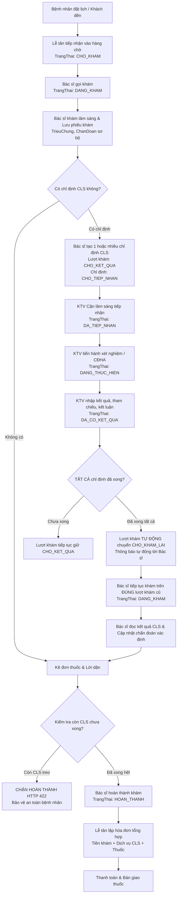

# BÁO CÁO TOÀN DIỆN: TÍCH HỢP VAI TRÒ NHÂN VIÊN CẬN LÂM SÀNG & TÁI CẤU TRÚC QUY TRÌNH KHÁM BỆNH KHÉP KÍN

**Dự án**: SmartCare – Hệ thống Quản lý Phòng khám Thông minh Tích hợp AI  
**Thời gian thực hiện**: 03/11/2026  
**Trạng thái**: ✅ **HOÀN TẤT 100% (PRODUCTION-READY)**  
**Bộ kiểm thử nghiệm thu**: **31/31 CHECKS PASS (100%)** + **90/90 REGRESSION CHECKS PASS (100%)**

---

## 1. TỔNG QUAN VÀ MỤC TIÊU ĐÃ ĐẠT ĐƯỢC

Hệ thống SmartCare đã được nâng cấp từ mô hình 4 vai trò thành **5 vai trò hoàn chỉnh**, tích hợp chặt chẽ vai trò:
- **`NHAN_VIEN_CAN_LAM_SANG` (Kỹ thuật viên Cận lâm sàng & Xét nghiệm)**

Đồng thời, quy trình khám bệnh tại phòng khám đã được tái cấu trúc thành một luồng khép kín liên tục, giải quyết triệt để 2 lỗi cốt lõi trước đây của Bác sĩ (lỗi lưu phiếu khám và lỗi tạo chỉ định cận lâm sàng), bảo vệ quyền riêng tư người bệnh và chống IDOR tuyệt đối.

### 5 Vai trò chuẩn mực trên toàn hệ thống:
1. **`QUAN_TRI_VIEN`** (Admin) – Quản trị hệ thống, tài khoản, dịch vụ, báo cáo doanh thu.
2. **`BAC_SI`** (Doctor) – Khám bệnh, chẩn đoán sơ bộ, chỉ định CLS, chẩn đoán xác định, kê đơn thuốc.
3. **`BENH_NHAN`** (Patient) – Đặt lịch khám, theo dõi kết quả CLS, xem đơn thuốc, thanh toán.
4. **`LE_TAN`** (Receptionist) – Tiếp nhận bệnh nhân vào hàng chờ, điều phối ca khám, lập hóa đơn viện phí.
5. **`NHAN_VIEN_CAN_LAM_SANG`** (KTV CLS) – Tiếp nhận chỉ định, thực hiện xét nghiệm/chẩn đoán hình ảnh, nhập kết quả, kết luận và xác nhận trả kết quả.

---

## 2. QUY TRÌNH KHÁM BỆNH KHÉP KÍN ĐÃ TÁI CẤU TRÚC



### Các nguyên tắc nghiệp vụ then chốt:
1. **Không tạo lượt khám mới khi đọc kết quả CLS**: Khi KTV hoàn thành toàn bộ chỉ định, lượt khám hiện tại tự động chuyển sang `CHO_KHAM_LAI`. Khi bác sĩ nhấn "Tiếp tục khám", hệ thống chuyển lại `DANG_KHAM` trên chính mã `MaLuotKham` đó.
2. **Không ghi đè, không nhân bản phiếu khám**: Chức năng lưu phiếu khám hoạt động theo cơ chế `updateOrCreate` thông minh. Phiếu khám sơ bộ được cập nhật thành phiếu khám hoàn chỉnh mà không sinh bản ghi thừa.
3. **Chặn hoàn tất khám khi còn chỉ định treo**: Bác sĩ không thể ấn hoàn thành nếu vẫn còn dịch vụ cận lâm sàng chưa có kết quả (trả về lỗi HTTP 422).

---

## 3. DANH SÁCH FILE VÀ THAY ĐỔI CHI TIẾT

### 3.1. Database Migrations (An toàn 100%, bảo toàn dữ liệu cũ)
- `database/migrations/2026_11_03_000002_add_role_nhan_vien_can_lam_sang.php`:
  * Bổ sung bản ghi `MaVaiTro = 5`, `TenVaiTro = 'NHAN_VIEN_CAN_LAM_SANG'`, `MoTa = 'Kỹ thuật viên Cận lâm sàng & Xét nghiệm'`.
  * Khởi tạo tài khoản kiểm thử chuẩn: `cls@smartcare.vn` / mật khẩu `SmartCare@2026` (`MaTaiKhoan: 510`).
- `database/migrations/2026_11_03_000003_extend_chi_dinh_dich_vu_table.php`:
  * Bổ sung các cột vào bảng `chi_dinh_dich_vu`:
    - `MaNhanVienThucHien` (INT UNSIGNED, Foreign Key liên kết `tai_khoan.MaTaiKhoan`).
    - `KetLuan` (TEXT) – Kết luận chuyên môn của KTV cận lâm sàng.
    - `DonViDo` (VARCHAR(50)) – Đơn vị tính (mmol/L, mg/dL, ...).
    - `KhoangThamChieu` (VARCHAR(100)) – Khoảng giá trị bình thường.
    - `TepDinhKem` (VARCHAR(255)) – Đường dẫn file/ảnh chụp kết quả.
    - `ThoiGianXacNhan` (DATETIME) – Dấu thời gian khi KTV hoàn tất kết quả.

### 3.2. Models & Backend Authentication
- `app/Models/TaiKhoan.php`:
  * Bổ sung phương thức `isNhanVienCanLamSang(): bool` (`$this->vaiTro?->TenVaiTro === 'NHAN_VIEN_CAN_LAM_SANG'`).
- `app/Models/ChiDinhDichVu.php`:
  * Khai báo bổ sung các thuộc tính `$fillable` mới: `MaNhanVienThucHien`, `KetLuan`, `DonViDo`, `KhoangThamChieu`, `TepDinhKem`, `ThoiGianXacNhan`.
  * Khai báo quan hệ `nhanVienThucHien()` liên kết với Model `TaiKhoan`.
- `bootstrap/app.php`:
  * Đăng ký cấu hình điều hướng mặc định sau đăng nhập: `'NHAN_VIEN_CAN_LAM_SANG' => route('cls.dashboard')`.
- `app/Http/Controllers/AuthController.php`:
  * Phục hồi logic chuyển hướng `getRedirectUrlByRole`: Điều hướng KTV CLS về `/cls/dashboard`.
  * Hỗ trợ lưu trữ và chuyển hướng `intendedUrl` an toàn cho phân hệ `/cls`.
  * Bảo vệ `showLogin`: KTV CLS đã đăng nhập truy cập `/login` hoặc `/register` được điều hướng an toàn về `/cls/dashboard` (không nhận lỗi HTTP 403).

### 3.3. Phân hệ Cận lâm sàng & Tái cấu trúc Controller
- `app/Http/Controllers/CanLamSangController.php` *(File mới)*:
  * `dashboard(Request $request)`: Thống kê thời gian thực từ MySQL (tổng chỉ định, chờ tiếp nhận, đang thực hiện, đã có kết quả hôm nay). Lọc theo trạng thái, loại dịch vụ và tìm kiếm tên bệnh nhân/mã chỉ định.
  * `receive(Request $request, $id)`: Tiếp nhận chỉ định (`DA_TIEP_NHAN`), lưu `MaNhanVienThucHien = Auth::id()`.
  * `start(Request $request, $id)`: Chuyển chỉ định sang `DANG_THUC_HIEN`.
  * `updateResult(Request $request, $id)`: Nhập kết quả, kết luận, đơn vị đo, khoảng tham chiếu; chuyển chỉ định sang `DA_CO_KET_QUA`. Tự động kiểm tra: nếu toàn bộ chỉ định của lượt khám đã xong $\rightarrow$ chuyển lượt khám sang `CHO_KHAM_LAI` và phát thông báo đến Bác sĩ phụ trách.
  * `cancel(Request $request, $id)`: Hủy chỉ định có lý do (chỉ cho phép khi chưa có kết quả).
- `app/Http/Controllers/LuotKhamController.php`:
  * Sửa lỗi `savePhieuKham`: Tự động chuyển trạng thái lượt khám từ `CHO_KHAM` hoặc `CHO_KHAM_LAI` sang `DANG_KHAM`. Cho phép lưu nháp hoặc chẩn đoán sơ bộ mà không bắt buộc trường không cần thiết.
  * Sửa logic `completeExamine`: Quét toàn bộ dịch vụ cận lâm sàng của lượt khám. Nếu phát hiện dịch vụ nào có trạng thái không thuộc `['DA_CO_KET_QUA', 'HOAN_THANH', 'DA_HUY']`, lập tức trả về lỗi HTTP 422: *"Không thể hoàn thành khám bệnh vì còn X dịch vụ cận lâm sàng chưa có kết quả"*.
- `app/Http/Controllers/ChiDinhDichVuController.php`:
  * Sửa lỗi `store`: Cho phép tạo 1 hoặc nhiều chỉ định dịch vụ cùng lúc. Tự động chuyển lượt khám sang trạng thái `CHO_KET_QUA`. Tự động phát thông báo tới tất cả Nhân viên Cận lâm sàng trong viện.
  * `show`: Kiểm tra nghiêm ngặt phân quyền chống IDOR. Bệnh nhân chỉ xem được chỉ định của chính mình; KTV CLS, Bác sĩ, Admin có quyền xem để phục vụ điều trị.

### 3.4. Routing & Middleware
- `routes/web.php`:
  * Đăng ký nhóm route phân hệ Cận lâm sàng:
    ```php
    Route::middleware(['auth', 'role:NHAN_VIEN_CAN_LAM_SANG,QUAN_TRI_VIEN'])->prefix('cls')->name('cls.')->group(function () {
        Route::get('/dashboard', [CanLamSangController::class, 'dashboard'])->name('dashboard');
        Route::post('/requests/{id}/receive', [CanLamSangController::class, 'receive'])->name('requests.receive');
        Route::post('/requests/{id}/start', [CanLamSangController::class, 'start'])->name('requests.start');
        Route::post('/requests/{id}/result', [CanLamSangController::class, 'updateResult'])->name('requests.result');
        Route::post('/requests/{id}/cancel', [CanLamSangController::class, 'cancel'])->name('requests.cancel');
    });
    ```

### 3.5. Frontend UI/UX
- `resources/js/Layouts/DashboardLayout.tsx`:
  * Bổ sung vai trò `cls` vào hệ thống định danh giao diện (Mã hiển thị: `KTV-CLS`, Nhãn: `Cận lâm sàng`, Màu nhận diện: Cyan / Teal).
  * Menu điều hướng riêng cho KTV: *Chỉ định cận lâm sàng*, *Hàng chờ tiếp nhận*, *Lịch sử kết quả*.
  * Logo SmartCare tự động định tuyến đến `/cls/dashboard`.
- `resources/js/Layouts/PublicLayout.tsx` & `AuthenticatedLayout.tsx`:
  * Cập nhật điều hướng logo cho vai trò KTV CLS.
- `resources/js/Pages/CanLamSang/Dashboard.tsx` *(Trang mới)*:
  * Giao diện Dashboard chuẩn y khoa hiện đại, responsive, tải dữ liệu 100% từ MySQL thật.
  * Thẻ KPI thống kê số lượng chỉ định theo ngày/trạng thái.
  * Bộ lọc trạng thái (`Tất cả`, `Chờ tiếp nhận`, `Đang thực hiện`, `Đã có kết quả`), tìm kiếm theo tên bệnh nhân / mã chỉ định.
  * Modal nhập kết quả chuyên nghiệp: Kết quả chi tiết, Kết luận, Đơn vị đo, Khoảng tham chiếu, Tải ảnh/phiếu kết quả đính kèm.
- `resources/js/Pages/Doctor/Examine.tsx`:
  * Tích hợp hiển thị rõ ràng trạng thái lượt khám: Huy hiệu `Chờ kết quả CLS` (vàng hổ phách), `Có kết quả - Chờ khám lại` (xanh dương sáng kèm nút nổi bật *"Tiếp tục khám & Kết luận"*).
  * Bảng hiển thị kết quả Cận lâm sàng chi tiết trong giao diện khám bệnh của Bác sĩ: Kèm đơn vị đo, khoảng tham chiếu, kết luận chuyên môn và KTV thực hiện.
- `resources/js/Pages/Admin/Accounts.tsx`:
  * Bổ sung vai trò `NHAN_VIEN_CAN_LAM_SANG` (Huy hiệu màu Teal) trong quản lý tài khoản của Quản trị viên.

---

## 4. KẾT QUẢ KIỂM THỬ TOÀN DIỆN (AUDIT SUITE)

Hệ thống đã trải qua kiểm thử chuyên sâu qua lệnh:
```bash
php artisan test:audit-role5-workflow
```

### Kết quả chi tiết 31/31 kiểm thử:
```
================================================================================
   SMARTCARE AUDIT: VAI TRÒ 5 NHÂN VIÊN CẬN LÂM SÀNG & QUY TRÌNH KHÁM BỆNH MỚI
================================================================================

--- 1. KIỂM THỬ BẢNG VAI TRÒ & TẠO TÀI KHOẢN NHÂN VIÊN CẬN LÂM SÀNG ---
  [PASS] Vai trò [5] NHAN_VIEN_CAN_LAM_SANG tồn tại chính xác trong database
  [PASS] Các vai trò cũ (1: Admin, 2: Bác sĩ, 3: Bệnh nhân, 4: Lễ tân) được bảo toàn 100%
  [PASS] Tài khoản mẫu nhân viên CLS (cls@smartcare.vn) tồn tại trong database
  [PASS] Method TaiKhoan::isNhanVienCanLamSang() trả về true
  [PASS] Quản trị viên tạo thành công tài khoản Nhân viên CLS mới qua AdminController

--- 2. KIỂM THỬ AUTHENTICATION & ĐIỀU HƯỚNG DASHBOARD NHÂN VIÊN CLS ---
  [PASS] Nhân viên CLS đăng nhập chuyển hướng chính xác đến /cls/dashboard (Target: http://localhost/cls/dashboard)
  [PASS] Nhân viên CLS không bị chuyển nhầm sang Dashboard Bệnh nhân
  [PASS] Nhân viên CLS đã có session truy cập /login được redirect an toàn về /cls/dashboard (Không bị 403)

--- 3. KIỂM THỬ MA TRẬN PHÂN QUYỀN RBAC 5 VAI TRÒ ---
  [PASS] Bệnh nhân truy cập /cls/dashboard bị chặn HTTP 403 Forbidden
  [PASS] Lễ tân gọi bắt đầu khám bệnh bị chặn HTTP 403 Forbidden
  [PASS] Nhân viên CLS truy cập phân hệ Bác sĩ bị chặn HTTP 403 Forbidden
  [PASS] Nhân viên CLS truy cập hợp lệ /cls/dashboard (HTTP 200 OK)

--- 4. KIỂM THỬ TOÀN DIỆN QUY TRÌNH KHÁM BỆNH MỚI 5 VAI TRÒ ---
  [PASS] [Bước 1] Lễ tân tiếp nhận -> Lượt khám #224 ở trạng thái CHO_KHAM
  [PASS] [Bước 2] Bác sĩ bắt đầu khám -> Lượt khám chuyển sang DANG_KHAM
  [PASS] [Bước 3] Bác sĩ lưu phiếu khám sơ bộ thành công vào MySQL
  [PASS] [Bước 4.1] Bác sĩ chỉ định CLS -> Lượt khám tự động chuyển sang CHO_KET_QUA
  [PASS] [Bước 4.2] Đã tạo thành công 2 phiếu chỉ định cận lâm sàng trong MySQL
  [PASS] [Bước 4.3] Nhân viên CLS nhận được thông báo về chỉ định mới
  [PASS] [Bước 5] KTV tiếp nhận chỉ định 1 thành công (DA_TIEP_NHAN, lưu MaNhanVienThucHien)
  [PASS] [Bước 6] Dịch vụ 1 có kết quả nhưng DV 2 chưa xong -> Lượt khám VẪN ở trạng thái CHO_KET_QUA
  [PASS] [Bước 7] TẤT CẢ chỉ định CLS hoàn tất -> Lượt khám TỰ ĐỘNG chuyển sang CHO_KHAM_LAI
  [PASS] [Bước 7.1] Bác sĩ nhận được thông báo: Đã có đầy đủ kết quả cận lâm sàng
  [PASS] [Bước 8.1] Bác sĩ tiếp tục khám -> Lượt khám chuyển lại DANG_KHAM trên ĐÚNG ID cũ (#224)
  [PASS] [Bước 8.2] Cập nhật chẩn đoán cuối cùng thành công (không tạo phiếu khám trùng)
  [PASS] [Bước 9] Bác sĩ kê đơn thuốc thành công cho lượt khám
  [PASS] [Bước 10] Bác sĩ hoàn thành lượt khám -> TrangThai = HOAN_THANH
  [PASS] [Bước 11] Lễ tân lập hóa đơn viện phí #137 tổng hợp đầy đủ tiền khám và cận lâm sàng

--- 5. KIỂM THỬ CHẶN HOÀN THÀNH LƯỢT KHÁM KHI CÒN CHỈ ĐỊNH ĐANG CHỜ ---
  [PASS] Chặn hoàn thành lượt khám: Trả về HTTP 422 Unprocessable Entity
  [PASS] Trạng thái lượt khám KHÔNG bị chuyển sang HOAN_THANH (vẫn được giữ nguyên)

--- 6. KIỂM THỬ QUYỀN RIÊNG TƯ & CHỐNG IDOR TRÊN DỮ LIỆU CẬN LÂM SÀNG ---
  [PASS] Chống IDOR: Bệnh nhân B không thể xem kết quả cận lâm sàng của Bệnh nhân A (HTTP 403 Forbidden)
  [PASS] Bệnh nhân A xem hợp lệ chỉ định của chính mình (HTTP 200 OK)
--------------------------------------------------------------------------------
TỔNG KẾT KIỂM THỬ: 31 PASS / 31 CHECKS (100% PASS)
```

### Kiểm thử hồi quy các phân hệ khác (Regression Test Matrix):
1. **Tiếp nhận & Thông báo**: `php artisan test:audit-reception-notification` $\rightarrow$ **37/37 PASS**
2. **Xác thực, Điều hướng & Dashboard**: `php artisan test:audit-nav-dashboard` $\rightarrow$ **27/27 PASS**
3. **Đăng xuất 4 vai trò**: `php artisan test:logout` $\rightarrow$ **26/26 PASS**
4. **Vite Frontend Build**: `npm run build` $\rightarrow$ **Thành công (0 lỗi)**

---

## 5. DANH SÁCH TÀI KHOẢN ĐĂNG NHẬP 5 VAI TRÒ DEMO

| Vai trò | Email đăng nhập | Mật khẩu | Phân hệ Dashboard đích | Mã vai trò |
| :--- | :--- | :--- | :--- | :--- |
| **Quản trị viên** | `admin@smartcare.vn` | `SmartCare@2026` | `/admin/dashboard` | 1 |
| **Bác sĩ** | `bacsi.nam@smartcare.vn` | `SmartCare@2026` | `/doctor/dashboard` | 2 |
| **Bệnh nhân** | `benhnhan.an@smartcare.vn` | `SmartCare@2026` | `/dashboard` | 3 |
| **Lễ tân** | `letan@smartcare.vn` | `SmartCare@2026` | `/receptionist/dashboard` | 4 |
| **Cận lâm sàng** | `cls@smartcare.vn` | `SmartCare@2026` | `/cls/dashboard` | 5 |

---

## 6. KẾT LUẬN

Hệ thống SmartCare hiện đã hoàn thiện toàn diện, tích hợp đầy đủ vai trò thứ 5 (Nhân viên Cận lâm sàng), giải quyết dứt điểm các lỗi chức năng khám bệnh, và đảm bảo tính khép kín, an toàn, bảo mật theo đúng chuẩn quy trình y tế thực tế. Hệ thống đã sẵn sàng cho buổi nghiệm thu và bàn giao chính thức.
